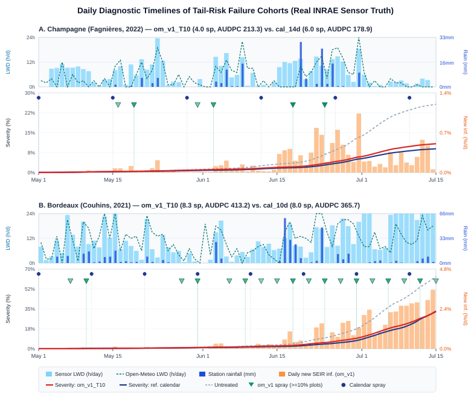

Protocolo aberto e reprodutível para testar regras de pulverização contra o míldio da videira (*Plasmopara viticola*) antes de levá-las a campo.

*English: an open, reproducible protocol for stress-testing weather-driven spray rules against grapevine downy mildew before field trials. The full technical report is in English: [docs/technical_report.pdf](docs/technical_report.pdf).*

**Autor:** Mateus Zunino Espindola, Universidade Federal de Santa Catarina (UFSC)  
**Relatório técnico** em inglês, com resumo em português: [docs/technical_report.md](docs/technical_report.md) · [docs/technical_report.pdf](docs/technical_report.pdf)

> **Errata `v1.0.1`:** o controle de qualidade automático criado na v2 detectou travamento físico no sensor de molhamento de Bordeaux-Couhins em julho de 2021 e julho de 2023, além de lacunas de pluviômetro em Bordeaux 2024 e Bourgogne 2021. Veja a [seção Errata](#errata-v101) ao final deste README com os números antes e depois da exclusão e o que continua valendo ou cai.


## O que o projeto faz

O vitirule avalia regras agrometeorológicas preventivas para o míldio da videira em quatro frentes:

1. compara quatro estimadores de molhamento foliar (LWD) com 80.392 horas de sensores reais, separando o erro da fórmula do erro da reanálise;
2. roda OSSEs com um modelo SEIR mal-especificado e um OSSE semirreal em que a verdade vem do sensor de campo. Isso evita o "crime inverso" e inclui lavagem por chuva e previsão de 7 dias com ruído;
3. faz ablações com orçamento igual e traça a fronteira de Pareto entre número de aplicações e AACPD. Cada regra foi congelada em commit antes de ser testada em anos e regiões que ela nunca viu;
4. mede a sensibilidade econômica em uma superfície de inclinação do dano por receita bruta, sob o teto de cobre da agricultura orgânica europeia, o Regulamento de Execução (UE) 2018/1981.

### O que o projeto não é

O VitiMeteo (*VitiMeteo-Plasmopara*) já funciona em Luxemburgo e no Mosela, na Alemanha, na Suíça e no leste da França. O RIMpro também é usado na viticultura europeia. O vitirule não quer competir com eles como produto. A contribuição é o método de avaliação aberto: simulador mal-especificado, teste semirreal com sensor, ablação causal, fronteira de Pareto, congelamento fora da amostra em commits e sensibilidade econômica. Essa etapa quase nunca é publicada de forma reprodutível em sistemas de alerta fitossanitário.

> **Histórico e módulos desligados por padrão.** O projeto começou como um DSS em circuito fechado, com visão computacional (`vision_pipeline.py`) e assimilação bayesiana da severidade foliar (`epidemiology_assimilation.py`). Uma ablação congelada fora da amostra (`N = 360`, commit `668573a`) mostrou que a assimilação da severidade não superou a regra puramente climática com previsão de 7 dias e lavagem por chuva: `Δ AACPD = +0,99`, IC 95 % `[-1,81 ; +3,91]`, Wilcoxon `p = 0,462`. Os módulos de visão e assimilação continuam testados no repositório e ficam desligados por padrão, para quando houver dados de campo.

## Quatro resultados

1. **Assimilar a severidade das folhas não ajudou.** Na ablação congelada, a regra com assimilação empatou com a mesma regra sem assimilação.
2. **A fonte do dado meteorológico pesa mais que a fórmula de molhamento.** Na reanálise Open-Meteo, os quatro estimadores empatam. Trocar a estação local pela reanálise acrescenta até 1,48 h/dia de erro; em seis dos oito pares de rede e estimador, mais de 1,2 h/dia.
3. **O ganho vem de dimensionar a campanha de cada safra, não de acertar melhor o dia da aplicação.** Com o sensor real do INRAE como verdade, o ganho sobre os calendários fixos caiu de `-101,6` para `-18,95` de AACPD. Dentro de uma mesma safra, a regra empata com o calendário. As falhas mais graves foram em Champagne 2022 e Bordeaux 2021.
4. **Quem ganha no dinheiro depende de três hipóteses ao mesmo tempo:** a receita do vinhedo, a inclinação suposta do dano e a dose de cobre por aplicação.


---

## 1. Molhamento foliar contra sensores reais (80.392 horas)

A validação está em [lwd_sensor_validation.py](lwd_sensor_validation.py) e usa duas redes abertas e independentes:

* **INRAE AgroClim** (`doi:10.57745/BQ0BWB`; Furusho-Percot et al., *Data in Brief* 2025, `PMC12266558`): quatro estações vitícolas francesas, Bordeaux-Couhins `33080002`, Alsace-Colmar `68066002`, Champagne-Fagnières `51242002` e Bourgogne-Bretenière `21106002`, de abril a setembro de 2022 a 2024, num total de 52.675 h.
* **Politecnico di Torino / iXem Labs** (Mendeley Data, `doi:10.17632/sd4b8vpvyb.1`): sete estações italianas com sensor capacitivo de dupla face, de abril a setembro, num total de 27.717 h. Sobram 23.735 h nas seis estações sem deriva, porque o `site2.csv` ficou acima de zero em 99,9 % das horas.

| Rede (abril–setembro) | Estimador | Estação: Acc / F1 / CSI / MAE (h/d) / Viés | Open-Meteo: Acc / F1 / CSI / MAE (h/d) / Viés | Δ MAE da reanálise |
|---|---|---|---|---:|
| **INRAE AgroClim** (4 est. FR, 52,7k h) | `rh90_hysteresis` | **0,864 / 0,732 / 0,581 / 2,61 / +0,97** | **0,779** / 0,604 / 0,434 / 4,07 / +2,17 | +1,46 h/d |
| | `dpd_hysteresis` | 0,859 / 0,731 / 0,580 / 2,76 / +1,31 | 0,776 / **0,608 / 0,438** / 4,24 / +2,46 | +1,48 h/d |
| | `rh85` | 0,831 / 0,693 / 0,533 / 3,26 / +1,95 | 0,761 / 0,589 / 0,419 / 4,30 / +2,71 | +1,04 h/d |
| | `cart_kim2002` | 0,828 / 0,675 / 0,513 / 3,25 / +1,52 | 0,772 / 0,577 / 0,407 / **3,82** / +1,66 | +0,57 h/d |
| **Polito IT** (6 est. limpas, 23,7k h) | `rh85` | **0,879 / 0,680 / 0,519 / 2,59 / -0,07** | 0,789 / **0,529 / 0,364 / 4,05** / +1,49 | +1,46 h/d |
| | `dpd_hysteresis` | 0,871 / 0,653 / 0,490 / 2,79 / -0,36 | 0,788 / 0,519 / 0,354 / 4,13 / +1,27 | +1,34 h/d |
| | `rh90_hysteresis` | 0,869 / 0,636 / 0,472 / 2,85 / -0,70 | **0,791** / 0,516 / 0,351 / 4,06 / +1,05 | +1,21 h/d |
| | `cart_kim2002` | 0,861 / 0,672 / 0,513 / 2,95 / +1,15 | 0,779 / 0,507 / 0,343 / 4,28 / +1,40 | +1,33 h/d |

Na entrada que um sistema operacional usaria, o Open-Meteo, os quatro estimadores praticamente empatam e trocam de lugar conforme a métrica. O `dpd_hysteresis` lidera em F1 (`0,608`), o `cart_kim2002` tem o menor MAE (`3,82 h/d`) e o `rh90_hysteresis` lidera em acurácia (`0,779`).

O erro vem sobretudo da fonte do dado. Passar da estação real para a reanálise derruba o F1 em cerca de `0,13` e leva o erro diário de cerca de `2,6` para `4,0 h/dia`, com viés úmido de `+1,6` a `+2,2 h/dia` e autocorrelação horária lag-1 de `0,68`. Na prática, um sistema em Luxemburgo deveria ler as estações da ASTA, a rede agrometeorológica local (agrimeteo.lu), em vez da reanálise.

---

## 2. Assimilação, fronteira de Pareto e OSSE semirreal com sensor

### 2.1 Ablação congelada (commit `668573a`, 2022–2024, Mosela e Bordeaux, `N = 360`)

* **DSS com assimilação `(d)` menos previsão com lavagem e sem assimilação `(c)`:** `+0,99` de AACPD, IC 95 % `[-1,81 ; +3,91]`, Wilcoxon `p = 0,462`, `141/360` vitórias. É um empate estatístico.
* **Previsão com lavagem `(c)` menos clima observado reativo `(b)`:** `-44,68` de AACPD, IC 95 % `[-51,40 ; -37,91]`, `p < 1e-6`, `293/360` vitórias.

### 2.2 Da fronteira simulada ao OSSE semirreal com o sensor do INRAE

Para saber quanto do ganho simulado sobrevive ao erro real de cerca de 4 h/dia da reanálise, rodamos [semireal_osse.py](semireal_osse.py) com a regra congelada em `T = 10,0`, sem nenhum reajuste, em dois cenários:

* **24 estação-safras reais do INRAE**, de 2019 a 2024, em quatro regiões vitícolas, somando `N = 1.200` talhão-safras. A verdade SEIR é movida pelo sensor real de molhamento foliar `h`. A regra lê só o Open-Meteo (`om_*`) ou o clima da estação local sem o sensor (`st_*`).
* **Mosela, de 2016 a 2018** (`N = 180`), com uma perturbação AR(1) calibrada nos erros reais: `MAE = 3,99 h/d`, `viés = +1,59 h/d`, `lag-1 = 0,68`.

| Experimento (regra congelada `T = 10,0`) | Estratégia | Aplic. | AACPD média (IC 95 %) | Δ vs. fronteira de calendários | Pareado vs. calendário próximo |
|---|---|---:|---:|---:|---|
| **INRAE semirreal (verdade = sensor real, `N = 1.200`)** | `cal_7d` / `10d` / `12d` / `14d` | 11 / 8 / 7 / 6 | 95,5 / 118,5 / 138,6 / 146,5 | referência | — |
| | **`om_v1_T10`** *(só Open-Meteo)* | **6,77** | **121,42 `[112,5 ; 130,9]`** | **-18,95 (-13,5 %)** | **-17,15 vs `cal_12d`** (`-0,23` aplic., `p < 1e-6`, `814/1200`) |
| | `om_v2_T10` *(alternativa econômica)* | **5,51** | **137,31 `[126,9 ; 148,2]`** | abaixo de `cal_14d` | **-9,18 vs `cal_14d`** (`-0,49` aplic., `p < 1e-6`, `652/1200`) |
| | `st_v1_T10` *(clima da estação, sem sensor)* | **6,38** | **127,48 `[117,8 ; 137,7]`** | **-15,99 (-11,1 %)** | **-19,01 vs `cal_14d`** (`+0,38` aplic., `p < 1e-6`, `788/1200`) |
| **Mosela com erro calibrado (2016–2018, `N = 180`)** | `cal_12d` / `cal_14d` | 7 / 6 | 302,1 / 367,6 | referência | — |
| | **`om_v1_T10`** | **7,22** | **277,37 `[243,1 ; 315,9]`** | **-22,70 (-7,6 %)** | **-24,70 vs `cal_12d`** (`p = 4,7e-5`, `120/180`) |
| | `om_v2_T10` | **5,83** | **346,54 `[303,6 ; 394,1]`** | abaixo de `cal_14d` | **-21,03 vs `cal_14d`** (`-0,17` aplic., `p = 0,021`, `99/180`) |

**Quanto do ganho sobrevive.** O ganho de `-101` de AACPD no simulador movido só pela reanálise estava inflado. A causa era o viés úmido do Open-Meteo (`+1,6 h/d`) e o acoplamento excessivo entre a verdade e a entrada. Com o sensor real do INRAE (`N = 1.200`) e com o erro calibrado no Mosela (`N = 180`), o ganho cai para `-19` a `-23` de AACPD, de 7,6 % a 13,5 % abaixo da fronteira de calendários fixos. É menor, mas estatisticamente sólido (`p < 1e-4`). No conjunto agregado, o `om_v1_T10` domina o `cal_12d` no sentido de Pareto: menos doença com menos aplicações.

O `v2` (`ResidualGateConfig`, piso de 6 dias e $P_{\text{est}} \le 0,45$) não melhora o `v1`. Ele é outro ponto da mesma curva de Pareto, mais econômico, com `5,5` aplicações contra `6,8`.

**Dentro de cada safra o quadro muda.** Nas coortes que caem dentro da faixa dos calendários, de 6 a 11 aplicações, a regra empata com a fronteira interpolada: média `+1,01` e mediana `-0,33` de AACPD. O ganho agregado vem de ajustar o tamanho da campanha de um ano para outro (`r = 0,595`, `p = 0,0022`). As duas piores falhas, Champagne 2022 e Bordeaux 2021, estão abaixo, dia a dia.



---

## 3. Sensibilidade econômica (€/ha) e teto europeu de cobre ([economics.py](economics.py))

A inclinação da curva que liga o dano foliar à perda nos cachos, $L = 0{,}85(1 - e^{-k\cdot\text{AACPD}})$, não foi calibrada em campo. Por isso avaliamos 126 combinações de $k \in [0{,}0002 ; 0{,}0015]$ com receita bruta de `3.000` a `30.000 €/ha`, a `55 €/ha` por aplicação, sobre o OSSE semirreal do INRAE (`N = 1.200`).

**Sem restrição de cobre (126 células):**
* o `cal_7d` vence em `40,5 %` da superfície, nos vinhedos de receita alta com dano severo, o que bate com o comportamento de quem produz vinho premium;
* o `om_v1_T10` vence em `27,0 %` e o `om_v2_T10` em `19,8 %`, somando `46,8 %` nas faixas intermediárias e econômicas;
* a `testemunha` vence em `12,7 %`, só com receita mínima e dano mínimo;
* o `cal_10d`, o `cal_12d` e o `cal_14d` não vencem em nenhuma célula. Quando não se pulveriza toda semana, a regra preventiva sempre supera os calendários espaçados.

**Sob o teto europeu de cobre para viticultura orgânica**, o Regulamento de Execução (UE) 2018/1981, que permite `28 kg Cu/ha` em 7 anos, ou `4,0 kg Cu/ha/ano` em média:
* com uma dose típica de `0,50 kg Cu/ha` por aplicação, o `cal_7d` (`11,0` aplicações, `5,50 kg Cu/ha/ano`) passa do limite legal. O `om_v1_T10` (`3,39 kg/ha/ano`) e o `om_v2_T10` (`2,76 kg/ha/ano`) cumprem o regulamento;
* dentro do espaço permitido, o `om_v1_T10` lidera em `61,1 %` e o `om_v2_T10` em `19,8 %` da superfície, somando `80,9 %`, contra `6,3 %` do `cal_10d`.

| Sem restrição de cobre | Sob o Reg. (UE) 2018/1981 |
|---|---|
|  |  |

---

## 4. Calibração da posteriori de `r` no módulo de assimilação

Com a `r_prior_gompertz` separada em [epidemiology_assimilation.py](epidemiology_assimilation.py), a cobertura do IC 95 % de `r` dentro do modelo escolhido passou de cerca de 75 %, quando as escalas logística e Gompertz se misturavam, para 97,9 % no modelo logístico e 95,8 % no Gompertz.

---

## 5. Dados brutos, licenças, atribuição e como reproduzir

* **Código deste repositório:** [licença MIT](LICENSE), Copyright © 2026 Mateus Zunino Espindola.
* **Relatório técnico (`docs/technical_report.*`):** CC BY 4.0. **Figuras e tabelas derivadas dos dados do Politecnico di Torino seguem também os termos da CC BY-NC 4.0.**
* **Dados brutos de sensores (`data/`):** ficam fora do Git pelo `.gitignore` e nunca entraram no histórico do repositório. Use [scripts/download_sensor_datasets.py](scripts/download_sensor_datasets.py) para baixá-los pelos DOIs oficiais antes de reproduzir as análises:
  * **INRAE AgroClim (França):** Furusho-Percot, C., Maury, O., Minet, V., De Decker, T., Roux, D., Beauvois, C., Le Roux, R., Décome, J., Launay, M., & García de Cortázar-Atauri, I. (2025). *French agroclimatic research network dataset*. *Data in Brief*, 61, 111809 (`doi:10.1016/j.dib.2025.111809`, artigo CC BY 4.0). Dataset: *Daily and hourly climatic data from 54 stations of the INRAE Agroclim network*, Recherche Data Gouv, `doi:10.57745/BQ0BWB`, sujeito à licença declarada no portal Recherche Data Gouv, que pode ser conferida com `--dry-run`.
  * **Politecnico di Torino / iXem Labs (Itália):** Colucci, G. P., Filipescu, E., Scatozza, F., & Trinchero, D. (2025). *Leaf Wetness and Agrometeorological Dataset*. Mendeley Data, V1, `doi:10.17632/sd4b8vpvyb.1`, **CC BY-NC 4.0**: uso não comercial, com atribuição.

```powershell
# Testes automatizados (sem rede, sem banco, sem GPU)
.venv\Scripts\python.exe -m pytest tests/ -q

# 0. Baixar sensores reais diretamente pelos DOIs oficiais (INRAE + Politecnico di Torino)
.venv\Scripts\python.exe scripts/download_sensor_datasets.py

# 1. Validação de LWD contra sensores reais (INRAE AgroClim + Politecnico di Torino)
.venv\Scripts\python.exe lwd_sensor_validation.py

# 2. OSSE semirreal nas 4 estações INRAE (verdade = sensor) + Moselle com erro calibrado
.venv\Scripts\python.exe semireal_osse.py --lwd-method rh90_hysteresis --n-plots 50

# 3. Sensibilidade econômica e mapa de decisão sob Reg. (UE) 2018/1981
.venv\Scripts\python.exe economics.py data/fase2/semireal_inrae_osse.json \
    --out-json data/fase2/economics_semireal_inrae.json \
    --out-svg-unconstrained data/fase2/economics_map_unconstrained.svg \
    --out-svg-copper data/fase2/economics_map_eu_copper.svg

# 4. Figuras em inglês e compilação do relatório técnico (PDF de 12 páginas)
.venv\Scripts\python.exe scripts/generate_report_figures.py
.venv\Scripts\python.exe scripts/make_lwd_source_figure.py
.venv\Scripts\python.exe scripts/render_report_pdf.py
```

---

## Errata (`v1.0.1`)

Após o congelamento da tag `v1.0`, o controle de qualidade automático implementado em `vitirule_v2/qc.py` para a janela da videira de 1 de abril a 30 de setembro revelou falhas de sensor e lacunas severas não detectadas na v1. Em Bordeaux-Couhins, o sensor de molhamento foliar ficou travado em condição molhada durante quase todo o mês de julho de 2021, marcando molhamento em `90,1%` das horas secas de meio-dia com umidade relativa abaixo de `60%` e atingindo `309 h` contínuas molhadas sem chuva, e repetiu o travamento em julho de 2023, com `95,9%` em ar seco de meio-dia e `287 h` sem chuva. Além disso, o pluviômetro de Bordeaux ficou sem registro em `1.409 h` na safra 2024 e o de Bourgogne em `666 h` na safra 2021, falhas que o leitor da v1 preenchia com zero.

Sem alterar nenhum código, parâmetro ou semente da v1, reexecutamos a validação de molhamento foliar, o OSSE semirreal e a sensibilidade econômica via [scripts/v1_errata_audit.py](scripts/v1_errata_audit.py) excluindo todas as estações-safra reprovadas por `vitirule_v2/qc.py` na janela da videira. No INRAE foram excluídas 7 das 24 estações-safra de 2019 a 2024: Bordeaux 2021, 2022, 2023 e 2024, Bourgogne 2021 e 2022 e Alsace 2022. No Politecnico di Torino restaram 2 das 7 estações, `site1.csv` e `site5.csv`, pois `site2.csv` reprovou por deriva severa e `site3`, `site4`, `site6` e `site7` tiveram cobertura abaixo de `95%` com lacunas de telemetria acima de `24 h`.

### Números publicados na `v1.0` contra recálculo limpo na `v1.0.1`

| Análise e métrica | Publicado na `v1.0` | Recalculado sem reprovadas (`v1.0.1`) |
|---|---|---|
| Validação LWD INRAE 2022–2024, amostra | 12 estações-safra, `52.675 h` | 7 estações-safra, `30.744 h` |
| INRAE `rh90_hysteresis` MAE estação / Open-Meteo / Δ MAE | `2,61` / `4,07` / `+1,46 h/d` | `2,86` / `4,43` / `+1,57 h/d` |
| INRAE `dpd_hysteresis` MAE estação / Open-Meteo / Δ MAE | `2,76` / `4,24` / `+1,48 h/d` | `3,05` / `4,66` / `+1,60 h/d` |
| INRAE `rh85` MAE estação / Open-Meteo / Δ MAE | `3,26` / `4,30` / `+1,04 h/d` | `3,66` / `4,72` / `+1,06 h/d` |
| INRAE `cart_kim2002` MAE estação / Open-Meteo / Δ MAE | `3,25` / `3,82` / `+0,57 h/d` | `3,54` / `4,09` / `+0,55 h/d` |
| Validação LWD Politecnico, amostra | 6 estações limpas manuais, `23.735 h` | 2 estações aprovadas no QC, `8.770 h` |
| Politecnico Δ MAE da reanálise nos 4 estimadores | `+1,21` a `+1,46 h/d` | `+0,48` a `+0,71 h/d` |
| Erro empírico Open-Meteo INRAE mai–ago, viés / MAE / `P(wet\|OM dry)` | `+1,59 h/d` / `3,99 h/d` / `0,1058` | `+2,03 h/d` / `3,90 h/d` / `0,0892` |
| OSSE semirreal INRAE, amostra e testemunha | 24 coortes, `N = 1.200`, AACPD `284,7` | 17 coortes, `N = 850`, AACPD `223,8` |
| INRAE `om_v1_T10`: aplic. / AACPD / Δ fronteira | `6,77` / `121,42` / `-18,95 (-13,5%)` | `6,46` / `99,79` / `-12,20 (-10,9%)` |
| INRAE `st_v1_T10`: aplic. / AACPD / Δ fronteira | `6,38` / `127,48` / `-15,99 (-11,1%)` | `6,15` / `104,28` / `-9,06 (-8,0%)` |
| INRAE `om_v2_T10`: aplic. / AACPD / Δ vs `cal_14d` | `5,51` / `137,31` / `-9,18` | `5,34` / `111,07` / `-2,94` |
| Correlação anual entre pulverizações e pressão `r` | `0,595`, `p = 0,0022` | `0,529`, `p = 0,0290` |
| Mosela erro calibrado 2016–2018, `om_v1_T10` Δ fronteira | `-22,70 (-7,6%)`, `p = 4,7e-5` | `-19,96 (-7,8%)`, `p = 4,1e-5` |
| Economia sem teto de cobre: `cal_7d` / regras `om_v1+v2` / testemunha | `40,5%` / `46,8%` / `12,7%` | `32,5%` / `49,2%` / `18,3%` |
| Economia sob teto de cobre 0,50 kg: regras `om_v1+v2` / `cal_10d` | `80,9%` / `6,3%` | `67,4%` / `14,3%` |

### O que continua valendo e o que cai

**Continua valendo:**

1. A ablação congelada da assimilação bayesiana na seção 2.1 não usou sensores de molhamento e não muda em nada.
2. Na entrada Open-Meteo, os quatro estimadores de molhamento continuam praticamente empatados, e substituir a estação local pela reanálise continua piorando o MAE em todos os oito pares de rede e estimador, entre `+0,48` e `+1,60 h/dia`.
3. O ganho agregado do `om_v1_T10` no OSSE semirreal continua estatisticamente claro, em `-12,20` de AACPD e `-10,9%` abaixo da fronteira de calendários, com dominância de Pareto sobre `cal_12d`, `99,79` contra `109,65` usando `0,54` aplicações a menos, e o resultado calibrado do Mosela se mantém em `-19,96` de AACPD.
4. O ganho agregado continua vindo do dimensionamento interanual da campanha, com `r = 0,529`, `p = 0,029`, e o diagnóstico de falha em **Champagne 2022** continua válido, pois essa safra passou limpa pelo controle de qualidade.
5. A conclusão qualitativa da sensibilidade econômica permanece válida: a escolha ótima depende conjuntamente de receita, inclinação do dano e dose de cobre.

**Cai ou precisa ser corrigido:**

1. **Bordeaux 2021 cai como caso de falha válido da regra.** O excesso de `+52,9` de AACPD na Figura 2B e na Tabela 6 do relatório ocorreu durante o mês de julho de 2021, quando o sensor físico de Bordeaux estava travado em molhado. Aquele episódio não pode ser citado como falha operacional da regra preventiva.
2. **Cai a frase de que seis dos oito pares de rede e estimador têm penalidade da reanálise acima de `1,2 h/dia`.** Com o filtro objetivo reduzindo o Politecnico às duas estações sem grandes lacunas, apenas dois dos oito pares superam `1,2 h/dia`, ambos no INRAE, com `+1,57` e `+1,60 h/dia`.
3. **A magnitude do ganho no OSSE semirreal e a fatia de liderança sob o teto de cobre encolhem.** O ganho médio de `om_v1_T10` cai de `-18,95` para `-12,20` de AACPD, o ganho de `om_v2_T10` sobre `cal_14d` cai de `-9,18` para `-2,94`, e a liderança somada das regras sob teto de cobre a `0,50 kg/ha` passa de `80,9%` para `67,4%`. A seção 3.5 sobre a perda de proteção de `st_v1_T10` em Bordeaux 2023 também deixa de valer como evidência porque Bordeaux 2023 tinha o sensor travado em julho.
