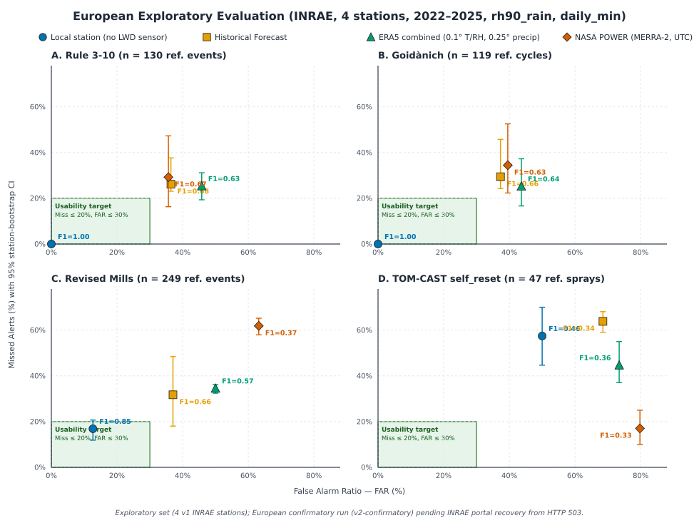
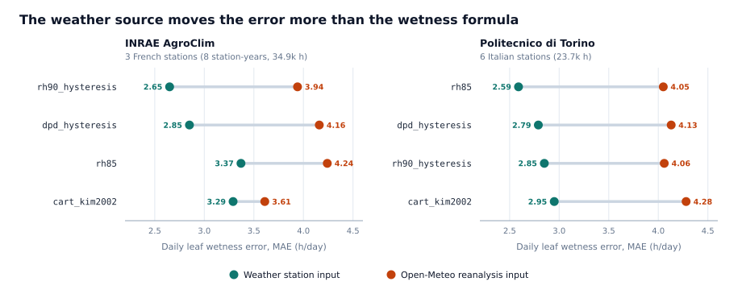

[](https://doi.org/10.5281/zenodo.24449844)

**Quanto se pode confiar num alerta de doença calculado com dado meteorológico gratuito?**

*English: an open, preregistered benchmark of how far plant-disease alerts computed from free gridded weather data can be trusted instead of on-site station sensors. Full v2 technical report in English, with a Portuguese summary: [docs/v2/report_v2.pdf](docs/v2/report_v2.pdf).*

**Autor:** Mateus Zunino Espindola, Universidade Federal de Santa Catarina (UFSC)  
**Relatório técnico v2,** em inglês com resumo em português: [docs/v2/report_v2_draft.md](docs/v2/report_v2_draft.md) · [docs/v2/report_v2.pdf](docs/v2/report_v2.pdf)  
**Pré-registro congelado** nas tags `v2-rules`, `v2-freeze` e `v2-freeze-br`: [docs/v2/preregistro.md](docs/v2/preregistro.md)  
**Ferramenta no navegador,** que roda as regras congeladas sobre o CSV da sua estação sem instalar Python: [https://mateuszunino.github.io/vitirule/app/](https://mateuszunino.github.io/vitirule/app/)  
**Reprodução na nuvem,** só com dados públicos: [.github/workflows/v2_reproduce.yml](.github/workflows/v2_reproduce.yml)

> **Escopo da v2:** o vitirule v2 não mede eficácia de controle no campo. Ele mede a confiabilidade da entrada meteorológica de um sistema de alerta. O [Estudo de Caso 1, o protocolo da v1, na tag `v1.0.2`](#estudo-de-caso-1-o-protocolo-da-v1-na-tag-v102), segue mais abaixo.

---

## vitirule v2: confiabilidade de alertas com dados meteorológicos gratuitos

### Desenho experimental

O pacote [vitirule_v2/rules/](vitirule_v2/rules/) implementa quatro regras publicadas usando só a biblioteca padrão do Python:

1. **Regra 3-10** para o míldio da videira, *Plasmopara viticola* (Baldacci, 1947; Goidànich, 1964; Rossi et al., 2008).
2. **Calendário de incubação de Goidànich** para o míldio da videira (Müller & Sleumer, 1934; Goidànich, 1964).
3. **Tabela de Mills revisada** para a sarna da macieira, *Venturia inaequalis* (MacHardy & Gadoury, 1989; Stensvand et al., 1997).
4. **TOM-CAST** para a pinta-preta do tomateiro, *Alternaria solani* (Madden et al., 1978; Pitblado, 1992; Gillespie et al., 1993). O TOM-CAST roda de dois modos: `reference_reset` mede a fidelidade da entrada e `self_reset` mede a divergência na operação.

Cada regra roda primeiro com os dados medidos na própria estação, incluindo o sensor de molhamento foliar. Depois roda com quatro entradas candidatas, todas em UTC:

- a mesma estação sem o sensor de molhamento, com o estimador `rh90_rain`;
- o ERA5 combinado: temperatura e umidade do ERA5-Land a 0,1°, chuva, vento e radiação do ERA5 a 0,25°, via `era5_seamless`;
- o Open-Meteo Historical Forecast;
- o NASA POWER, pedido em `time-standard=UTC`.

### Principais resultados

Os resultados europeus são exploratórios. O conjunto confirmatório depende do portal do INRAE, que seguia fora do ar, com HTTP 503, em 22 de novembro de 2026.

1. **Nenhuma fonte gratuita em grade passou no critério de uso** pré-registrado, em nenhuma das quatro regras, no conjunto exploratório europeu. Ele reúne 4 estações do INRAE na França, entre 2022 e 2025, mais 2 estações do Politecnico di Torino mostradas só de forma descritiva, sob licença CC BY-NC 4.0. As grades perderam de 25,2% a 34,5% dos alertas da 3-10 e do Goidànich. Em Mills, perderam de 31,7% a 61,9%. Com só 4 estações, o bootstrap por bloco subestima a incerteza.
2. **A estação local sem sensor de molhamento passou em Mills.** Ela perdeu 16,9% dos eventos, com razão de alarmes falsos de 12,7% e F1 de 0,852. Na 3-10 e no Goidànich essa comparação não se aplica: as duas regras não usam molhamento, então a estação recebe a mesma entrada da referência. No TOM-CAST, nenhum dos três estimadores de molhamento testados substituiu o sensor. Um viés médio de -1,02 DSV por intervalo desloca os zeramentos seguintes e leva a 57,5% de alertas perdidos quando a estação segue as próprias aplicações. Com o ERA5 combinado e o NASA POWER, as pulverizações se multiplicam de 2,1 a 4,1 vezes.
3. **Previsões com 1 a 3 dias de antecedência pioram o quadro.** Com o Open-Meteo Previous Runs, em 2024 e 2025, os alertas perdidos subiram de 8 a 11 pontos percentuais em relação ao arquivo de quase-análise. O valor econômico dos alertas de Mills, com razão custo/perda de 0,10, caiu para -0,06 no terceiro dia.
4. **Em Santa Catarina, 11 das 24 estações automáticas do INMET entraram por seleção às cegas,** sob a tag `v2-freeze-br`. O filtro usou a PAM 2025 do IBGE e o controle de qualidade sem sensor, de 2022 a 2025. O INMET não tem sensor de molhamento, então o resultado é a divergência entre a grade e a estação. Em Mills, as grades deixaram sem par de 37,6% a 59,2% dos eventos do INMET. O menor F1 apareceu em São Joaquim, a 1.400 m: 0,381 no NASA POWER. Essa divergência só vira estimativa de erro da grade se o conjunto confirmatório europeu repetir o resultado exploratório. No TOM-CAST, as grades multiplicaram as pulverizações de 1,8 a 2,5 vezes.




### Ferramenta no navegador e reprodução

A página [https://mateuszunino.github.io/vitirule/app/](https://mateuszunino.github.io/vitirule/app/) carrega o código congelado de [docs/app/vitirule_bundle.json](docs/app/vitirule_bundle.json) pelo Pyodide. As regras rodam no navegador, sobre o CSV da estação do usuário. A tabela de confiabilidade medida aparece ao lado de cada alerta. Alertas calculados com dado em grade nunca aparecem como recomendação.

```powershell
# Suíte completa de testes (v1 + v2, sem rede)
.venv\Scripts\python.exe -m pytest tests/ -q

# Reproduzir a transferência pública de Santa Catarina (INMET + IBGE PAM + Open-Meteo + NASA POWER)
.venv\Scripts\python.exe scripts/v2_phase4_brazil.py
.venv\Scripts\python.exe scripts/v2_generate_figures.py --public-only

# Recompilar o PDF do relatório da v2
.venv\Scripts\python.exe scripts/render_v2_report_pdf.py
```

**Licenças e dados na v2.** O código do repositório é MIT. As figuras e tabelas públicas, derivadas do INMET e do IBGE, podem ser refeitas no GitHub Actions com disparo manual. A licença literal do dataset do INRAE, `10.57745/BQ0BWB`, ainda não foi confirmada, porque o portal está fora do ar. Por isso o repositório e o relatório usam só agregados derivados dele. Tudo o que deriva do Politecnico di Torino, `10.17632/sd4b8vpvyb.1`, leva atribuição CC BY-NC 4.0 e nunca entra no CI nem em redistribuição de dados brutos.

---

## Estudo de Caso 1, o protocolo da v1, na tag `v1.0.2`

Protocolo aberto e reprodutível para testar regras de pulverização contra o míldio da videira (*Plasmopara viticola*) antes de levá-las a campo.

**Relatório técnico v1** em inglês, com resumo em português: [docs/technical_report.md](docs/technical_report.md) · [docs/technical_report.pdf](docs/technical_report.pdf)


### O que o Estudo de Caso 1 faz

O vitirule avalia regras agrometeorológicas preventivas para o míldio da videira em quatro frentes:

1. compara quatro estimadores de molhamento foliar (LWD) com 58.615 horas limpas de sensores físicos, separando o erro da fórmula do erro da reanálise;
2. roda OSSEs com um modelo SEIR mal-especificado e um OSSE movido pelo sensor em que a verdade vem do sensor de campo. Isso evita o "crime inverso" e inclui lavagem por chuva e previsão de 7 dias com ruído;
3. faz ablações com orçamento igual e traça a fronteira de Pareto entre número de aplicações e AACPD. Cada regra foi congelada em commit antes de ser testada em anos e regiões que ela nunca viu;
4. mede a sensibilidade econômica em uma superfície de inclinação do dano por receita bruta, sob o teto de cobre da agricultura orgânica europeia, o Regulamento de Execução (UE) 2018/1981.

### O que o projeto não é

O VitiMeteo (*VitiMeteo-Plasmopara*) já funciona em Luxemburgo e no Mosela, na Alemanha, na Suíça e no leste da França. O RIMpro também é usado na viticultura europeia. O vitirule não quer competir com eles como produto. A contribuição é o método de avaliação aberto: simulador mal-especificado, OSSE movido pelo sensor, ablação causal, fronteira de Pareto, congelamento fora da amostra em commits e sensibilidade econômica. Essa etapa quase nunca é publicada de forma reprodutível em sistemas de alerta fitossanitário.

> **Histórico e módulos desligados por padrão.** O projeto começou como um DSS em circuito fechado, com visão computacional (`vision_pipeline.py`) e assimilação bayesiana da severidade foliar (`epidemiology_assimilation.py`). Uma ablação congelada fora da amostra (`N = 360`, commit `668573a`) mostrou que a assimilação da severidade não superou a regra puramente climática com previsão de 7 dias e lavagem por chuva: `Δ AACPD = +0,99`, IC 95 % `[-1,81 ; +3,91]`, Wilcoxon `p = 0,462`. Os módulos de visão e assimilação continuam testados no repositório e ficam desligados por padrão, para quando houver dados de campo.

## Quatro resultados

1. **Assimilar a severidade das folhas não ajudou.** Na ablação congelada, a regra com assimilação empatou com a mesma regra sem assimilação.
2. **A fonte do dado meteorológico pesa mais que a fórmula de molhamento.** Na reanálise Open-Meteo, os quatro estimadores empatam. Trocar a estação local pela reanálise acrescenta mais de 1,2 h/dia de erro em seis dos oito pares de rede e estimador, chegando a 1,46 h/dia.
3. **O ganho vem de dimensionar a campanha de cada safra, não de acertar melhor o dia da aplicação.** No OSSE movido pelo sensor do INRAE (19 coortes, `N = 950`), o ganho sobre os calendários fixos caiu de `-101,6` para `-11,59` de AACPD (`-10,4 %`). Dentro de uma mesma safra, a regra empata com o calendário, e o ganho agregado vem da correlação interanual entre aplicações e pressão da doença (`r = 0,479`, `p = 0,038`). As piores coortes foram Champagne 2022 e Champagne 2019.
4. **Quem ganha no dinheiro depende de três hipóteses ao mesmo tempo:** a receita do vinhedo, a inclinação suposta do dano e a dose de cobre por aplicação.



---

## 1. Molhamento foliar contra sensores físicos (58.615 horas limpas)

A validação está em [lwd_sensor_validation.py](lwd_sensor_validation.py) e usa duas redes abertas e independentes:

* **INRAE AgroClim** (`doi:10.57745/BQ0BWB`; Furusho-Percot et al., *Data in Brief* 2025, `PMC12266558`): estações vitícolas francesas (Bordeaux-Couhins `33080002`, Alsace-Colmar `68066002`, Champagne-Fagnières `51242002` e Bourgogne-Bretenière `21106002`), de abril a setembro de 2022 a 2024, com `34.880 h` limpas em 8 estações-safra aprovadas.
* **Politecnico di Torino / iXem Labs** (Mendeley Data, `doi:10.17632/sd4b8vpvyb.1`): seis estações italianas limpas com sensor capacitivo de dupla face, de abril a setembro, somando `23.735 h` após excluir `site2.csv`, que ficou acima de zero em 99,9 % das horas.

As estações-safra com falha de sensor detectada pelo controle de qualidade automático, Bordeaux-Couhins em 2021 e 2023 com sensor travado em molhado, foram excluídas, assim como as safras em que o pluviômetro falhou dentro da janela simulada.

| Rede (abril–setembro) | Estimador | Estação: Acc / F1 / CSI / MAE (h/d) / Viés | Open-Meteo: Acc / F1 / CSI / MAE (h/d) / Viés | Δ MAE da reanálise |
|---|---|---|---|---:|
| **INRAE AgroClim** (8 est.-safra, 34,9k h) | `rh90_hysteresis` | **0,865 / 0,706 / 0,549 / 2,65 / +1,64** | **0,786** / 0,571 / 0,400 / 3,94 / +2,65 | +1,29 h/d |
| | `dpd_hysteresis` | 0,858 / 0,703 / 0,545 / 2,85 / +2,02 | 0,782 / **0,575 / 0,404** / 4,16 / +2,98 | +1,30 h/d |
| | `rh85` | 0,832 / 0,664 / 0,500 / 3,37 / +2,61 | 0,768 / 0,553 / 0,383 / 4,24 / +3,17 | +0,87 h/d |
| | `cart_kim2002` | 0,830 / 0,643 / 0,477 / 3,29 / +2,04 | 0,785 / 0,546 / 0,376 / **3,61** / +2,08 | +0,32 h/d |
| **Polito IT** (6 est. limpas, 23,7k h) | `rh85` | **0,879 / 0,680 / 0,519 / 2,59 / -0,07** | 0,789 / **0,529 / 0,364 / 4,05** / +1,49 | +1,46 h/d |
| | `dpd_hysteresis` | 0,871 / 0,653 / 0,490 / 2,79 / -0,36 | 0,788 / 0,519 / 0,354 / 4,13 / +1,27 | +1,34 h/d |
| | `rh90_hysteresis` | 0,869 / 0,636 / 0,472 / 2,85 / -0,70 | **0,791** / 0,516 / 0,351 / 4,06 / +1,05 | +1,21 h/d |
| | `cart_kim2002` | 0,861 / 0,672 / 0,513 / 2,95 / +1,15 | 0,779 / 0,507 / 0,343 / 4,28 / +1,40 | +1,33 h/d |

Na entrada que um sistema operacional usaria, o Open-Meteo, os quatro estimadores praticamente empatam e trocam de lugar conforme a métrica. O `dpd_hysteresis` lidera em F1 (`0,575`), o `cart_kim2002` tem o menor MAE (`3,61 h/d`) e o `rh90_hysteresis` lidera em acurácia (`0,786`).

O erro vem sobretudo da fonte do dado. Passar da estação medida para a reanálise derruba o F1 em `0,10` a `0,16` e leva o erro diário de cerca de `2,6` para cerca de `4,0 h/dia`, com viés úmido de `+1,96 h/dia` e autocorrelação horária lag-1 de `0,65` nas `64.663 h` de maio a agosto no INRAE. Na prática, um sistema em Luxemburgo deveria ler as estações da ASTA, a rede agrometeorológica local (agrimeteo.lu), em vez da reanálise.

---

## 2. Assimilação, fronteira de Pareto e OSSE movido pelo sensor

### 2.1 Ablação congelada (commit `668573a`, 2022–2024, Mosela e Bordeaux, `N = 360`)

* **DSS com assimilação `(d)` menos previsão com lavagem e sem assimilação `(c)`:** `+0,99` de AACPD, IC 95 % `[-1,81 ; +3,91]`, Wilcoxon `p = 0,462`, `141/360` vitórias. É um empate estatístico.
* **Previsão com lavagem `(c)` menos clima observado reativo `(b)`:** `-44,68` de AACPD, IC 95 % `[-51,40 ; -37,91]`, `p < 1e-6`, `293/360` vitórias.

### 2.2 Da fronteira simulada ao OSSE movido pelo sensor do INRAE

Para saber quanto do ganho simulado sobrevive ao erro medido da reanálise, rodamos [semireal_osse.py](semireal_osse.py) com a regra congelada em `T = 10,0`, sem nenhum reajuste, em dois cenários:

* **19 estações-safra limpas do INRAE**, de 2019 a 2024, em quatro regiões vitícolas, somando `N = 950` talhão-safras (testemunha média `218,4` de AACPD). A verdade SEIR é movida pelo sensor físico de molhamento foliar `h`. A regra lê só o Open-Meteo (`om_*`) ou o clima da estação local sem o sensor (`st_*`).
* **Mosela, de 2016 a 2018** (`N = 180`), com uma perturbação AR(1) calibrada nos erros medidos contra o INRAE: `MAE = 3,74 h/d`, `viés = +1,96 h/d`, `lag-1 = 0,647`.

| Experimento (regra congelada `T = 10,0`) | Estratégia | Aplic. | AACPD média (IC 95 %) | Δ vs. fronteira de calendários | Pareado vs. calendário próximo |
|---|---|---:|---:|---:|---|
| **INRAE OSSE movido pelo sensor (19 coortes, `N = 950`)** | `cal_7d` / `10d` / `12d` / `14d` | 11 / 8 / 7 / 6 | 74,9 / 92,7 / 108,8 / 111,9 | referência | — |
| | **`om_v1_T10`** *(só Open-Meteo)* | **6,23** | **99,63 `[92,6 ; 107,7]`** | **-11,59 (-10,4 %)** | **-12,30 vs `cal_14d`** (`+0,23` aplic., `p < 1e-6`, `630/950`) |
| | `om_v2_T10` *(alternativa econômica)* | **5,19** | **109,39 `[101,4 ; 118,4]`** | abaixo de `cal_14d` | **-2,55 vs `cal_14d`** (`-0,81` aplic., `p = 0,815`, `425/950`) |
| | `st_v1_T10` *(clima da estação, sem sensor)* | **6,03** | **102,01 `[94,7 ; 110,5]`** | **-9,83 (-8,8 %)** | **-9,92 vs `cal_14d`** (`+0,03` aplic., `p < 1e-6`, `548/950`) |
| **Mosela com erro calibrado (2016–2018, `N = 180`)** | `cal_12d` / `cal_14d` | 7 / 6 | 263,5 / 320,6 | referência | — |
| | **`om_v1_T10`** | **7,22** | **240,04 `[210,2 ; 273,9]`** | **-21,68 (-8,3 %)** | **-23,44 vs `cal_12d`** (`p = 2,1e-5`, `120/180`) |
| | `om_v2_T10` | **5,83** | **299,48 `[261,7 ; 341,3]`** | abaixo de `cal_14d` | **-21,13 vs `cal_14d`** (`-0,17` aplic., `p = 0,011`, `99/180`) |

**Quanto do ganho sobrevive.** O ganho de `-101` de AACPD no simulador movido só pela reanálise estava inflado. A causa era o viés úmido do Open-Meteo (`+1,96 h/d`) e o acoplamento excessivo entre a verdade e a entrada. No OSSE movido pelo sensor do INRAE (`N = 950`) e com o erro calibrado no Mosela (`N = 180`), o ganho cai para `-11,59` a `-21,68` de AACPD, de `8,3 %` a `10,4 %` abaixo da fronteira de calendários fixos. É menor, mas estatisticamente claro (`p < 1e-4`). No conjunto agregado, o `om_v1_T10` domina o `cal_12d` no sentido de Pareto: `99,63` contra `108,82` de AACPD usando `0,77` aplicações a menos.

O `v2` (`ResidualGateConfig`, piso de 6 dias e $P_{\text{est}} \le 0,45$) empata estatisticamente em AACPD com `cal_14d` (`-2,55`, Wilcoxon `p = 0,815`), mantendo uma economia média de `0,81` aplicações por safra (`5,19` contra `6,00`).

**Dentro de cada safra o quadro muda.** Nas 7 coortes que caem dentro da faixa dos calendários, de 6 a 11 aplicações, a regra fica perto da fronteira interpolada: média `-2,09` e mediana `-0,33` de AACPD, abaixo da fronteira em `4/7` coortes. O ganho agregado vem de ajustar o tamanho da campanha de um ano para outro (`r = 0,479`, `p = 0,038`). As duas piores coortes da Tabela 5 do relatório, Champagne 2022 e Champagne 2019, estão abaixo, dia a dia.


---

## 3. Sensibilidade econômica (€/ha) e teto europeu de cobre ([economics.py](economics.py))

A inclinação da curva que liga o dano foliar à perda nos cachos, $L = 0{,}85(1 - e^{-k\cdot\text{AACPD}})$, não foi calibrada em campo. Por isso avaliamos 126 combinações de $k \in [0{,}0002 ; 0{,}0015]$ com receita bruta de `3.000` a `30.000 €/ha`, a `55 €/ha` por aplicação, sobre o OSSE movido pelo sensor do INRAE (`N = 950`).

**Sem restrição de cobre (126 células):**
* o `cal_7d` vence em `33,3 %` da superfície, nos vinhedos de receita alta com dano severo, o que bate com o comportamento de quem produz vinho premium;
* o `om_v2_T10` vence em `25,4 %` e o `om_v1_T10` em `23,0 %`, somando `48,4 %` nas faixas intermediárias e econômicas;
* a `testemunha` vence em `18,3 %`, só com receita mínima e dano mínimo;
* o `cal_10d`, o `cal_12d` e o `cal_14d` não vencem em nenhuma célula. Quando não se pulveriza toda semana, a regra preventiva sempre supera os calendários espaçados.

**Sob o teto europeu de cobre para viticultura orgânica**, o Regulamento de Execução (UE) 2018/1981, que permite `28 kg Cu/ha` em 7 anos, ou `4,0 kg Cu/ha/ano` em média:
* com uma dose típica de `0,50 kg Cu/ha` por aplicação, o `cal_7d` (`11,0` aplicações, `5,50 kg Cu/ha/ano`) passa do limite legal. No agregado, o `om_v1_T10` (`3,11 kg/ha/ano`, `21,8 kg` em 7 anos) e o `om_v2_T10` (`2,59 kg/ha/ano`, `18,2 kg` em 7 anos) cumprem o regulamento, embora em Bordeaux o `om_v1_T10` chegue a `30,0 kg` em 7 anos;
* dentro do espaço permitido, o `om_v1_T10` lidera em `34,9 %` e o `om_v2_T10` em `25,4 %` da superfície, somando `60,3 %`, contra `21,4 %` do `cal_10d` e `18,3 %` da testemunha.

| Sem restrição de cobre | Sob o Reg. (UE) 2018/1981 |
|---|---|
|  |  |

---

## 4. Calibração da posteriori de `r` no módulo de assimilação

Com a `r_prior_gompertz` separada em [epidemiology_assimilation.py](epidemiology_assimilation.py), a cobertura do IC 95 % de `r` dentro do modelo escolhido passou de cerca de 75 %, quando as escalas logística e Gompertz se misturavam, para 97,9 % no modelo logístico e 95,8 % no Gompertz.

---

## 5. Dados brutos, licenças, atribuição e como reproduzir

* **Código deste repositório:** [licença MIT](LICENSE), Copyright © 2026 Mateus Zunino Espindola.
* **Relatório técnico (`docs/technical_report.*`):** CC BY 4.0. **Figuras e tabelas derivadas dos dados do Politecnico di Torino seguem também os termos da CC BY-NC 4.0.**
* **Dados brutos de sensores (`data/`):** ficam fora do Git pelo `.gitignore` e nunca entraram no histórico do repositório. Use [scripts/download_sensor_datasets.py](scripts/download_sensor_datasets.py) para baixá-los pelos DOIs oficiais antes de reproduzir as análises:
  * **INRAE AgroClim (França):** Furusho-Percot, C., Maury, O., Minet, V., De Decker, T., Roux, D., Beauvois, C., Le Roux, R., Décome, J., Launay, M., & García de Cortázar-Atauri, I. (2025). *French agroclimatic research network dataset*. *Data in Brief*, 61, 111809 (`doi:10.1016/j.dib.2025.111809`, artigo CC BY 4.0). Dataset: *Daily and hourly climatic data from 54 stations of the INRAE Agroclim network*, Recherche Data Gouv, `doi:10.57745/BQ0BWB`, sujeito à licença declarada no portal Recherche Data Gouv, que pode ser conferida com `--dry-run`.
  * **Politecnico di Torino / iXem Labs (Itália):** Colucci, G. P., Filipescu, E., Scatozza, F., & Trinchero, D. (2025). *Leaf Wetness and Agrometeorological Dataset*. Mendeley Data, V1, `doi:10.17632/sd4b8vpvyb.1`, **CC BY-NC 4.0**: uso não comercial, com atribuição.

```powershell
# Testes automatizados (sem rede, sem banco, sem GPU)
.venv\Scripts\python.exe -m pytest tests/ -q

# 0. Baixar dados de sensores físicos diretamente pelos DOIs oficiais (INRAE + Politecnico di Torino)
.venv\Scripts\python.exe scripts/download_sensor_datasets.py

# 1. Validação de LWD contra sensores físicos (INRAE AgroClim + Politecnico di Torino)
.venv\Scripts\python.exe lwd_sensor_validation.py

# 2. OSSE movido pelo sensor nas 4 estações INRAE + Mosela com erro calibrado
.venv\Scripts\python.exe semireal_osse.py --lwd-method rh90_hysteresis --n-plots 50

# 3. Sensibilidade econômica e mapa de decisão sob Reg. (UE) 2018/1981
.venv\Scripts\python.exe economics.py data/fase2/semireal_inrae_osse.json \
    --out-json data/fase2/economics_semireal_inrae.json \
    --out-svg-unconstrained data/fase2/economics_map_unconstrained.svg \
    --out-svg-copper data/fase2/economics_map_eu_copper.svg

# 4. Figuras em inglês e compilação do relatório técnico
.venv\Scripts\python.exe scripts/generate_report_figures.py
.venv\Scripts\python.exe scripts/make_lwd_source_figure.py
.venv\Scripts\python.exe scripts/render_report_pdf.py
```
