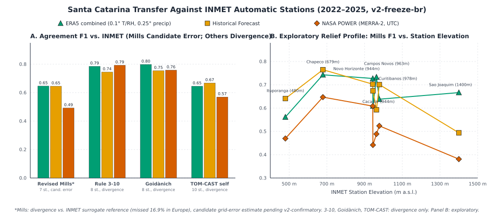
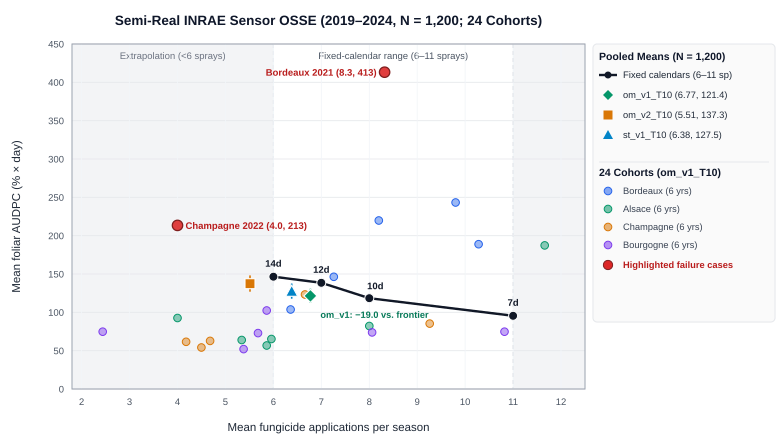
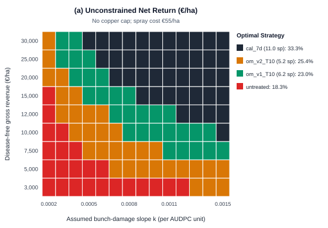

[](https://doi.org/10.5281/zenodo.24449844)

**Quanto se pode confiar num alerta de doença calculado com dado meteorológico gratuito, e onde ele falha?**

*English: an open, preregistered benchmark of how reliable plant-disease alerts are when driven by free gridded weather data instead of on-site station sensors. Full v2 technical report in English, with a Portuguese summary: [docs/v2/report_v2.pdf](docs/v2/report_v2.pdf).*

**Autor:** Mateus Zunino Espindola, Universidade Federal de Santa Catarina (UFSC)  
**Relatório técnico v2,** em inglês com resumo em português: [docs/v2/report_v2_draft.md](docs/v2/report_v2_draft.md) · [docs/v2/report_v2.pdf](docs/v2/report_v2.pdf)  
**Pré-registro congelado** nas tags `v2-rules`, `v2-freeze` e `v2-freeze-br`: [docs/v2/preregistro.md](docs/v2/preregistro.md)  
**Ferramenta no navegador,** que roda as regras congeladas sobre o CSV da sua estação sem instalar Python: [https://mateuszunino.github.io/vitirule/app/](https://mateuszunino.github.io/vitirule/app/)  
**Reprodução na nuvem,** só com dados públicos: [.github/workflows/v2_reproduce.yml](.github/workflows/v2_reproduce.yml)

> **Escopo da v2:** o vitirule v2 não mede eficácia de controle no campo. Ele mede a confiabilidade da entrada meteorológica de um sistema de alerta. O protocolo do míldio da videira da v1 continua congelado mais abaixo, como [Estudo de Caso 1](#estudo-de-caso-1-vitirule-v1-congelado-em-v10--errata-v102), com a [Errata `v1.0.2`](#errata-v102).

---

## vitirule v2: confiabilidade de alertas com dados meteorológicos gratuitos

### Desenho experimental

O pacote [vitirule_v2/rules/](vitirule_v2/rules/) implementa quatro regras publicadas usando só a biblioteca padrão do Python:

1. **Regra 3-10** para o míldio da videira, *Plasmopara viticola* (Baldacci, 1947; Goidànich, 1964; Rossi et al., 2008).
2. **Calendário de incubação de Goidànich** para o míldio da videira (Müller & Sleumer, 1934; Goidànich, 1964).
3. **Tabela de Mills revisada** para a sarna da macieira, *Venturia inaequalis* (MacHardy & Gadoury, 1989; Stensvand et al., 1997).
4. **TOM-CAST** para a pinta-preta do tomateiro, *Alternaria solani* (Madden et al., 1978; Pitblado, 1992; Gillespie et al., 1993). O TOM-CAST roda de dois modos: `reference_reset` mede a fidelidade da entrada e `self_reset` mede a divergência na operação.

Cada regra roda primeiro com os dados medidos na própria estação, incluindo o sensor de molhamento foliar. Depois roda com quatro entradas candidatas, todas em UTC:

- a mesma estação sem o sensor de molhamento, com o estimador `rh90_rain`;
- o ERA5 combinado: temperatura e umidade do ERA5-Land a 0,1°, chuva, vento e radiação do ERA5 a 0,25°, via `era5_seamless`;
- o Open-Meteo Historical Forecast;
- o NASA POWER, pedido em `time-standard=UTC`.

### Principais resultados

Os resultados europeus são exploratórios. O conjunto confirmatório depende do portal do INRAE, que seguia fora do ar, com HTTP 503, em 22 de novembro de 2026.

1. **Nenhuma fonte gratuita em grade passou no critério de uso** pré-registrado, em nenhuma das quatro regras, no conjunto exploratório europeu. Ele reúne 4 estações do INRAE na França, entre 2022 e 2025, mais 2 estações do Politecnico di Torino mostradas só de forma descritiva, sob licença CC BY-NC 4.0. As grades perderam de 25,2% a 34,5% dos alertas da 3-10 e do Goidànich. Em Mills, perderam de 31,7% a 61,9%. Com só 4 estações, o bootstrap por bloco subestima a incerteza.
2. **A estação local sem sensor de molhamento passou em Mills.** Ela perdeu 16,9% dos eventos, com razão de alarmes falsos de 12,7% e F1 de 0,852. Na 3-10 e no Goidànich essa comparação não se aplica: as duas regras não usam molhamento, então a estação recebe a mesma entrada da referência. No TOM-CAST, nenhum dos três estimadores de molhamento testados substituiu o sensor. Um viés médio de -1,02 DSV por intervalo desloca os zeramentos seguintes e leva a 57,5% de alertas perdidos quando a estação segue as próprias aplicações. Com o ERA5 combinado e o NASA POWER, as pulverizações se multiplicam de 2,1 a 4,1 vezes.
3. **Previsões reais de 1 a 3 dias pioram o quadro.** Com o Open-Meteo Previous Runs, em 2024 e 2025, os alertas perdidos subiram de 8 a 11 pontos percentuais em relação ao arquivo de quase-análise. O valor econômico dos alertas de Mills, com razão custo/perda de 0,10, caiu para -0,06 no terceiro dia.
4. **Em Santa Catarina, 11 das 24 estações automáticas do INMET entraram por seleção às cegas,** sob a tag `v2-freeze-br`. O filtro usou a PAM 2025 do IBGE e o controle de qualidade sem sensor, de 2022 a 2025. O INMET não tem sensor de molhamento, então o resultado é a divergência entre a grade e a estação. Em Mills, as grades deixaram sem par de 37,6% a 59,2% dos eventos do INMET. O menor F1 apareceu em São Joaquim, a 1.400 m: 0,381 no NASA POWER. Essa divergência só vira estimativa de erro da grade se o conjunto confirmatório europeu repetir o resultado exploratório. No TOM-CAST, as grades multiplicaram as pulverizações de 1,8 a 2,5 vezes.




### Ferramenta no navegador e reprodução

A página [https://mateuszunino.github.io/vitirule/app/](https://mateuszunino.github.io/vitirule/app/) carrega o código congelado de [docs/app/vitirule_bundle.json](docs/app/vitirule_bundle.json) pelo Pyodide. As regras rodam no navegador, sobre o CSV da estação do usuário. A tabela de confiabilidade medida aparece ao lado de cada alerta. Alertas calculados com dado em grade nunca aparecem como recomendação.

```powershell
# Suíte completa de testes (v1 + v2, sem rede)
.venv\Scripts\python.exe -m pytest tests/ -q

# Reproduzir a transferência pública de Santa Catarina (INMET + IBGE PAM + Open-Meteo + NASA POWER)
.venv\Scripts\python.exe scripts/v2_phase4_brazil.py
.venv\Scripts\python.exe scripts/v2_generate_figures.py --public-only

# Recompilar o PDF do relatório da v2
.venv\Scripts\python.exe scripts/render_v2_report_pdf.py
```

**Licenças e dados na v2.** O código do repositório é MIT. As figuras e tabelas públicas, derivadas do INMET e do IBGE, podem ser refeitas no GitHub Actions com disparo manual. A licença literal do dataset do INRAE, `10.57745/BQ0BWB`, ainda não foi confirmada, porque o portal está fora do ar. Por isso o repositório e o relatório usam só agregados derivados dele. Tudo o que deriva do Politecnico di Torino, `10.17632/sd4b8vpvyb.1`, leva atribuição CC BY-NC 4.0 e nunca entra no CI nem em redistribuição de dados brutos.

---

## Estudo de Caso 1: vitirule v1 (congelado em `v1.0` + Errata `v1.0.2`)

Protocolo aberto e reprodutível para testar regras de pulverização contra o míldio da videira (*Plasmopara viticola*) antes de levá-las a campo.

**Relatório técnico v1** em inglês, com resumo em português: [docs/technical_report.md](docs/technical_report.md) · [docs/technical_report.pdf](docs/technical_report.pdf)

> **Errata `v1.0.2`:** o controle de qualidade criado na v2 detectou travamento físico no sensor de molhamento de Bordeaux-Couhins em julho de 2021 e julho de 2023, além de falhas de pluviômetro preenchidas com zero em algumas safras. A `v1.0.2` substitui a `v1.0.1` com exclusões cirúrgicas análise por análise. Veja a [seção Errata](#errata-v102) ao final deste README.



### O que o Estudo de Caso 1 faz

O vitirule avalia regras agrometeorológicas preventivas para o míldio da videira em quatro frentes:

1. compara quatro estimadores de molhamento foliar (LWD) com 80.392 horas de sensores reais, separando o erro da fórmula do erro da reanálise;
2. roda OSSEs com um modelo SEIR mal-especificado e um OSSE semirreal em que a verdade vem do sensor de campo. Isso evita o "crime inverso" e inclui lavagem por chuva e previsão de 7 dias com ruído;
3. faz ablações com orçamento igual e traça a fronteira de Pareto entre número de aplicações e AACPD. Cada regra foi congelada em commit antes de ser testada em anos e regiões que ela nunca viu;
4. mede a sensibilidade econômica em uma superfície de inclinação do dano por receita bruta, sob o teto de cobre da agricultura orgânica europeia, o Regulamento de Execução (UE) 2018/1981.

### O que o projeto não é

O VitiMeteo (*VitiMeteo-Plasmopara*) já funciona em Luxemburgo e no Mosela, na Alemanha, na Suíça e no leste da França. O RIMpro também é usado na viticultura europeia. O vitirule não quer competir com eles como produto. A contribuição é o método de avaliação aberto: simulador mal-especificado, teste semirreal com sensor, ablação causal, fronteira de Pareto, congelamento fora da amostra em commits e sensibilidade econômica. Essa etapa quase nunca é publicada de forma reprodutível em sistemas de alerta fitossanitário.

> **Histórico e módulos desligados por padrão.** O projeto começou como um DSS em circuito fechado, com visão computacional (`vision_pipeline.py`) e assimilação bayesiana da severidade foliar (`epidemiology_assimilation.py`). Uma ablação congelada fora da amostra (`N = 360`, commit `668573a`) mostrou que a assimilação da severidade não superou a regra puramente climática com previsão de 7 dias e lavagem por chuva: `Δ AACPD = +0,99`, IC 95 % `[-1,81 ; +3,91]`, Wilcoxon `p = 0,462`. Os módulos de visão e assimilação continuam testados no repositório e ficam desligados por padrão, para quando houver dados de campo.

## Quatro resultados

1. **Assimilar a severidade das folhas não ajudou.** Na ablação congelada, a regra com assimilação empatou com a mesma regra sem assimilação.
2. **A fonte do dado meteorológico pesa mais que a fórmula de molhamento.** Na reanálise Open-Meteo, os quatro estimadores empatam. Trocar a estação local pela reanálise acrescenta até 1,48 h/dia de erro; em seis dos oito pares de rede e estimador, mais de 1,2 h/dia.
3. **O ganho vem de dimensionar a campanha de cada safra, não de acertar melhor o dia da aplicação.** Com o sensor real do INRAE como verdade, o ganho sobre os calendários fixos caiu de `-101,6` para `-18,95` de AACPD. Dentro de uma mesma safra, a regra empata com o calendário. As falhas mais graves foram em Champagne 2022 e Bordeaux 2021.
4. **Quem ganha no dinheiro depende de três hipóteses ao mesmo tempo:** a receita do vinhedo, a inclinação suposta do dano e a dose de cobre por aplicação.


---

## 1. Molhamento foliar contra sensores reais (80.392 horas)

A validação está em [lwd_sensor_validation.py](lwd_sensor_validation.py) e usa duas redes abertas e independentes:

* **INRAE AgroClim** (`doi:10.57745/BQ0BWB`; Furusho-Percot et al., *Data in Brief* 2025, `PMC12266558`): quatro estações vitícolas francesas, Bordeaux-Couhins `33080002`, Alsace-Colmar `68066002`, Champagne-Fagnières `51242002` e Bourgogne-Bretenière `21106002`, de abril a setembro de 2022 a 2024, num total de 52.675 h.
* **Politecnico di Torino / iXem Labs** (Mendeley Data, `doi:10.17632/sd4b8vpvyb.1`): sete estações italianas com sensor capacitivo de dupla face, de abril a setembro, num total de 27.717 h. Sobram 23.735 h nas seis estações sem deriva, porque o `site2.csv` ficou acima de zero em 99,9 % das horas.

| Rede (abril–setembro) | Estimador | Estação: Acc / F1 / CSI / MAE (h/d) / Viés | Open-Meteo: Acc / F1 / CSI / MAE (h/d) / Viés | Δ MAE da reanálise |
|---|---|---|---|---:|
| **INRAE AgroClim** (4 est. FR, 52,7k h) | `rh90_hysteresis` | **0,864 / 0,732 / 0,581 / 2,61 / +0,97** | **0,779** / 0,604 / 0,434 / 4,07 / +2,17 | +1,46 h/d |
| | `dpd_hysteresis` | 0,859 / 0,731 / 0,580 / 2,76 / +1,31 | 0,776 / **0,608 / 0,438** / 4,24 / +2,46 | +1,48 h/d |
| | `rh85` | 0,831 / 0,693 / 0,533 / 3,26 / +1,95 | 0,761 / 0,589 / 0,419 / 4,30 / +2,71 | +1,04 h/d |
| | `cart_kim2002` | 0,828 / 0,675 / 0,513 / 3,25 / +1,52 | 0,772 / 0,577 / 0,407 / **3,82** / +1,66 | +0,57 h/d |
| **Polito IT** (6 est. limpas, 23,7k h) | `rh85` | **0,879 / 0,680 / 0,519 / 2,59 / -0,07** | 0,789 / **0,529 / 0,364 / 4,05** / +1,49 | +1,46 h/d |
| | `dpd_hysteresis` | 0,871 / 0,653 / 0,490 / 2,79 / -0,36 | 0,788 / 0,519 / 0,354 / 4,13 / +1,27 | +1,34 h/d |
| | `rh90_hysteresis` | 0,869 / 0,636 / 0,472 / 2,85 / -0,70 | **0,791** / 0,516 / 0,351 / 4,06 / +1,05 | +1,21 h/d |
| | `cart_kim2002` | 0,861 / 0,672 / 0,513 / 2,95 / +1,15 | 0,779 / 0,507 / 0,343 / 4,28 / +1,40 | +1,33 h/d |

Na entrada que um sistema operacional usaria, o Open-Meteo, os quatro estimadores praticamente empatam e trocam de lugar conforme a métrica. O `dpd_hysteresis` lidera em F1 (`0,608`), o `cart_kim2002` tem o menor MAE (`3,82 h/d`) e o `rh90_hysteresis` lidera em acurácia (`0,779`).

O erro vem sobretudo da fonte do dado. Passar da estação real para a reanálise derruba o F1 em cerca de `0,13` e leva o erro diário de cerca de `2,6` para `4,0 h/dia`, com viés úmido de `+1,6` a `+2,2 h/dia` e autocorrelação horária lag-1 de `0,68`. Na prática, um sistema em Luxemburgo deveria ler as estações da ASTA, a rede agrometeorológica local (agrimeteo.lu), em vez da reanálise.

---

## 2. Assimilação, fronteira de Pareto e OSSE semirreal com sensor

### 2.1 Ablação congelada (commit `668573a`, 2022–2024, Mosela e Bordeaux, `N = 360`)

* **DSS com assimilação `(d)` menos previsão com lavagem e sem assimilação `(c)`:** `+0,99` de AACPD, IC 95 % `[-1,81 ; +3,91]`, Wilcoxon `p = 0,462`, `141/360` vitórias. É um empate estatístico.
* **Previsão com lavagem `(c)` menos clima observado reativo `(b)`:** `-44,68` de AACPD, IC 95 % `[-51,40 ; -37,91]`, `p < 1e-6`, `293/360` vitórias.

### 2.2 Da fronteira simulada ao OSSE semirreal com o sensor do INRAE

Para saber quanto do ganho simulado sobrevive ao erro real de cerca de 4 h/dia da reanálise, rodamos [semireal_osse.py](semireal_osse.py) com a regra congelada em `T = 10,0`, sem nenhum reajuste, em dois cenários:

* **24 estação-safras reais do INRAE**, de 2019 a 2024, em quatro regiões vitícolas, somando `N = 1.200` talhão-safras. A verdade SEIR é movida pelo sensor real de molhamento foliar `h`. A regra lê só o Open-Meteo (`om_*`) ou o clima da estação local sem o sensor (`st_*`).
* **Mosela, de 2016 a 2018** (`N = 180`), com uma perturbação AR(1) calibrada nos erros reais: `MAE = 3,99 h/d`, `viés = +1,59 h/d`, `lag-1 = 0,68`.

| Experimento (regra congelada `T = 10,0`) | Estratégia | Aplic. | AACPD média (IC 95 %) | Δ vs. fronteira de calendários | Pareado vs. calendário próximo |
|---|---|---:|---:|---:|---|
| **INRAE semirreal (verdade = sensor real, `N = 1.200`)** | `cal_7d` / `10d` / `12d` / `14d` | 11 / 8 / 7 / 6 | 95,5 / 118,5 / 138,6 / 146,5 | referência | — |
| | **`om_v1_T10`** *(só Open-Meteo)* | **6,77** | **121,42 `[112,5 ; 130,9]`** | **-18,95 (-13,5 %)** | **-17,15 vs `cal_12d`** (`-0,23` aplic., `p < 1e-6`, `814/1200`) |
| | `om_v2_T10` *(alternativa econômica)* | **5,51** | **137,31 `[126,9 ; 148,2]`** | abaixo de `cal_14d` | **-9,18 vs `cal_14d`** (`-0,49` aplic., `p < 1e-6`, `652/1200`) |
| | `st_v1_T10` *(clima da estação, sem sensor)* | **6,38** | **127,48 `[117,8 ; 137,7]`** | **-15,99 (-11,1 %)** | **-19,01 vs `cal_14d`** (`+0,38` aplic., `p < 1e-6`, `788/1200`) |
| **Mosela com erro calibrado (2016–2018, `N = 180`)** | `cal_12d` / `cal_14d` | 7 / 6 | 302,1 / 367,6 | referência | — |
| | **`om_v1_T10`** | **7,22** | **277,37 `[243,1 ; 315,9]`** | **-22,70 (-7,6 %)** | **-24,70 vs `cal_12d`** (`p = 4,7e-5`, `120/180`) |
| | `om_v2_T10` | **5,83** | **346,54 `[303,6 ; 394,1]`** | abaixo de `cal_14d` | **-21,03 vs `cal_14d`** (`-0,17` aplic., `p = 0,021`, `99/180`) |

**Quanto do ganho sobrevive.** O ganho de `-101` de AACPD no simulador movido só pela reanálise estava inflado. A causa era o viés úmido do Open-Meteo (`+1,6 h/d`) e o acoplamento excessivo entre a verdade e a entrada. Com o sensor real do INRAE (`N = 1.200`) e com o erro calibrado no Mosela (`N = 180`), o ganho cai para `-19` a `-23` de AACPD, de 7,6 % a 13,5 % abaixo da fronteira de calendários fixos. É menor, mas estatisticamente sólido (`p < 1e-4`). No conjunto agregado, o `om_v1_T10` domina o `cal_12d` no sentido de Pareto: menos doença com menos aplicações.

O `v2` (`ResidualGateConfig`, piso de 6 dias e $P_{\text{est}} \le 0,45$) não melhora o `v1`. Ele é outro ponto da mesma curva de Pareto, mais econômico, com `5,5` aplicações contra `6,8`.

**Dentro de cada safra o quadro muda.** Nas coortes que caem dentro da faixa dos calendários, de 6 a 11 aplicações, a regra empata com a fronteira interpolada: média `+1,01` e mediana `-0,33` de AACPD. O ganho agregado vem de ajustar o tamanho da campanha de um ano para outro (`r = 0,595`, `p = 0,0022`). As duas piores falhas, Champagne 2022 e Bordeaux 2021, estão abaixo, dia a dia.


---

## 3. Sensibilidade econômica (€/ha) e teto europeu de cobre ([economics.py](economics.py))

A inclinação da curva que liga o dano foliar à perda nos cachos, $L = 0{,}85(1 - e^{-k\cdot\text{AACPD}})$, não foi calibrada em campo. Por isso avaliamos 126 combinações de $k \in [0{,}0002 ; 0{,}0015]$ com receita bruta de `3.000` a `30.000 €/ha`, a `55 €/ha` por aplicação, sobre o OSSE semirreal do INRAE (`N = 1.200`).

**Sem restrição de cobre (126 células):**
* o `cal_7d` vence em `40,5 %` da superfície, nos vinhedos de receita alta com dano severo, o que bate com o comportamento de quem produz vinho premium;
* o `om_v1_T10` vence em `27,0 %` e o `om_v2_T10` em `19,8 %`, somando `46,8 %` nas faixas intermediárias e econômicas;
* a `testemunha` vence em `12,7 %`, só com receita mínima e dano mínimo;
* o `cal_10d`, o `cal_12d` e o `cal_14d` não vencem em nenhuma célula. Quando não se pulveriza toda semana, a regra preventiva sempre supera os calendários espaçados.

**Sob o teto europeu de cobre para viticultura orgânica**, o Regulamento de Execução (UE) 2018/1981, que permite `28 kg Cu/ha` em 7 anos, ou `4,0 kg Cu/ha/ano` em média:
* com uma dose típica de `0,50 kg Cu/ha` por aplicação, o `cal_7d` (`11,0` aplicações, `5,50 kg Cu/ha/ano`) passa do limite legal. O `om_v1_T10` (`3,39 kg/ha/ano`) e o `om_v2_T10` (`2,76 kg/ha/ano`) cumprem o regulamento;
* dentro do espaço permitido, o `om_v1_T10` lidera em `61,1 %` e o `om_v2_T10` em `19,8 %` da superfície, somando `80,9 %`, contra `6,3 %` do `cal_10d`.

| Sem restrição de cobre | Sob o Reg. (UE) 2018/1981 |
|---|---|
|  |  |

---

## 4. Calibração da posteriori de `r` no módulo de assimilação

Com a `r_prior_gompertz` separada em [epidemiology_assimilation.py](epidemiology_assimilation.py), a cobertura do IC 95 % de `r` dentro do modelo escolhido passou de cerca de 75 %, quando as escalas logística e Gompertz se misturavam, para 97,9 % no modelo logístico e 95,8 % no Gompertz.

---

## 5. Dados brutos, licenças, atribuição e como reproduzir

* **Código deste repositório:** [licença MIT](LICENSE), Copyright © 2026 Mateus Zunino Espindola.
* **Relatório técnico (`docs/technical_report.*`):** CC BY 4.0. **Figuras e tabelas derivadas dos dados do Politecnico di Torino seguem também os termos da CC BY-NC 4.0.**
* **Dados brutos de sensores (`data/`):** ficam fora do Git pelo `.gitignore` e nunca entraram no histórico do repositório. Use [scripts/download_sensor_datasets.py](scripts/download_sensor_datasets.py) para baixá-los pelos DOIs oficiais antes de reproduzir as análises:
  * **INRAE AgroClim (França):** Furusho-Percot, C., Maury, O., Minet, V., De Decker, T., Roux, D., Beauvois, C., Le Roux, R., Décome, J., Launay, M., & García de Cortázar-Atauri, I. (2025). *French agroclimatic research network dataset*. *Data in Brief*, 61, 111809 (`doi:10.1016/j.dib.2025.111809`, artigo CC BY 4.0). Dataset: *Daily and hourly climatic data from 54 stations of the INRAE Agroclim network*, Recherche Data Gouv, `doi:10.57745/BQ0BWB`, sujeito à licença declarada no portal Recherche Data Gouv, que pode ser conferida com `--dry-run`.
  * **Politecnico di Torino / iXem Labs (Itália):** Colucci, G. P., Filipescu, E., Scatozza, F., & Trinchero, D. (2025). *Leaf Wetness and Agrometeorological Dataset*. Mendeley Data, V1, `doi:10.17632/sd4b8vpvyb.1`, **CC BY-NC 4.0**: uso não comercial, com atribuição.

```powershell
# Testes automatizados (sem rede, sem banco, sem GPU)
.venv\Scripts\python.exe -m pytest tests/ -q

# 0. Baixar sensores reais diretamente pelos DOIs oficiais (INRAE + Politecnico di Torino)
.venv\Scripts\python.exe scripts/download_sensor_datasets.py

# 1. Validação de LWD contra sensores reais (INRAE AgroClim + Politecnico di Torino)
.venv\Scripts\python.exe lwd_sensor_validation.py

# 2. OSSE semirreal nas 4 estações INRAE (verdade = sensor) + Moselle com erro calibrado
.venv\Scripts\python.exe semireal_osse.py --lwd-method rh90_hysteresis --n-plots 50

# 3. Sensibilidade econômica e mapa de decisão sob Reg. (UE) 2018/1981
.venv\Scripts\python.exe economics.py data/fase2/semireal_inrae_osse.json \
    --out-json data/fase2/economics_semireal_inrae.json \
    --out-svg-unconstrained data/fase2/economics_map_unconstrained.svg \
    --out-svg-copper data/fase2/economics_map_eu_copper.svg

# 4. Figuras em inglês e compilação do relatório técnico (PDF de 12 páginas)
.venv\Scripts\python.exe scripts/generate_report_figures.py
.venv\Scripts\python.exe scripts/make_lwd_source_figure.py
.venv\Scripts\python.exe scripts/render_report_pdf.py
```

---

## Errata (`v1.0.2`)

> **Nota sobre a `v1.0.1`:** a errata `v1.0.1` aplicou a regra antiga de lacuna máxima de 24 horas da v2 de forma uniforme a todas as análises e excluiu estações-safra cujas falhas não falseavam os números da v1, como as quatro estações do Politecnico com linhas apenas omitidas e as safras de Alsace 2022 e Bourgogne 2022 descartadas por `dropna`. A `v1.0.2` refaz a auditoria análise por análise, retirando apenas o que de fato tinha sensor travado ou valores inventados no código congelado da v1. As tags `v1.0` e `v1.0.1` permanecem intactas no histórico.

Uma errata retira somente o que estava errado. Inspecionamos linha a linha o código congelado da v1 em `lwd_sensor_validation.py`, `leaf_wetness.py`, `semireal_osse.py` e `osse_benchmark.py` e aplicamos dois critérios objetivos via [scripts/v1_errata_audit.py](scripts/v1_errata_audit.py), sem alterar nenhum parâmetro, regra ou semente:

1. **Sensor reprovado nos testes de deriva ou travamento:** excluído de todas as análises da v1 que usam o sensor.
2. **Lacuna ou cobertura baixa:** se a análise descartou a hora faltante por `dropna` ou por linha omitida no arquivo, sem inventar valor, a estação-safra fica. Se o código preencheu a hora faltante com valor inventado dentro da janela efetiva daquela análise, como `rr` preenchida com `0,0 mm` em `load_inrae_station` ou `vt` preenchido com `1,5 m/s` em `leaf_wetness.py`, a estação-safra sai apenas daquela análise.

### Decisão por estação-safra e por análise

As 15 estações-safra do INRAE sem nenhuma falta nem deriva em 2019–2024 ficam em todas as análises em que participam: Bordeaux 2019 e 2020, Alsace 2019, 2020, 2021 e 2023, Champagne 2019, 2020, 2022, 2023 e 2024, e Bourgogne 2019, 2020, 2023 e 2024. No Politecnico di Torino, `site1` e `site5` são íntegras e ficam. A tabela abaixo registra todas as estações-safra com alguma ocorrência de deriva ou lacuna:

| Rede e estação-safra | Validação LWD, abr–set 2022–2024 | Erro empírico Open-Meteo, mai–ago 2019–2024 | OSSE semirreal INRAE, 1 mai–16 jul 2019–2024 | Motivo no código congelado da v1 |
|---|---|---|---|---|
| INRAE Bordeaux 2021 | Não participa | **Sai** | **Sai** | Sensor LWD travado em julho, com `90,1%` molhado em ar seco de meio-dia e `309 h` sem chuva |
| INRAE Bordeaux 2022 | **Sai** | **Fica** | **Sai** | `rr` faltante em `94 h` de junho preenchida com `0,0 mm` e `vt` em `172 h` preenchido com `1,5 m/s`; o erro empírico só lê `h` e Open-Meteo |
| INRAE Bordeaux 2023 | **Sai** | **Sai** | **Sai** | Sensor LWD travado em julho, com `95,9%` molhado em ar seco de meio-dia e `287 h` sem chuva |
| INRAE Bordeaux 2024 | **Sai** | **Fica** | **Fica** | `rr` faltante em `1.409 h` preenchida com `0,0 mm` ocorreu de 20 jul a 18 set, fora da janela OSSE de 1 mai a 16 jul; erro empírico não lê `rr` |
| INRAE Alsace 2022 | **Fica** | **Fica** | **Fica** | Apenas `t` faltante em `100 h`, descartada por `dropna`, sem nenhum valor inventado |
| INRAE Alsace 2024 | **Sai** | **Fica** | **Sai** | `rr` faltante em `29 h`, sendo `19 h` entre 1 mai e 16 jul, preenchida com `0,0 mm`; erro empírico não lê `rr` |
| INRAE Champagne 2021 | Não participa | **Fica** | **Fica** | `h` faltante em `21 h` de abril, descartada por `dropna` e fora de mai–ago |
| INRAE Bourgogne 2021 | Não participa | **Fica** | **Sai** | `rr` faltante em `666 h`, sendo `58 h` até 16 jul, preenchida com `0,0 mm`; erro empírico não lê `rr` |
| INRAE Bourgogne 2022 | **Fica** | **Fica** | **Fica** | Apenas `t` faltante em `156 h`, descartada por `dropna`, sem nenhum valor inventado |
| Politecnico `site2`, 2023 | **Sai** | Não participa | Não participa | Sensor LWD com deriva severa, já excluído nos 6 sítios limpos da `v1.0` |
| Politecnico `site3`, `site4`, `site6`, `site7` | **Ficam** | Não participa | Não participa | Zero valores `NaN` nas colunas; as horas ausentes eram linhas omitidas no CSV, sem nenhum valor inventado |

### Números publicados na `v1.0` contra recálculo cirúrgico na `v1.0.2`

| Análise e métrica | Publicado na `v1.0` | Recalculado na `v1.0.2` |
|---|---|---|
| Validação LWD INRAE 2022–2024, amostra | 12 estações-safra, `52.675 h` | 8 estações-safra, `34.880 h` |
| INRAE `rh90_hysteresis` MAE estação / Open-Meteo / Δ MAE | `2,61` / `4,07` / `+1,46 h/d` | `2,65` / `3,94` / `+1,29 h/d` |
| INRAE `dpd_hysteresis` MAE estação / Open-Meteo / Δ MAE | `2,76` / `4,24` / `+1,48 h/d` | `2,85` / `4,16` / `+1,30 h/d` |
| INRAE `rh85` MAE estação / Open-Meteo / Δ MAE | `3,26` / `4,30` / `+1,04 h/d` | `3,37` / `4,24` / `+0,87 h/d` |
| INRAE `cart_kim2002` MAE estação / Open-Meteo / Δ MAE | `3,25` / `3,82` / `+0,57 h/d` | `3,29` / `3,61` / `+0,32 h/d` |
| Validação LWD Politecnico, 6 sítios limpos | `23.735 h`, Δ MAE `+1,21` a `+1,46 h/d` | Inalterado: `23.735 h`, Δ MAE `+1,21` a `+1,46 h/d` |
| Erro empírico Open-Meteo INRAE mai–ago, amostra | 24 coortes, `70.537 h` | 22 coortes, `64.663 h` |
| Erro empírico viés / MAE / lag-1 / `P(wet\|OM dry)` | `+1,59` / `3,99` / `0,676` / `0,1058` | `+1,96` / `3,74` / `0,647` / `0,0862` |
| OSSE semirreal INRAE, amostra e testemunha | 24 coortes, `N = 1.200`, AACPD `284,7` | 19 coortes, `N = 950`, AACPD `218,4` |
| INRAE `om_v1_T10`: aplic. / AACPD / Δ fronteira | `6,77` / `121,42` / `-18,95 (-13,5%)` | `6,23` / `99,63` / `-11,59 (-10,4%)` |
| INRAE `st_v1_T10`: aplic. / AACPD / Δ fronteira | `6,38` / `127,48` / `-15,99 (-11,1%)` | `6,03` / `102,01` / `-9,83 (-8,8%)` |
| INRAE `om_v2_T10`: aplic. / AACPD / Δ vs `cal_14d` | `5,51` / `137,31` / `-9,18`, `p < 1e-6` | `5,19` / `109,39` / `-2,55`, `p = 0,815` |
| Correlação anual entre pulverizações e pressão `r` | `0,595`, `p = 0,0022` | `0,479`, `p = 0,0380` |
| Mosela erro calibrado 2016–2018, `om_v1_T10` Δ fronteira | `-22,70 (-7,6%)`, `p = 4,7e-5` | `-21,68 (-8,3%)`, `p = 2,1e-5` |
| Economia sem teto de cobre: `cal_7d` / regras `om_v1+v2` / testemunha | `40,5%` / `46,8%` / `12,7%` | `33,3%` / `48,4%` / `18,3%` |
| Economia sob teto de cobre 0,50 kg: regras `om_v1+v2` / `cal_10d` | `80,9%` / `6,3%` | `60,3%` / `21,4%` |

### O que continua valendo e o que cai

**Continua valendo:**

1. A ablação congelada da assimilação bayesiana na seção 2.1 não usou sensores de molhamento e não muda em nada.
2. **A conclusão de molhamento foliar se mantém integralmente:** os quatro estimadores continuam empatados na entrada Open-Meteo, o conjunto de 6 sítios limpos do Politecnico não sofre alteração alguma e a penalidade da reanálise segue acima de `1,2 h/dia` em **seis dos oito pares** de rede e estimador, sendo os quatro do Politecnico mais `rh90_hysteresis` e `dpd_hysteresis` no INRAE, com `+1,29` e `+1,30 h/dia`.
3. O ganho agregado de `om_v1_T10` no OSSE semirreal continua estatisticamente claro, em `-11,59` de AACPD e `-10,4%` abaixo da fronteira de calendários, com dominância de Pareto sobre `cal_12d` usando `0,77` aplicações a menos, e o resultado calibrado do Mosela praticamente não muda, passando de `-22,70` para `-21,68` de AACPD.
4. O ganho agregado segue vindo do dimensionamento interanual da campanha, com `r = 0,479`, `p = 0,038`, e **Champagne 2022** continua válida como falha operacional real da regra.
5. A conclusão qualitativa da sensibilidade econômica permanece válida: a melhor estratégia depende conjuntamente de receita, inclinação do dano e dose de cobre.

**Cai ou precisa ser corrigido:**

1. **Bordeaux 2021 cai como caso de falha válido da regra.** O excesso de `+52,9` de AACPD na Figura 2B e na Tabela 6 do relatório ocorreu com o sensor de molhamento travado em julho de 2021 e não pode ser citado como falha operacional da regra preventiva.
2. **A superioridade estatística de `om_v2_T10` em AACPD sobre `cal_14d` cai.** Na `v1.0.2`, `om_v2_T10` empata estatisticamente em AACPD com `cal_14d`, com `-2,55` de diferença e Wilcoxon `p = 0,815`, mantendo apenas a economia de `0,81` aplicações por safra.
3. **A magnitude do ganho agregado no INRAE e a fatia de liderança sob o teto de cobre encolhem.** O ganho médio de `om_v1_T10` cai de `-18,95` para `-11,59` de AACPD, e a liderança somada das regras sob teto de cobre a `0,50 kg/ha` passa de `80,9%` para `60,3%`, enquanto `cal_10d` sobe de `6,3%` para `21,4%`. A citação de Bordeaux 2023 na seção 3.5 também cai pelo sensor travado em julho.
