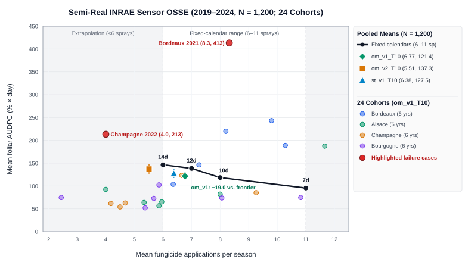
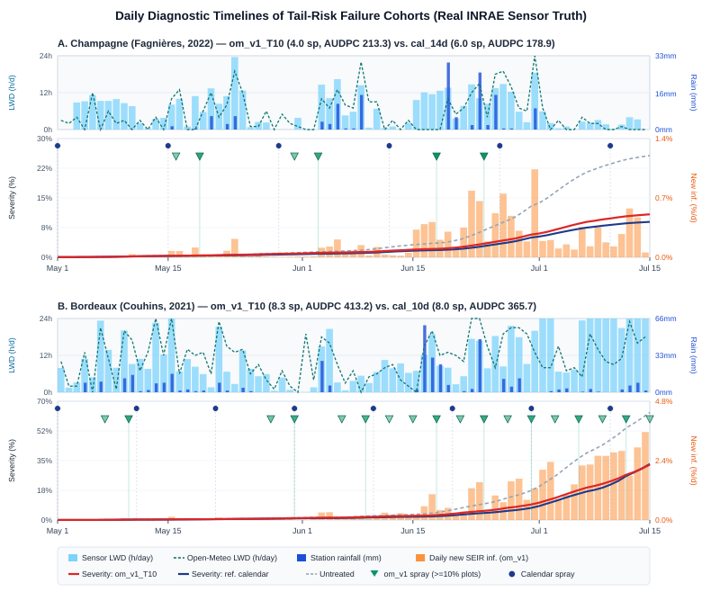
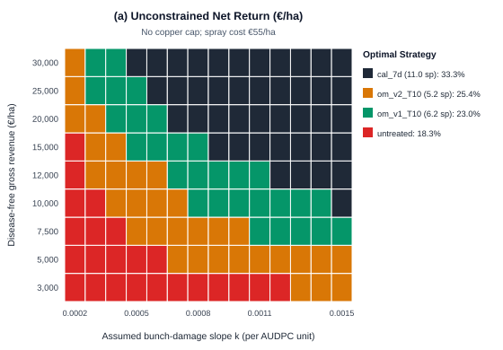

# An Open, Reproducible Evaluation Protocol for Preventive Agrometeorological Decision Support in Grapevine Downy Mildew (*Plasmopara viticola*)

**Author:** Mateus Zunino Espindola — Universidade Federal de Santa Catarina (UFSC)  
**Repository:** `grapevine-downy-mildew-eval`  
**Date:** November 2026  
**Frozen Checkpoints:** Git commits `2e8aea8`, `68ef7fd`, `a562ccc`, `958cbe3`

---

## Abstract

Weather-driven decision support systems (DSS) for grapevine downy mildew (*Plasmopara viticola*) are widely used in Europe, yet evaluations combining equal-budget ablations, frozen out-of-sample thresholds, physical wetness-sensor checks, and per-cohort tail-risk analysis are not always reported. We present an open, reproducible evaluation protocol pairing a misspecified hourly SEIR simulator (four-stage Müller–Sleumer/Goidànich incubation, rain wash-off, and autocorrelated 7-day forecast errors) with frozen out-of-sample validation across disjoint years (2016–2025), empirical benchmarking of four leaf wetness duration (LWD) estimators against 80,392 real sensor hours (INRAE AgroClim and Politecnico di Torino), and economic sensitivity analysis under Commission Implementing Regulation (EU) 2018/1981 (28 kg Cu/ha over 7 years).

Four findings emerge. First, in a frozen ablation (N = 360, 2022–2024), Bayesian foliar-severity assimilation added no benefit over an identical weather-forecast and wash-off rule (Δ AUDPC = +0.99, 95% CI [−1.81, +3.91], p = 0.462). Second, all four LWD estimators tied under Open-Meteo reanalysis (MAE 3.82–4.30 h/day), whereas switching from station weather to reanalysis added 1.21–1.48 h/day of error (+1.6 h/day wet bias). Third, driving the SEIR truth with real INRAE sensors (N = 1,200) shrank pooled Pareto gains from −101.6 to −18.95 AUDPC (−13.5%, p < 10⁻⁶); within individual seasons, the rule tied the calendar frontier (interpolated 6–11 spray cohorts: mean +1.01, median −0.33), showing that pooled gains come from inter-annual campaign sizing (r = 0.595, p = 0.0022), alongside severe failures in Champagne 2022 and Bordeaux 2021. Fourth, economic dominance and copper compliance depend jointly on revenue, assumed damage slope, and copper dose.

### Resumo (Português)

Este relatório apresenta um protocolo aberto e reprodutível para avaliar regras agrometeorológicas preventivas contra o míldio da videira (*Plasmopara viticola*), e não um novo sistema operacional concorrente do VitiMeteo ou do RIMpro. Quatro resultados se destacam: (1) em ablação fora da amostra congelada em commit (N = 360), a assimilação bayesiana de severidade foliar não acrescentou ganho sobre a regra preventiva com previsão de 7 dias e lavagem por chuva (Δ AACPD = +0,99; p = 0,462); (2) contra 80.392 horas de sensores reais de molhamento foliar (INRAE AgroClim e Politecnico di Torino), os quatro estimadores empataram na reanálise Open-Meteo (MAE 3,82–4,30 h/d) e a fonte climática dominou o erro (+1,21 a +1,48 h/d); (3) em OSSE semirreal movido pelo sensor real do INRAE (N = 1.200), o ganho consolidado caiu para −18,95 de AACPD (−13,5%), vindo do dimensionamento interanual da campanha (r = 0,595) e não de melhor momento dentro de uma mesma safra, com falhas marcantes em Champagne 2022 e Bordeaux 2021; e (4) sob o Regulamento (UE) 2018/1981 (28 kg Cu/ha em 7 anos), a viabilidade econômica e regulatória depende conjuntamente da receita, da inclinação suposta de dano e da dose de cobre por aplicação.

---

## 1. Introduction

Grapevine downy mildew, caused by the obligate biotrophic oomycete *Plasmopara viticola*, is a major foliar and cluster disease across temperate humid European wine regions, including the Moselle Valley (Luxembourg and Germany), Bordeaux, Alsace, Champagne, and Burgundy (Rossi et al., 2008; Gessler et al., 2011). Under warm and wet spring–summer conditions, polycyclic secondary infection cycles can complete incubation in as little as four days (Müller & Sleumer, 1934; Goidànich, 1964), risking severe inflorescence and berry losses when protective fungicide coverage fails.

To guard against sudden outbreaks, winegrowers commonly adopt fixed-interval calendar spraying—typically every 7 to 14 days from shoot elongation through veraison. Calendar schedules are operationally simple but blind to inter-annual weather variability: they over-apply fungicides in dry seasons and risk coverage gaps during heavy rainfall when contact fungicides wash off. In European certified organic viticulture, minimizing redundant sprays is also a legal constraint: metallic copper is capped at 28 kg Cu/ha over a 7-year period under Commission Implementing Regulation (EU) 2018/1981 (an average of 4.0 kg Cu/ha/year with inter-annual smoothing).

Established operational agrometeorological decision support systems already serve European viticulture. Notably, **VitiMeteo** (*VitiMeteo-Plasmopara*), co-developed by the Staatliches Weinbauinstitut Freiburg and Agroscope (Bleyer et al., 2008), operates on regional station networks across Germany, Switzerland, and Luxembourg's Moselle Valley (integrated via ASTA's AgriMeteo service, `agrimeteo.lu`), while **RIMpro** (*RIMpro-Plasmopara*; Trapman, 2013, evaluated in comparative studies such as Brischetto et al., 2021) provides commercial weather-driven infection modeling. Building another commercial forecasting platform is outside the scope of this project.

Instead, our contribution is **an open, reproducible evaluation protocol** for stress-testing preventive spray rules prior to field trials. In applied DSS studies, safeguards such as equal-budget component ablations, strictly frozen out-of-sample threshold tests, empirical validation of reanalysis-derived leaf wetness against physical sensors, per-cohort tail-risk inspection, and multi-parameter economic sensitivity are not always reported together. Here, we assemble and execute that full verification pipeline—documenting both negative and positive findings—with every methodological freeze recorded in Git history.

---

## 2. Methods

### 2.1 System Scope and Frozen-Rule Protocol

The project originally explored a closed-loop architecture coupling foliar severity observations to Bayesian epidemiological assimilation (`epidemiology_assimilation.py`, logistic and Gompertz models in favorable-day physiological time $\tau$) and computer vision (`vision_pipeline.py`). Following the negative ablation result in Section 3.1, the active protocol focused on preventive weather-driven rules, while keeping the assimilation and vision modules tested and disabled by default (with a dedicated Gompertz rate prior `r_prior_gompertz` added to correct cross-model scale mixing in posterior rate coverage; Section 5.1).

To prevent post-hoc threshold tuning across weather years, every decision rule or estimator change was frozen in a Git commit **before** running its evaluation block. Each historical year block served a distinct methodological role (Table 1).

**Table 1.** Separation of historical weather years, regions, and frozen Git checkpoints across study phases.

| Study Phase | Years | Regions / Stations | Sample Size (plot-seasons) | Role | Frozen Commit |
|---|---|---|---:|---|---|
| Initial prototyping & calibration | 2025 | Moselle (LU), Bordeaux (FR) | 16 | Rule design & initial calibration | Pre-freeze |
| Four-arm ablation | 2022–2024 | Moselle (LU), Bordeaux (FR) | 360 (60 × 2 × 3) | Out-of-sample test of severity assimilation (`d` vs. `c`) | `2e8aea8` |
| Pareto operating-point selection | 2022–2024 | Moselle (LU), Bordeaux (FR) | 360 (60 × 2 × 3) | Threshold selection ($T = 10.0$) on calendar frontier | `68ef7fd` |
| Out-of-sample Pareto validation #1 | 2019–2021 | Moselle, Bordeaux, Alsace (new) | 540 (60 × 3 × 3) | Unseen temporal & spatial test (`cart_kim2002`) | `68ef7fd` |
| LWD empirical sensor validation | 2022–2024 | 4 INRAE FR vineyards; 7 Polito IT sites | 80,392 real hours | Benchmark of 4 LWD models (station vs. Open-Meteo) | `a562ccc` |
| Out-of-sample Pareto validation #2 | 2016–2018 | Moselle, Bordeaux, Alsace | 540 (60 × 3 × 3) | Untouched years with `rh90_hysteresis` | `a562ccc` |
| Semi-real sensor OSSE | 2019–2024 (split 19–21 / 22–24) | 4 INRAE stations (Bordeaux, Alsace, Champagne, Bourgogne) | 1,200 (50 × 4 × 6) | Robustness under real measured LWD sensor truth (no rule edits) | `958cbe3` |
| Calibrated-error Moselle test | 2016–2018 | Moselle (LU) | 180 (60 × 1 × 3) | Sensor-less region with empirical AR(1) LWD error | `958cbe3` |

### 2.2 Misspecified Mechanistic SEIR Ground-Truth Generator

To avoid the *inverse crime* of generating epidemics with the same logistic/Gompertz curves fitted by the assimilation module, synthetic epidemics were generated by an hourly discrete-time compartmental **SEIR model** (`osse_benchmark.py`) over a 75-day season (May 1 to July 15, with meteorological records through August 5 for 7-day forecasts):

1. **Compartmental structure and incubation delay:** Susceptible leaf area $S$ enters a four-stage Erlang exposed pipeline $(E_1, \dots, E_4)$ before entering infectious sporulating tissue $I$ (infectious period 12 days) and removed necrotic tissue $R$. Visible foliar severity is $100 \times (I + R)$, so infections remain invisible during incubation. Stage progression uses piecewise linear interpolation of the Müller–Sleumer / Goidànich temperature–incubation relationship (Müller & Sleumer, 1934; Goidànich, 1964: 25.0%/day at 22–25 °C [4 days], 7.7%/day at 12 °C [~13 days], 0%/day outside 8–30 °C).
2. **Parameter misspecification and decoupling:** Plot-level parameters were sampled independently per plot to break alignment with rule and assimilation defaults: maximum infection rate $\beta_{\max} \sim 0.055 \cdot \exp(\mathcal{N}(0, 0.25^2))$, initial latent inoculum $E_1(0) \sim \text{clip}(0.0025 \cdot \exp(\mathcal{N}(0, 0.45^2)), 0.0004, 0.018)$, shifted thermal cardinals ($\Delta T_{\min} \sim \mathcal{N}(0, 1.2^2)$, $\Delta T_{\text{opt}} \sim \mathcal{N}(0, 1.5^2)$ °C), true protectant efficacy $E_{\text{true}} \sim \text{clip}(\mathcal{N}(0.76, 0.08^2), 0.55, 0.92)$ (vs. 0.60 in assimilation), and half-life $t_{1/2,\text{true}} \sim \text{clip}(\mathcal{N}(5.5, 1.2^2), 3.5, 9.0)$ days (vs. 7.0 days).
3. **Rain wash-off (decoupled from decision rules):** Cumulative rainfall $R_{\text{since}}$ since the last spray washes off active protection via $P(t) = E_{\text{true}} \cdot 0.5^{\Delta t / t_{1/2,\text{true}}} \cdot 0.5^{R_{\text{since}} / W_{\text{true}}}$, where $W_{\text{true}} \sim \text{clip}(\mathcal{N}(25, 8^2), 12, 48)$ mm—decoupled from the fixed 15 mm wash-off override in `v1` and the 30 mm residual gate in `v2`.
4. **Autocorrelated 7-day forecast error:** Every 3-day decision step received a 168-hour forecast perturbed with AR(1) errors ($\phi = 0.85$) whose standard deviation grew linearly with lead time (0.5 to 2.5 °C in temperature, 3 to 12% in relative humidity, and 20% lognormal wind noise). All arms evaluated on the same plot saw identical perturbed forecasts.
5. **Canopy wetness truth:** In purely simulated OSSEs (2022–2024, 2019–2021, 2016–2018), canopy wetness applied microclimatic dew-point depression shifts ($\mathcal{N}(-0.35, 0.40^2)$ °C) and wind shelter ($\mathcal{N}(0.65, 0.12^2)$) to reanalysis. In the **semi-real INRAE OSSE** (`semireal_osse.py`), true temperature, rainfall, and hourly leaf wetness $h \in [0, 1]$ came **directly from the INRAE field station and its physical LWD sensor**. For sensor-less Moselle (2016–2018), an empirical AR(1) wetness-error generator calibrated to INRAE Open-Meteo residuals replaced the microclimate perturbation.

### 2.3 Leaf Wetness Estimators and Real-Sensor Validation

Four hourly LWD estimators were implemented in `leaf_wetness.py` (all treating rainfall $\ge 0.1\text{ mm/h}$ as wet):
1. **`rh85`**: simple relative-humidity threshold $\text{RH} \ge 85\%$;
2. **`rh90_hysteresis`** (Sentelhas et al., 2008): onset at $\text{RH} \ge 90\%$ (with solar radiation $< 150\text{ W/m}^2$ when available), drying when $\text{RH} < 80\%$ or radiation $> 250\text{ W/m}^2$ with $\text{RH} < 92\%$;
3. **`dpd_hysteresis`** (Gillespie et al., 1993; Gleason et al., 1994; Sentelhas et al., 2008): dew-point depression $\text{DPD} = T - T_d \le 1.8\,^\circ\text{C}$ for onset, drying at $\text{DPD} \ge 3.8\,^\circ\text{C}$ (or $\ge 2.2\,^\circ\text{C}$ under $> 250\text{ W/m}^2$);
4. **`cart_kim2002`** (Kim et al., 2002): four-category CART/SLD model using $T$, $\text{RH}$, $\text{DPD}$, and canopy-adjusted wind speed (FAO-56 scaling from 10 m Open-Meteo wind to 2 m).

Validation (`lwd_sensor_validation.py`) used two independent open field networks during April–September:
* **INRAE AgroClim** (Furusho-Percot et al., 2025; dataset DOI 10.57745/BQ0BWB): four French vineyard stations—Bordeaux-Couhins (33080002), Alsace-Colmar (68066002), Champagne-Fagnières (51242002), and Bourgogne-Bretenière (21106002)—yielding 52,675 valid hourly observations (2022–2024), binarized at hourly sensor duration $h \ge 0.5$.
* **Politecnico di Torino / iXem Labs** (Colucci et al., 2025; DOI 10.17632/sd4b8vpvyb.1): seven Italian sites with capacitive sensors (27,717 total hours; 23,735 hours across six clean sites after flagging `site2.csv`, which showed 99.9% non-zero readings consistent with sensor drift), binarized at `leaf_top >= 20`.

Each estimator was evaluated twice on identical timestamps: **(A) on-station measured meteorology** and **(B) Open-Meteo Archive ERA5 reanalysis** at the exact coordinates. The difference (B) − (A) isolates the reanalysis error penalty.

### 2.4 Decision Rules, Ablation Arms, and Pareto Evaluation

Daily *P. viticola* risk indices (`downy_mildew.py`) computed over 12h–12h local windows comprise Baldacci's 3–10 primary infection trigger (Baldacci, 1947: $T_{\text{mean}} \ge 10\,^\circ\text{C}$, 48 h rain $\ge 10\text{ mm}$, shoots $\ge 10\text{ cm}$) and a 0–4 secondary infection severity score (`secondary_sv`) driven by LWD, wet-period temperature, and nocturnal sporulation.

1. **Four-arm ablation (2022–2024, `osse_benchmark.py`):** Each plot ran under `(d) closed_loop_dss` (7-day forecast + 15 mm rain wash-off override + Bayesian severity assimilation triggers `delta_y_7d`, `p_exceed`, `regime_change`), producing spray count $N_d$. Three controls targeted $N_d$: `(a) uniform_calendar` (exact $N_d$ evenly spaced sprays), `(b) climate_reactive` (past 7-day observed climate only, causal threshold scanned over a grid [1.0, 22.5] to match $N_d$), and `(c) climate_forecast_washoff` (identical 7-day forecast, dry-week block, and 15 mm wash-off mechanics as `(d)`, **without assimilation**, causal threshold matched to $N_d$). **Important constraint on arm `(b)`:** because `(b)` enforces a fixed 7-day minimum interval *without* the 4-day wash-off override on a 3-day decision grid (75-day season), its effective minimum spacing is 9 days, creating a physical ceiling of 9 sprays per season. In the three wet cohorts where `(c)` and `(d)` reached 10.0–11.15 sprays via rain wash-off overrides (Moselle 2024, Bordeaux 2023, Bordeaux 2024), arm `(b)` saturated at 9.00 sprays, yielding a pooled mean of 7.77 vs. 8.56 sprays. Thus, `(c) − (b)` reflects combined forecast and wash-off capacity (including +0.79 sprays in wet years), whereas the primary assimilation test `(d) − (c)` is strictly budget-identical (8.56 vs. 8.56 sprays). Pairwise AUDPC differences (% × day, trapezoidal rule verified against R to < 10⁻⁶) were evaluated via 5,000 bootstrap resamples and two-sided paired Wilcoxon signed-rank tests.
2. **Pareto frontier (`pareto_analysis.py`):** Because an equal-budget uniform calendar implicitly uses oracle knowledge of seasonal spray count, practical policy evaluation compares **fixed calendars selected before the season** (`cal_7d` [11 sprays], `cal_10d` [8], `cal_12d` [7], `cal_14d` [6]) against preventive rules on the (mean sprays, mean AUDPC) plane. Two frozen variants at threshold $T = 10.0$ (chosen on 2022–2024 development data) were tested unchanged:
   * **`v1_T10`**: 7-day minimum interval reduced to 4 days after $\ge 15\text{ mm}$ rain; sprays when `sv_fc_7d + 0.5 * sv_fc_3d >= 10.0` (or primary 3–10 before first spray) with active incoming risk (`sv_fc_7d >= 3` or `sv_fc_3d >= 2`).
   * **`v2_T10`**: replaces the binary 4-day / 15 mm trigger with a continuous residual-coverage gate requiring $\Delta t \ge 6.0$ days and $P_{\text{est}} = 0.5^{\Delta t / 7.0} \cdot 0.5^{R_{\text{since}} / 30.0} \le 0.45$, forming a more economical operating point.

### 2.5 Economic Damage Function and 7-Year EU Copper Accounting

Because foliar AUDPC does not directly equal financial loss (downy mildew impacts yield chiefly through cluster infection), we parameterized an illustrative saturating exponential bunch-damage curve (`economics.py`), adopting the general saturating-loss functional form common in quantitative plant-disease epidemiology (Madden et al., 2007):

$$L(\text{AUDPC}) = L_{\max}\left(1 - e^{-k \cdot \text{AUDPC}}\right), \qquad \text{Net Return (€/ha)} = G \cdot (1 - L) - N_{\text{sprays}} \cdot C_{\text{spray}}$$

Here, both $L_{\max} = 0.85$ and the slope range $k \in [0.0002, 0.0015]$ per AUDPC unit are **assumed values** rather than literature-derived or field-calibrated parameters, with spray cost $C_{\text{spray}} = 55\text{ €/ha}$. Rather than trusting a single assumed slope, we swept a 126-cell sensitivity surface across $k \in [0.0002, 0.0015]$ and disease-free gross revenue $G \in [3{,}000;\, 30{,}000]\text{ €/ha}$.

Regulatory compliance under **Commission Implementing Regulation (EU) 2018/1981** was modeled as the actual **7-year cumulative cap ($\le 28\text{ kg Cu/ha}$ over 7 years)**, scaling each INRAE station's 6-year empirical spray total (2019–2024) by 7/6 across four sensitivity doses per application: 0.30, 0.40, 0.50, and 0.60 kg Cu/ha/spray.

---

## 3. Results

### 3.1 Negative Result: Severity Assimilation Adds No Value Over Preventive Weather Rules (`d` vs. `c`)

In the frozen out-of-sample ablation across Moselle and Bordeaux (2022–2024, N = 360 plot-seasons, commit `2e8aea8`), **closed-loop Bayesian assimilation of foliar severity did not outperform the identical weather-forecast and wash-off rule without assimilation** (Table 2).

**Table 2.** Frozen out-of-sample four-arm ablation (2022–2024, Moselle & Bordeaux, N = 360, commit `2e8aea8`). Negative Δ AUDPC favors the first arm.

| Ablation Arm / Contrast | Mean Sprays | Mean AUDPC (SD) | Final Sev. (%) | Paired Δ AUDPC [95% Boot CI] | Wilcoxon p | Wins |
|---|---:|---:|---:|---|---:|---:|
| `(0)` untreated | 0.00 | 1004.98 (903.11) | 50.02 | — | — | — |
| `(a)` `uniform_calendar` (oracle equal-N) | 8.56 | 405.71 (480.58) | 23.13 | — | — | — |
| `(b)` `climate_reactive` (observed past only)* | 7.77 | 474.54 (561.45) | 26.71 | — | — | — |
| `(c)` `climate_forecast_washoff` (no assim.) | 8.56 | 429.87 (518.53) | 24.09 | — | — | — |
| `(d)` `closed_loop_dss` (full assimilation) | 8.56 | 430.85 (513.14) | 24.12 | — | — | — |
| `(e)` `weekly_calendar` (fixed 7-day) | 11.00 | 386.18 (481.62) | 21.67 | — | — | — |
| **Main test: `(d) − (c)` (assimilation value)** | **0.00** | — | — | **+0.99 [−1.81, +3.91]** | **0.4618** | **141/360** *(106 ties)* |
| Forecast + wash-off: `(c) − (b)`* | +0.79 | — | — | −44.68 [−51.40, −37.91] | < 10⁻⁶ | 293/360 |
| Oracle equal-N: `(d) − (a)` | 0.00 | — | — | +25.14 [+19.02, +31.49] | < 10⁻⁶ | 121/360 |
| Trade-off vs. weekly: `(c) − (e)` | −2.44 (−22.2%) | — | — | +43.69 [+38.09, +49.40] | < 10⁻⁶ | — |

**Note (Table 2):** *Arm `(b)` lacks the 4-day wash-off override and therefore saturates at 9.00 sprays (effective 9-day spacing on the 3-day evaluation grid) in Moselle 2024, Bordeaux 2023, and Bordeaux 2024, where `(c)` and `(d)` reached 10.00–11.15 sprays (Section 2.4).*

Biologically, protectant fungicides block *new* infections entering $E_1$, not already-incubating latent lesions. Because visible symptoms lag infection by the 4–13 day incubation period, severity-derived triggers acted too late in intermittent years (in 2022, `(c)` beat `(d)` by 14.6 to 18.4 AUDPC) and offered only minor adjustments in wet years, canceling out to a statistical tie (p = 0.462). Even without field video-segmentation errors, severity assimilation did not justify its monitoring overhead.

### 3.2 Real-Sensor LWD Validation: Estimators Tie on Reanalysis; Data Source Dominates Error

Validation across 80,392 real hourly sensor observations (Table 3) overturned our initial choice of `cart_kim2002` and identified meteorological input quality as the dominant error source.

**Table 3.** Hourly LWD estimator performance against real sensors in French (INRAE AgroClim, 2022–2024 Apr–Sep) and Italian (Politecnico di Torino, Apr–Sep) networks, driven by on-station weather vs. Open-Meteo ERA5 reanalysis at the identical coordinates.

| Network (N hours) | Estimator | Station: Acc / F1 / CSI / MAE (h/d) / Bias | Open-Meteo: Acc / F1 / CSI / MAE (h/d) / Bias | Reanalysis Penalty (Δ MAE) |
|---|---|---|---|---:|
| **INRAE AgroClim FR** (52,675 h, 4 vineyards) | `rh90_hysteresis` | **0.864 / 0.732 / 0.581 / 2.61 / +0.97** | **0.779** / 0.604 / 0.434 / 4.07 / +2.17 | +1.46 h/d |
| | `dpd_hysteresis` | 0.859 / 0.731 / 0.580 / 2.76 / +1.31 | 0.776 / **0.608 / 0.438** / 4.24 / +2.46 | +1.48 h/d |
| | `rh85` | 0.831 / 0.693 / 0.533 / 3.26 / +1.95 | 0.761 / 0.589 / 0.419 / 4.30 / +2.71 | +1.04 h/d |
| | `cart_kim2002` | 0.828 / 0.675 / 0.513 / 3.25 / +1.52 | 0.772 / 0.577 / 0.407 / **3.82** / +1.66 | +0.57 h/d |
| **Polito IT** (23,735 h, 6 clean sites) | `rh85` | **0.879 / 0.680 / 0.519 / 2.59 / −0.07** | 0.789 / **0.529 / 0.364 / 4.05** / +1.49 | +1.46 h/d |
| | `dpd_hysteresis` | 0.871 / 0.653 / 0.490 / 2.79 / −0.36 | 0.788 / 0.519 / 0.354 / 4.13 / +1.27 | +1.34 h/d |
| | `rh90_hysteresis` | 0.869 / 0.636 / 0.472 / 2.85 / −0.70 | **0.791** / 0.516 / 0.351 / 4.06 / +1.05 | +1.21 h/d |
| | `cart_kim2002` | 0.861 / 0.672 / 0.513 / 2.95 / +1.15 | 0.779 / 0.507 / 0.343 / 4.28 / +1.40 | +1.33 h/d |

Two findings stand out:
1. **On operational Open-Meteo input, the four estimators tie closely and trade rankings by metric:** in INRAE vineyards, `dpd_hysteresis` led in F1 (0.608), `rh90_hysteresis` in accuracy (0.779), and `cart_kim2002` in daily MAE (3.82 h/day). On measured station weather, `cart_kim2002` ranked **last** in both networks.
2. **Meteorological data source dominates estimation error:** replacing station weather with Open-Meteo reanalysis lowered F1 by ~0.13, raised daily MAE from ~2.6 to ~4.0 h/day, and added a wet bias (+1.59 h/day across 70,537 May–August INRAE hours; hourly lag-1 error autocorrelation 0.676; $P(\text{sensor wet} \mid \text{OM wet}) = 0.532$). This reanalysis penalty (+1.21 to +1.48 h/day) was more than twice the spread among formulas on station data (0.65 h/day).

### 3.3 Pareto Frontier: Pooled Gain vs. Per-Cohort Reality (Inter-Annual Sizing, Not Within-Season Timing)

In purely simulated out-of-sample blocks (2019–2021 with `cart_kim2002`, N = 540; 2016–2018 with `rh90_hysteresis`, N = 540), the frozen rule $T = 10.0$ lay well below the fixed-calendar frontier (−37.1 AUDPC in 2019–2021; −101.6 AUDPC in 2016–2018, p < 10⁻⁶). However, as anticipated from Section 3.2, those gains were inflated by the tight coupling between reanalysis-derived canopy truth and reanalysis rule input.

When the SEIR model was driven directly by **real INRAE physical LWD sensors** (`semireal_osse.py`, 4 French stations × 6 years 2019–2024, N = 1,200) while the frozen rule read only Open-Meteo reanalysis (`om_v1_T10`, `om_v2_T10`), mean untreated pressure dropped to 284.7 AUDPC and the pooled Pareto advantage shrank from −101.6 to **−18.95 AUDPC (−13.5% below the interpolated calendar frontier)**—still statistically robust (p < 10⁻⁶, 814/1,200 wins over `cal_12d` with 0.23 fewer sprays; Table 4 and Figure 1). Both the strictly unseen 2019–2021 half (−13.50 AUDPC, N = 600) and the 2022–2024 selection-year half (−19.51 AUDPC, N = 600) maintained pooled dominance, as did the calibrated-error Moselle test (2016–2018, N = 180: −22.70 AUDPC, p = 4.7 × 10⁻⁵).

**Table 4.** Semi-real INRAE sensor-truth OSSE (pooled 2019–2024 and split into unseen 2019–2021 vs. selection years 2022–2024) and calibrated-error Moselle (2016–2018). Rule frozen at $T = 10.0$ (`rh90_hysteresis`).

| Experiment / Subset | Strategy | Sprays | AUDPC [95% CI] | Δ vs. Calendar Frontier | Paired vs. Closest Calendar (p) |
|---|---|---:|---:|---:|---|
| **INRAE Semi-Real Pooled** (N = 1,200, 24 cohorts) | `cal_7d`, `cal_10d`, `cal_12d`, `cal_14d` | 11 / 8 / 7 / 6 | 95.5 / 118.5 / 138.6 / 146.5 | ref. | — |
| | **`om_v1_T10`** (Open-Meteo only) | **6.77** | **121.42 [112.5, 130.9]** | **−18.95 (−13.5%)** | −17.15 vs `cal_12d` (−0.23 sp, < 10⁻⁶) |
| | `om_v2_T10` (economical point) | 5.51 | 137.31 [126.9, 148.2] | below `cal_14d` | −9.18 vs `cal_14d` (−0.49 sp, < 10⁻⁶) |
| | `st_v1_T10` (INRAE station, no LWD) | 6.38 | 127.48 [117.8, 137.7] | −15.99 (−11.1%) | −19.01 vs `cal_14d` (+0.38 sp, < 10⁻⁶) |
| **INRAE Unseen 2019–2021** (N = 600, 12 cohorts) | `cal_12d` / `cal_14d` | 7 / 6 | 127.69 / 134.53 | ref. | — |
| | **`om_v1_T10`** | **6.25** | **119.32** | **−13.50 (−10.2%)** | — |
| | `st_v1_T10` | 6.09 | 123.14 | −10.78 (−8.1%) | — |
| **INRAE Selection Yrs 2022–2024** (N = 600, 12 cohorts) | `cal_12d` / `cal_14d` | 7 / 6 | 149.45 / 158.46 | ref. | — |
| | **`om_v1_T10`** | **7.30** | **123.53** | **−19.51 (−13.6%)** | — |
| | `st_v1_T10` | 6.67 | 131.82 | −20.56 (−13.5%) | — |
| **Moselle Calibrated Error** (2016–2018, N = 180) | `cal_12d` / `cal_14d` | 7 / 6 | 302.1 / 367.6 | ref. | — |
| | **`om_v1_T10`** | **7.22** | **277.37 [243.1, 315.9]** | **−22.70 (−7.6%)** | −24.70 vs `cal_12d` (4.7 × 10⁻⁵, 120/180) |
| | `om_v2_T10` | 5.83 | 346.54 [303.6, 394.1] | below `cal_14d` | −21.03 vs `cal_14d` (0.021, 99/180) |

**Figure 1.** Semi-real INRAE sensor-truth Pareto frontier (2019–2024, N = 1,200 plot-seasons across 24 station-years). Solid black line connects pooled fixed-calendar schedules (`cal_14d` through `cal_7d`, 6–11 sprays). Large colored markers show pooled means with 95% bootstrap confidence intervals for `om_v1_T10` (green diamond), `om_v2_T10` (amber square), and `st_v1_T10` (blue triangle). Small circles plot all 24 individual station-years under `om_v1_T10`, with Champagne 2022 and Bordeaux 2021 highlighted in red. Shaded gray bands mark spray counts outside the 6–11 spray range of the fixed calendars, where per-cohort frontier comparisons require linear extrapolation.

**Per-cohort decomposition reveals the underlying mechanism (Table 5):** when the distance from `om_v1_T10` to the fixed-calendar curve is evaluated separately inside each of the 24 station-years, the rule sits virtually **on top of the calendar frontier**. Across all 24 cohorts, the mean difference is +1.55 AUDPC (median −3.37, below the frontier in 14/24 cohorts). Crucially, in **13 of 24 cohorts** (marked with † in Table 5), `om_v1_T10` fell outside the 6–11 spray span of the fixed calendars (12 cohorts below 6 sprays—down to 2.44 in Bourgogne 2019—and Alsace 2024 at 11.66 sprays), so the reference frontier was obtained by linear extrapolation from the nearest calendar segment and is therefore fragile. Restricting attention exclusively to the **11 strictly interpolated cohorts (6–11 sprays)** yields the exact same conclusion without extrapolation: mean **+1.01 AUDPC**, median **−0.33 AUDPC**, below the frontier in **6/11 cohorts** (54.5%).

Why does a −18.95 AUDPC pooled gain emerge when within-season performance ties an equal-count calendar? Because **`om_v1_T10`'s annual spray count correlates strongly with untreated epidemic pressure (Pearson r = 0.595, p = 0.0022)**, spanning 2.44 sprays in low-pressure Bourgogne 2019 (untreated 113.6) to 10.28–11.66 sprays in wet Bordeaux 2024 and Alsace 2024 (untreated 563–598). Fixed calendars spend the same spray budget every year, over-spraying mild seasons and under-protecting severe ones. Pooling across years therefore captures the true multi-year policy gain—**sizing each season's spray campaign appropriately**—even though **within a given season, timing is no better than an evenly spaced calendar of the same spray count**.

**Table 5.** Per-cohort semi-real INRAE results (24 station-years, N = 50 plots each). Cohorts marked with † fall outside the 6–11 spray range of fixed calendars and rely on linear frontier extrapolation from the nearest calendar segment (`cal_14d`–`cal_12d` below 6, or `cal_10d`–`cal_7d` above 11).

| Station | Year | Untreated AUDPC | `om_v1` Sprays | `om_v1` AUDPC | Ref. Frontier AUDPC | Δ AUDPC (%) | `st_v1` Sprays (Δ) |
|---|---:|---:|---:|---:|---:|---:|---:|
| Bordeaux (Couhins) | 2019 | 357.3 | 7.26 | 146.4 | 164.4 | −18.0 (−11.0%) | 7.50 (−10.6) |
| Bordeaux (Couhins) | 2020 | 545.5 | 8.20 | 219.8 | 214.7 | +5.1 (+2.4%) | 7.26 (+1.0) |
| **Bordeaux (Couhins)** | **2021** | **782.0** | **8.32** | **413.2** | **360.3** | **+52.9 (+14.7%)** | **7.94 (+51.8)** |
| Bordeaux (Couhins) | 2022 | 281.7 | 6.36 | 103.7 | 119.2 | −15.5 (−13.0%) | 6.00 (−20.6) |
| Bordeaux (Couhins) | 2023 | 864.3 | 9.80 | 243.2 | 259.1 | −15.9 (−6.1%) | 8.58 (+7.0) |
| Bordeaux (Couhins) | 2024 | 563.1 | 10.28 | 188.8 | 182.7 | +6.1 (+3.4%) | 9.04 (−20.6) |
| Alsace (Colmar) | 2019 | 103.0 | 5.86† | 56.8 | 64.6† | −7.8 (−12.1%) | 6.34 (−4.8) |
| Alsace (Colmar) | 2020 | 139.3 | 5.96† | 65.3 | 75.0† | −9.7 (−13.0%) | 5.94† (−9.7) |
| Alsace (Colmar) | 2021 | 171.7 | 8.00 | 82.1 | 84.3 | −2.2 (−2.6%) | 8.22 (−0.3) |
| Alsace (Colmar) | 2022 | 168.3 | 4.00† | 92.6 | 111.1† | −18.5 (−16.7%) | 4.00† (−18.5) |
| Alsace (Colmar) | 2023 | 99.0 | 5.34† | 63.9 | 68.5† | −4.6 (−6.7%) | 4.32† (−0.4) |
| Alsace (Colmar) | 2024 | 597.9 | 11.66† | 187.3 | 183.4† | +3.9 (+2.1%) | 8.96 (−3.7) |
| Champagne (Fagnières) | 2019 | 114.0 | 4.18† | 61.6 | 50.8† | +10.8 (+21.3%) | 3.88† (+15.3) |
| Champagne (Fagnières) | 2020 | 98.0 | 4.68† | 62.7 | 58.1† | +4.6 (+7.9%) | 4.26† (+6.3) |
| Champagne (Fagnières) | 2021 | 322.3 | 6.66 | 123.3 | 135.9 | −12.6 (−9.3%) | 7.60 (−0.4) |
| **Champagne (Fagnières)** | **2022** | **450.5** | **4.00†** | **213.3** | **136.1†*** | **+77.3 (+56.8%)*** | **4.24† (+66.8)*** |
| Champagne (Fagnières) | 2023 | 77.6 | 4.50† | 54.2 | 64.8† | −10.7 (−16.5%) | 4.26† (−9.1) |
| Champagne (Fagnières) | 2024 | 223.5 | 9.26 | 85.3 | 85.7 | −0.3 (−0.4%) | 8.40 (+2.4) |
| Bourgogne (Bretenière) | 2019 | 113.6 | 2.44† | 74.8 | 83.8† | −9.0 (−10.7%) | 2.64† (−8.1) |
| Bourgogne (Bretenière) | 2020 | 76.3 | 5.38† | 52.1 | 50.8† | +1.2 (+2.4%) | 4.36† (+1.6) |
| Bourgogne (Bretenière) | 2021 | 157.7 | 8.06 | 73.8 | 69.5 | +4.3 (+6.2%) | 7.12 (−1.6) |
| Bourgogne (Bretenière) | 2022 | 210.9 | 5.86† | 102.5 | 115.4† | −13.0 (−11.3%) | 5.86† (−13.0) |
| Bourgogne (Bretenière) | 2023 | 125.4 | 5.68† | 73.0 | 84.6† | −11.7 (−13.8%) | 6.16 (−13.3) |
| Bourgogne (Bretenière) | 2024 | 189.8 | 10.82 | 74.7 | 67.4 | +7.2 (+10.7%) | 10.28 (+8.4) |

**Note (Table 5):** *In Champagne 2022, `cal_14d` (6 sprays, 178.9 AUDPC) outperformed `cal_12d` (7 sprays, 200.4 AUDPC) due to spray-date alignment; extrapolating that non-monotonic segment backward to 4.0 sprays artificially lowered the extrapolated frontier to 136.1. Direct comparison against actual `cal_14d` is +34.4 AUDPC (+19.2%) with 2.0 fewer sprays.*

### 3.4 Diagnostic Analysis of Tail-Risk Failure Cases

Pooled averages conceal asymmetric downside risk. Figure 2 plots the exact simulated daily trajectories (real sensor LWD, Open-Meteo LWD, station rainfall, daily SEIR new infections $S \to E_1$, severity curves, and spray timing) for the two worst cohorts in Table 5, enabling a strictly evidence-based diagnosis (Table 6).

**Figure 2.** Daily diagnostic timelines for the two tail-risk failure cohorts in the semi-real INRAE OSSE (May 1 to July 15, mean of N = 50 plots per cohort): **(A)** Champagne (Fagnières, 2022) comparing `om_v1_T10` (4.0 sprays, AUDPC 213.3) against `cal_14d` (6.0 sprays, AUDPC 178.9); **(B)** Bordeaux (Couhins, 2021) comparing `om_v1_T10` (8.3 sprays, AUDPC 413.2) against `cal_10d` (8.0 sprays, AUDPC 365.7). Top sub-tracks show daily real sensor LWD (light-blue bars), Open-Meteo LWD (dashed teal line), and station rainfall (dark-blue bars). Bottom sub-tracks show daily new SEIR infections under `om_v1_T10` (orange bars), mean severity curves, and spray dates for `om_v1_T10` (green triangles, opacity proportional to % of plots spraying) and the reference calendar (navy dots).

**Table 6.** Evidence-based failure diagnosis from the simulated daily timelines (Figure 2; N = 50 plots per cohort).

| Cohort | `om_v1_T10` (Sprays / AUDPC) | Nearest Actual Calendar (Sprays / AUDPC) | Excess vs. Calendar / Frontier | Observed Timeline Mechanism (Figure 2) |
|---|---|---|---|---|
| **Champagne 2022** | 4.00 / 213.3 | `cal_14d` (6.00 / 178.9) | +34.4 vs. `cal_14d` (+77.3 vs. extrapolated frontier†) | Three sequential gaps: (i) no spray until May 16–19 despite 91.8 h sensor LWD in May 1–15 (OM estimated 49.0 h); (ii) 15-day gap from June 3 to June 18 during which June 15–19 logged 59.4 h sensor LWD and 30.0 mm rain while OM estimated only 10.0 h LWD; (iii) zero sprays during the final 21 days after June 24, leaving June 25–July 4 (76.7 h sensor LWD, 26.0 mm rain) unprotected and triggering the peak infection wave (4.04% cumulative new infection vs. 2.93% under `cal_14d`, which sprayed on June 26 and July 10). |
| **Bordeaux 2021** | 8.32 / 413.2 | `cal_10d` (8.00 / 365.7) | +47.6 vs. `cal_10d` (+52.9 vs. interpolated frontier 360.3) | Early-season under-protection followed by late-season over-clustering: (i) delayed first spray (76% of plots sprayed on May 10) followed by an 18–21 day gap until May 28–31 across 162.7 h sensor LWD and 57.5 mm rain (May 11–25), whereas `cal_10d` sprayed May 1, 11, 21, and 31; (ii) amplified inoculum expanded sharply during the June 15–24 storms (176.5 mm rain; severity reached 5.86% vs. 4.47% on June 25); (iii) `om_v1_T10` then fired every 6 days from June 18 to July 12 (equalizing final day-75 severity at 32.6% vs. 33.0%), too late to recover the AUDPC already lost in May–June. |

*†See Table 5 footnote: backward linear extrapolation over non-monotonic `cal_14d` < `cal_12d` inflated the apparent frontier deficit from +34.4 to +77.3 AUDPC.*

Notably, both cohorts also failed under local station weather (`st_v1_T10`: +66.8 extrapolated in Champagne 2022; +51.8 interpolated in Bordeaux 2021), demonstrating that although Open-Meteo missed specific wetness bursts in Champagne (June 15–19), the underlying failure also involves the frozen threshold $T = 10$ failing to maintain early- and late-season baseline coverage. In practical viticulture, losing control in a single severe season outweighs saving 2–3 sprays in several mild ones.

### 3.5 Local Station Weather Did Not Beat Reanalysis at the Frozen Threshold

Despite reducing daily LWD MAE from 4.07 to 2.61 h/day (Table 3), feeding local INRAE station meteorology (`st_v1_T10`) into the frozen rule yielded **−15.99 AUDPC** below the frontier (6.38 sprays, 127.48 AUDPC)—slightly *less* than Open-Meteo (`om_v1_T10`: −18.95 AUDPC, 6.77 sprays, 121.42 AUDPC), with nearly identical per-cohort behavior (all 24 cohorts: mean +1.07 vs. +1.55).

The plausible cause is **threshold–bias coupling**: $T = 10.0$ was selected on Open-Meteo reanalysis (2022–2024), which carries a +1.6 to +2.2 h/day wet bias. Replacing reanalysis with drier, more accurate station data without recalibrating $T$ reduced firing by 0.39 sprays/season (6.38 vs. 6.77), shifting slightly left along the Pareto curve and losing protection in humid Bordeaux 2023 (dropping from 9.80 to 8.58 sprays and swinging from −15.9 to +7.0 AUDPC). Recommending local weather stations over reanalysis for *decision quality* therefore remains a **hypothesis requiring station-specific threshold recalibration**, not an established result of the frozen run.

### 3.6 Economic Sensitivity Maps and 7-Year Cumulative EU Copper Accounting

Across the 126-cell sensitivity grid ($k \in [0.0002, 0.0015]$ × revenue €3,000–€30,000/ha, spray cost €55/ha) applied to the pooled semi-real INRAE OSSE (N = 1,200; Figure 3):

* **Unconstrained net return (Figure 3a):** `cal_7d` maximized net return in **40.5%** of parameter combinations (high grape value and/or steep assumed bunch-damage slopes), `om_v1_T10` won **27.0%**, `om_v2_T10` won **19.8%** (46.8% combined across moderate/lower revenues), and untreated won 12.7% (extreme low revenue and low slope). Fixed 10-, 12-, and 14-day calendars won **0.0%** of the grid.
* **Seven-year cumulative EU copper accounting ($\le 28\text{ kg Cu/ha}$ over 7 years, Regulation (EU) 2018/1981)** with **dose per spray as a sensitivity parameter** (Table 7) shows how sharply compliance depends on both dose and regional climate:

**Table 7.** Projected 7-year cumulative metallic copper load (kg Cu/ha per 7 yr) across the four INRAE stations (2019–2024 scaled × 7/6) vs. the EU 28.0 kg/ha 7-year legal cap (Regulation (EU) 2018/1981).

| Dose (kg Cu/ha/spray) | `cal_7d` (11.0/yr) | `cal_10d` (8.0/yr) | `cal_12d` (7.0/yr) | `cal_14d` (6.0/yr) | `om_v1_T10` Pooled (Worst: Bordeaux) | `om_v2_T10` Pooled (Worst: Bordeaux) | `st_v1_T10` Pooled (Worst: Bordeaux) |
|---:|---:|---:|---:|---:|---|---|---|
| **0.30** | **23.1** (OK) | 16.8 (OK) | 14.7 (OK) | 12.6 (OK) | 14.2 (17.6; **4/4** OK) | 11.6 (14.2; **4/4** OK) | 13.4 (16.2; **4/4** OK) |
| **0.40** | 30.8 (**EXCEEDS**) | **22.4** (OK) | 19.6 (OK) | 16.8 (OK) | **19.0** (23.4; **4/4** OK) | 15.4 (19.0; **4/4** OK) | 17.9 (21.6; **4/4** OK) |
| **0.50** | 38.5 (**EXCEEDS**) | **28.0** (OK) | 24.5 (OK) | 21.0 (OK) | 23.7 (**29.3**; **3/4** OK) | **19.3** (23.7; **4/4** OK) | **22.3** (27.0; **4/4** OK) |
| **0.60** | 46.2 (**EXCEEDS**) | 33.6 (**EXCEEDS**) | 29.4 (**EXCEEDS**) | **25.2** (OK) | 28.4 (**35.2**; **2/4** OK) | **23.1** (**28.4**; **3/4** OK) | 26.8 (**32.4**; **3/4** OK) |

At low modern organic doses (0.30 kg Cu/ha), even `cal_7d` complies (23.1 kg/7 yr), eliminating the regulatory constraint. At 0.40 kg Cu/ha, `cal_7d` exceeds 28 kg while `om_v1_T10` complies at all 4/4 stations. At 0.50 kg Cu/ha, `om_v1_T10` and `om_v2_T10` together win 80.9% of the pooled copper-compliant grid (Figure 3b), yet station-level accounting reveals that `om_v1_T10` exceeds 28 kg in humid **Bordeaux** (29.3 kg/7 yr), where only `om_v2_T10` (23.7 kg) or `st_v1_T10` (27.0 kg) remains compliant.

**Figure 3.** Economic sensitivity maps over the 126-cell grid of assumed bunch-damage slope $k$ (x-axis) vs. disease-free gross revenue (y-axis), evaluated on pooled semi-real INRAE outcomes (N = 1,200, spray cost €55/ha): **(a)** unconstrained net return; **(b)** net return restricted to strategies complying with Commission Implementing Regulation (EU) 2018/1981 on a pooled basis ($\le 28\text{ kg Cu/ha}$ over 7 years at 0.50 kg Cu/ha/spray).

---

## 4. Discussion and Limitations

### 4.1 Limitations (Primary Caveats)

Interpretation of these results must start from six fundamental limitations:

1. **Disease progression is entirely simulated; only leaf wetness is field-measured.** Although the semi-real OSSE uses real hourly temperature, rainfall, and physical leaf wetness sensors from four INRAE stations, the epidemic trajectories (SEIR), fungicide wash-off dynamics, and AUDPC values remain simulated. The direction of inter-annual campaign sizing agrees with viticultural experience, but **the exact numerical magnitudes (−19 AUDPC, −13.5%, or €/ha differences) are simulator outputs, not field measurements**.
2. **No empirical validation against real vineyard epidemic curves or cluster-loss field trials.** Because no paired field spray trial with real *P. viticola* cluster ratings was performed, real-world factors—including shoot-growth dilution of protectant deposits, cultivar resistance differences, sprayer coverage heterogeneity, and translaminar/systemic fungicides—are omitted.
3. **The bunch-damage function is assumed, not calibrated.** Foliar AUDPC was mapped to yield loss using an assumed saturating exponential curve with uncalibrated parameters ($L_{\max} = 0.85$, $k \in [0.0002, 0.0015]$). Sweeping $k$ across a 7.5-fold range bounds qualitative strategy regions, but financial break-even points depend on phenology-specific cluster susceptibility (flowering to pea-size berry) that foliar AUDPC does not capture.
4. **Per-cohort frontier comparisons rely on linear extrapolation in 13 of 24 cohorts and single-start calendar schedules.** Because fixed calendars spanned 6 to 11 sprays (`cal_14d` to `cal_7d`), more than half of the station-years under `om_v1_T10` (12 dry cohorts below 6 sprays—down to 2.44 in Bourgogne 2019—and Alsace 2024 at 11.66 sprays) fell outside the calendar range. Moreover, each fixed calendar starts on a single fixed date (May 1); in any isolated season, whether those dates coincide with rainfall events introduces phase noise—demonstrated in Champagne 2022 where `cal_14d` (178.9) outperformed `cal_12d` (200.4), causing backward linear extrapolation to yield an artificially low frontier (136.1). While start-date noise averages out across 24 cohorts, single-season comparisons should rely primarily on the 11 strictly interpolated cohorts (mean +1.01, median −0.33, 6/11 below) and direct comparisons against actual calendar points.
5. **Half of the semi-real INRAE sample overlaps the threshold-selection years.** The 2019–2024 semi-real benchmark includes 2022–2024, which were used on Open-Meteo data to choose $T = 10.0$. No parameter was altered during the semi-real run, and splitting out strictly unseen 2019–2021 (N = 600) preserved pooled dominance (−13.50 AUDPC vs. −19.51 in 2022–2024), yet full temporal independence holds strictly for 2019–2021 (and 2016–2018 Moselle).
6. **LWD sensor benchmarks carry sensor-specific calibration uncertainty.** Capacitive and resistive leaf wetness sensors vary across hardware and mounting heights (illustrated by `site2.csv` in Politecnico di Torino reporting 99.9% non-zero readings), and open-field station sensors only approximate inner-canopy microclimate.

### 4.2 Implications for Agrometeorological Evaluation

Within those caveats, four practical lessons emerge:

* **Isolate components with equal-budget ablations:** Evaluating closed-loop severity assimilation only against an untreated plot or fixed weekly calendar would have credited assimilation for gains actually produced by 7-day forecasts and rain wash-off tracking.
* **Pair pooled Pareto means with per-cohort decomposition and timeline diagnostics:** Pooled averages hide both *why* the rule works (inter-annual campaign sizing, r = 0.595, rather than better within-season timing) and *how* it fails (early-season and late-season gaps in Champagne 2022 and Bordeaux 2021, Figure 2). Controlling these tail-risk gaps—rather than chasing marginal mean reductions—is the central requirement for field adoption.
* **Missed wetness events (false negatives), not mean wet bias, drive control failures:** Although Open-Meteo ERA5 reanalysis carries a positive mean wet bias (+1.59 h/day over 70,537 INRAE hours), the Champagne 2022 failure occurred during wet periods that reanalysis misclassified as dry (June 15–19: 59.4 h measured by the sensor vs. 10.0 h estimated from Open-Meteo, Figure 2A). Operationally, the critical vulnerability is the conditional false-negative rate $P(\text{sensor wet} \mid \text{OM dry}) = 0.106$ (0.1058), not average wet bias; mitigating missed wetting events—rather than correcting average bias—is the primary target for future rule or sensor improvements.
* **Treat weather-source quality and decision thresholds as coupled:** Open-Meteo ERA5 reanalysis added 1.21–1.48 h/day of LWD error relative to local stations, yet plugging station weather into a reanalysis-calibrated threshold (`st_v1_T10`) did not improve decisions automatically. Any deployment on local station networks (such as Luxembourg's ASTA / `agrimeteo.lu`) should calibrate thresholds directly on local station history.

---

## 5. Reproducibility, Software, and AI Assistance Statement

### 5.1 Software Architecture and Verification

All code is implemented in Python 3.12 (`numpy`, `scipy`, `pandas`, `requests`, `flask`, `psycopg2-binary`, `pytest`) with trapezoidal AUDPC cross-checked against R 4.6.1 (`r/aacpd_validacao.R`, maximum discrepancy 3.33 × 10⁻⁹ < 10⁻⁶). The automated test suite (`pytest tests/ -q`) runs 69 offline unit and integration tests without external database or GPU requirements. A companion fix in `epidemiology_assimilation.py` separated `r_prior_gompertz` from `r_prior`, restoring within-model 95% credible-interval coverage of $r$ from ~75% (cross-model scale mixing) to 97.9% (logistic) and 95.8% (Gompertz).

Every frozen checkpoint is auditable in Git history:
* `2e8aea8`: Freeze four-arm OSSE ablation before 2022–2024 out-of-sample evaluation.
* `68ef7fd`: Freeze $T = 10.0$ and residual coverage gate (`v2`) before unseen 2019–2021 + Alsace validation.
* `a562ccc`: Freeze `rh90_hysteresis` sensor validation and economics before untouched 2016–2018 validation.
* `958cbe3`: Semi-real INRAE sensor OSSE (N = 1,200), calibrated Moselle error test (N = 180), and EU 2018/1981 copper sensitivity surface.

### 5.2 AI Assistance Statement

*[To be completed by the author in his own words before distribution.]*

---

## References

1. Baldacci, E. (1947). Epifitie di *Plasmopara viticola* (1941–46) nell'Oltrepò Pavese ed adozione del calendario di incubazione come strumento di lotta. *Atti dell'Istituto Botanico della Università di Pavia*, 8, 45–85.
2. Bleyer, G., Kassemeyer, H.-H., Krause, R., Viret, O., & Siegfried, W. (2008). „VitiMeteo Plasmopara“ – Prognosemodell zur Bekämpfung von *Plasmopara viticola* (Rebenperonospora) im Weinbau. *Gesunde Pflanzen*, 60(3), 91–100. DOI: 10.1007/s10343-008-0187-1.
3. Brischetto, C., Bove, F., Languasco, L., & Rossi, V. (2021). Can spore sampler data be used to predict *Plasmopara viticola* infection in vineyards? *Frontiers in Plant Science*, 11, 574169. DOI: 10.3389/fpls.2020.574169.
4. Colucci, G. P., Filipescu, E., Scatozza, F., & Trinchero, D. (2025). *Leaf Wetness and Agrometeorological Dataset*. Politecnico di Torino / iXem Labs, Mendeley Data, V1. DOI: 10.17632/sd4b8vpvyb.1.
5. European Commission (2018). *Commission Implementing Regulation (EU) 2018/1981 of 13 December 2018 renewing the approval of the active substances copper compounds, as candidates for substitution*. Official Journal of the European Union, L 317, 16–20.
6. Furusho-Percot, C., Maury, O., Minet, V., De Decker, T., Roux, D., Beauvois, C., Le Roux, R., Décome, J., Launay, M., & García de Cortázar-Atauri, I. (2025). French agroclimatic research network dataset. *Data in Brief*, 61, 111809. DOI: 10.1016/j.dib.2025.111809. Dataset: INRAE AgroClim, Recherche Data Gouv, DOI: 10.57745/BQ0BWB.
7. Gessler, C., Pertot, I., & Perazzolli, M. (2011). *Plasmopara viticola*: a review of knowledge on downy mildew of grapevine and effective disease management. *Phytopathologia Mediterranea*, 50(1), 3–44. DOI: 10.14601/Phytopathol_Mediterr-9360.
8. Gillespie, T. J., Srivastava, B., & Pitblado, R. E. (1993). Using operational weather data to schedule fungicide sprays on tomatoes in southern Ontario, Canada. *Journal of Applied Meteorology*, 32(3), 567–573. DOI: 10.1175/1520-0450(1993)032<0567:UOWDTS>2.0.CO;2.
9. Gleason, M. L., Taylor, S. E., Loughin, T. M., & Koehler, K. J. (1994). Development and validation of an empirical model to estimate the duration of dew periods. *Plant Disease*, 78(10), 1011–1016. DOI: 10.1094/PD-78-1011.
10. Goidànich, G. (1964). *Manuale di Patologia Vegetale*, Vol. II. Edagricole, Bologna.
11. Kim, K. S., Taylor, S. E., Gleason, M. L., & Koehler, K. J. (2002). Model to enhance site-specific estimation of leaf wetness duration. *Plant Disease*, 86(2), 179–185. DOI: 10.1094/PDIS.2002.86.2.179.
12. Madden, L. V., Hughes, G., & van den Bosch, F. (2007). *The Study of Plant Disease Epidemics*. APS Press, St. Paul, MN. ISBN: 978-0-89054-354-2. DOI: 10.1094/9780890545058.
13. Müller, K., & Sleumer, H. (1934). Biologische Untersuchungen über die Peronosporakrankheit des Weinstocks, mit besonderer Berücksichtigung ihrer Bekämpfung nach der Inkubationskalendermethode. *Landwirtschaftliche Jahrbücher*, 79, 509–576.
14. Rossi, V., Caffi, T., Giosuè, S., & Bugiani, R. (2008). A mechanistic model simulating primary infections of downy mildew in grapevine. *Ecological Modelling*, 212(3–4), 480–491. DOI: 10.1016/j.ecolmodel.2007.10.046.
15. Sentelhas, P. C., Dalla Marta, A., Orlandini, S., Santos, E. A., Gillespie, T. J., & Gleason, M. L. (2008). Suitability of relative humidity as an estimator of leaf wetness duration. *Agricultural and Forest Meteorology*, 148(3), 392–400. DOI: 10.1016/j.agrformet.2007.09.011.
16. Trapman, M. (2013). *Protocol validation RIMpro-Plasmopara 2013*. Bio Fruit Advies, Zoelmond, Netherlands, 1–7.
