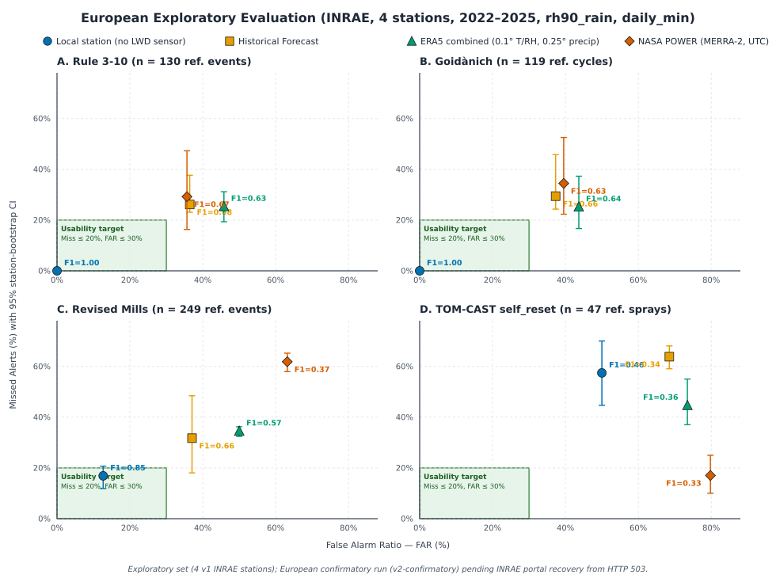
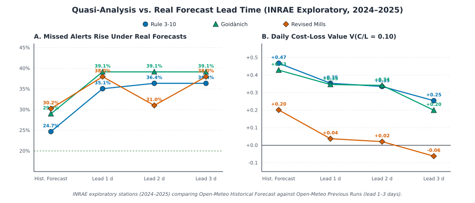

# How reliable are disease-warning alerts driven by free weather data?

**vitirule v2 technical report. Draft for review, not yet published.**

Author: Mateus Zunino Espindola, Universidade Federal de Santa Catarina (UFSC)  
Date: 22 November 2026  
Frozen tags: `v1.0`, `v1.0.1`, `v1.0.2`, `v2-rules`, `v2-freeze`, `v2-freeze-br`  
Confirmatory status: the European confirmatory run (`v2-confirmatory`) is pending. The INRAE portal on Recherche Data Gouv (`entrepot.recherche.data.gouv.fr`) still returned HTTP 503 on 22 November 2026.

> *Scope: vitirule v2 does not measure field control efficacy. It measures the reliability of the meteorological input to a disease-warning system.*

---

## Abstract

Free gridded weather data, such as reanalyses, archived forecasts and NASA POWER, are often used to run disease-warning rules where growers have no on-farm sensors. We measured how far those alerts can be trusted. Under a preregistered protocol (tags `v2-freeze` and `v2-freeze-br`), we ran four published rules as pure Python functions: Rule 3-10 and the Goidànich incubation calendar for grapevine downy mildew (*Plasmopara viticola*), the revised Mills table (MacHardy & Gadoury, 1989) for apple scab (*Venturia inaequalis*), and TOM-CAST for tomato early blight (*Alternaria solani*).

In Europe the reference was each rule fed with on-site station data, including a physical leaf wetness duration (LWD) sensor. These results come from an exploratory set of four INRAE AgroClim stations (2022-2025), plus two Politecnico di Torino stations reported descriptively under CC BY-NC 4.0; the confirmatory set has not run yet. In the exploratory set, no free gridded source met the preregistered usability criterion (missed alerts ≤ 20%, false alarm ratio ≤ 30%, median signed lag ≤ 1 day, upper 95% CI of missed alerts < 30%) for any of the four rules. Gridded sources missed 25.2% to 34.5% of Rule 3-10 and Goidànich alerts and 31.7% to 61.9% of Mills events.

A local station without the LWD sensor, using the `rh90_rain` estimator, met the criterion for revised Mills (16.9% missed, 95% CI 11.9 to 20.7; FAR 12.7%; F1 0.852). The same comparison does not apply to Rule 3-10 and Goidànich, because neither rule uses LWD, so the station input is identical to the reference. TOM-CAST failed even with the local station. A mean input deficit of -1.02 DSV per interval shifted the later spray resets, which produced 57.5% missed alerts and 50.0% FAR when the station ran on its own resets. Wet biases in ERA5 combined and NASA POWER raised TOM-CAST spray counts 2.1 to 4.1 times. Real 1-3 day forecasts (Open-Meteo Previous Runs, 2024-2025) did worse than the quasi-analysis archive, and the cost-loss value of Mills alerts fell to -0.06 at day 3.

In Santa Catarina, Brazil, 11 of the 24 INMET automatic stations were selected blindly under `v2-freeze-br`. INMET stations have no LWD sensor, so these results measure divergence between gridded sources and the station. For Mills, gridded sources left 37.6% to 59.2% of station events unmatched, with the lowest agreement at São Joaquim (1,400 m), the state's main apple-growing area. This divergence becomes an error estimate only if the European confirmatory set repeats the exploratory result. Against the same stations, gridded inputs raised TOM-CAST spray counts 1.8 to 2.5 times.

We also release a browser tool built on Pyodide. It runs the frozen rules on a grower's own station CSV, with no Python installation, and shows the measured reliability next to each alert.

---

## Resumo em português

Dados meteorológicos gratuitos em grade, como reanálises e previsões arquivadas, costumam ser usados para alimentar alertas de doenças em propriedades sem estação ou sem sensor de molhamento foliar. O vitirule v2 mede quanto se pode confiar nesses alertas e onde eles falham. O protocolo foi pré-registrado e congelado nas tags `v2-freeze` e `v2-freeze-br`. Avaliamos quatro regras publicadas, escritas como funções puras em Python: a regra 3-10 e o calendário de incubação de Goidànich para o míldio da videira, a tabela de Mills revisada para a sarna da macieira e o TOM-CAST para a pinta-preta do tomateiro. O projeto não mede eficácia de controle no campo. Ele mede a confiabilidade da entrada meteorológica de um sistema de alerta.

Na Europa, a referência é a regra alimentada com os dados da própria estação, incluindo o sensor físico de molhamento. Os resultados vêm de um conjunto exploratório com quatro estações do INRAE na França, entre 2022 e 2025, mais duas estações do Politecnico di Torino, apresentadas só de forma descritiva. O conjunto confirmatório ainda não rodou, porque o portal do INRAE segue fora do ar. No conjunto exploratório, nenhuma fonte gratuita em grade passou no critério de uso pré-registrado em nenhuma das quatro regras. As grades perderam de 25,2% a 34,5% dos alertas da 3-10 e do Goidànich. Em Mills, perderam de 31,7% a 61,9% dos eventos.

A estação local sem o sensor de molhamento passou no critério em Mills. Ela perdeu 16,9% dos eventos, com razão de alarmes falsos de 12,7% e F1 de 0,852. Na 3-10 e no Goidànich essa comparação não se aplica: as duas regras não usam molhamento, então a estação recebe exatamente a entrada da referência. O TOM-CAST falhou até com a estação local. Um viés pequeno, de -1,02 DSV por intervalo, desloca os zeramentos seguintes e leva a 57,5% de alertas perdidos quando a estação segue as próprias aplicações. Com o ERA5 combinado e o NASA POWER, o viés úmido multiplica as pulverizações de 2,1 a 4,1 vezes. Com previsões reais de 1 a 3 dias, o desempenho piora. O valor econômico dos alertas de Mills cai para -0,06 no terceiro dia.

Em Santa Catarina, 11 das 24 estações automáticas do INMET entraram por seleção às cegas, sob a tag `v2-freeze-br`. Essas estações não têm sensor de molhamento, então o resultado é a divergência entre a grade e a estação. Em Mills, as grades deixaram sem par de 37,6% a 59,2% dos eventos da estação. A pior concordância apareceu em São Joaquim, a 1.400 metros, principal polo de maçã do estado. Essa divergência só pode ser lida como erro da grade se o conjunto confirmatório europeu repetir o resultado exploratório. No TOM-CAST, as grades multiplicaram as pulverizações de 1,8 a 2,5 vezes em relação à estação.

O projeto entrega uma página que roda as regras congeladas no navegador, sobre o CSV da estação do próprio usuário, sem instalar Python. A tabela de confiabilidade medida aparece ao lado de cada alerta. Alertas calculados com dado em grade nunca aparecem como recomendação.

---

## 1. Introduction and research question

Plant disease warning rules turn hourly or daily weather into spray timing. Physical LWD sensors need maintenance and calibration, and many small farms have no weather station at all, so decision-support tools often replace station data with free gridded products such as ERA5, archived numerical forecasts or NASA POWER. This report asks one question:

> **How much can a grower trust a disease alert calculated from free weather data, and where does it fail?**

The first version of this repository (`vitirule v1`, frozen at tag `v1.0`, with errata in `v1.0.2`) evaluated downy mildew spray rules inside an epidemic simulator. Version 2 drops the simulator and measures input fidelity directly against station data. The v1 grapevine protocol stays in the repository as Case Study 1.

v2 does not measure field disease control, fungicide deposition or cultivar resistance. It measures how disease alerts change when the sensor-equipped station is replaced by the same station without its LWD sensor, or by free gridded weather.

### 1.1 Related work

Several studies have compared weather sources for disease warnings, each within one disease and one region. Duttweiler et al. (2008) compared an orchard station with an LWD sensor against a commercial site-specific estimate for sooty blotch and flyspeck of apple in Iowa and the US Midwest, using wet-hour accumulation, warning dates and field incidence. Kim, Beresford & Henshall (2008) compared measured station data with spatially interpolated estimates for grapevine botrytis in New Zealand and assessed the value of the warnings with a cost-loss model. Gleason et al. (2008) and Rowlandson et al. (2015) reviewed how LWD is obtained for warning systems and reported errors in hours of wetness per day. Asadi & Tian (2021) estimated LWD from NLDAS-2 and ERA5 reanalyses with machine learning against field sensors, without running a disease rule.

Three recent lines of work come closer. Embrapa's MAHM algorithm (Cavalcanti, 2021; Cavalcanti, Botton & Fioravanço, 2024) runs grapevine downy mildew warnings on local IoT microstations in the Serra Gaúcha, Brazil, without an LWD sensor; the algorithm is not open. The octoPus tool (Bregaglio et al., 2025) publishes eight primary-infection models for downy mildew, under a CC BY-NC-ND 4.0 licence, and focuses on the models rather than on the weather source. Mensah et al. (2026) is the closest study: it compared four weather sources (in-canopy sensor, on-farm station, Bureau of Meteorology station and the SILO grid) through a flower blight model for macadamia in Queensland over three seasons, 2022-2024.

This work adds four things to that literature: several published rules across three crops, a measured LWD reference in two European networks, a transfer to southern Brazil, and a preregistered protocol with frozen code tags and open source.

---

## 2. Protocol, preregistration and integrity audit

### 2.1 Four published disease rules

All rule parameters, literature divergences and primary citations are kept in `vitirule_v2/rules/params.json`. The rules use only the Python standard library, so the same code runs in offline Python, in CI and in the Pyodide browser tool.

1. **Rule 3-10** (grapevine downy mildew; Baldacci, 1947; Goidànich, 1964; Rossi et al., 2008). An alert fires inside the grapevine window when the local daily minimum temperature is $\ge 10.0\,^\circ\text{C}$ (Amendment 2; the daily mean of `v2-rules` is kept as a secondary analysis), the rolling 48-hour rainfall reaches $\ge 10.0\,\text{mm}$ and the trigger day has $\ge 0.2\,\text{mm}$ of rain. Consecutive qualifying days merge into one event dated by the first day.
2. **Goidànich incubation calendar** (grapevine downy mildew; Müller & Sleumer, 1934; Goidànich, 1964). Each 3-10 trigger starts an incubation cohort at 0% on the next day. Daily progress is linearly interpolated from the daily mean temperature and multiplied by $0.85$ when the daily mean RH is below 75%. The alert fires at 100%; the 80% advisory is stored as metadata.
3. **Revised Mills table** (apple scab; MacHardy & Gadoury, 1989; Stensvand et al., 1997; OMAFRA). The rule evaluates hourly wetness events inside the primary scab window that start with, or include, at least $0.2\,\text{mm}$ of rain. Wet spells separated by dry breaks of up to 8 h merge into one event that counts only wet hours; a dry break longer than 8 h resets the count. Events are classed as light, moderate or heavy.
4. **TOM-CAST** (tomato early blight; Madden et al., 1978; Pitblado, 1988, 1992; Gillespie et al., 1993). The rule computes daily Disease Severity Values (DSV, 0 to 4) over local 12:00 to 12:00 days from wet hours and the mean temperature of the wet period, rounded half up, and triggers a spray at 15 cumulative DSV. It runs in two modes: `reference_reset`, which measures input fidelity, and `self_reset`, which measures operational divergence (Section 3.2).

The same fixed phenological windows apply to the reference and to every candidate input. Northern Hemisphere: grapevine 1 April to 30 September, apple 15 March to 30 June, tomato 1 May to 30 September. Southern Hemisphere: grapevine 1 October to 31 March, apple 15 September to 31 December, tomato 1 November to 31 March.

### 2.2 Sources, LWD estimators and metrics

The European reference is the on-site station with its physical LWD sensor. All candidate sources are aligned in UTC:

1. the local station without the LWD sensor, which keeps on-site temperature, RH, rain, wind and radiation and estimates LWD with a formula;
2. ERA5 combined: temperature and RH from ERA5-Land at 0.1°, with precipitation, wind and radiation from ERA5 at 0.25°, from the Open-Meteo archive (`models=era5_seamless`, CC BY 4.0);
3. Open-Meteo Historical Forecast (`models=best_match`, CC BY 4.0), a quasi-analysis stitched from the most recent model runs;
4. NASA POWER (MERRA-2, 0.5° × 0.625°), requested with `time-standard=UTC` and checked for `header.time_standard == "UTC"`;
5. Open-Meteo Previous Runs, used only in secondary analysis B (2024-2025) for real forecasts 1, 2 and 3 days ahead.

LWD estimators live in `vitirule_v2/lwd.py`. The primary estimator is `rh90_rain` (RH ≥ 90% or rain > 0). The secondary estimators use published fixed parameters: `dpd_hysteresis` (Gillespie et al., 1993; wetness starts at a dew point depression ≤ 1.8 °C and ends at ≥ 3.8 °C) and `cart_kim2002` (Kim et al., 2002, with FAO-56 scaling of wind from 10 m to 2 m where needed).

The single primary analysis, fixed in `v2-freeze`, uses the paired 2022-2025 window, `rh90_rain`, Rule 3-10 with the daily minimum, and the `mask_with_warmup` QC policy. That policy keeps the 95% coverage floor and every physical and sensor-drift check, and masks gaps plus a rule-specific warm-up derived from `params.json`. Every other combination is secondary.

Events are matched one to one, greedily, within these tolerances: ±2 days for 3-10 and Goidànich, ±24 h on `light_ts` for Mills, and ±3 days for TOM-CAST in `self_reset`. Signed lag is $t_{\text{cand}} - t_{\text{ref}}$, so a positive lag means the candidate alerted late. The daily cost-loss analysis follows Richardson (2000) and Kim et al. (2008). It uses every unmasked season day, including correct negatives, for $r = C/L \in \{0.05, 0.10, 0.20\}$, and reports the relative value $V(r) = (E_{\text{fixed}} - E_{\text{cand}}) / (E_{\text{fixed}} - E_{\text{perf}})$, where $E_{\text{fixed}}$ is the cheaper of always or never spraying.

Confidence intervals come from a station-block bootstrap (2,000 replicates, seed `20261122`) when a network has at least three stations. With only four INRAE stations in the exploratory set, this bootstrap underestimates uncertainty, so the European intervals should be read with that caveat. The Politecnico network has two passing stations and is reported without intervals.

A source is called usable for a rule if, on the confirmatory set, missed alerts are ≤ 20%, FAR ≤ 30%, the median signed lag ≤ 1.0 day and the upper bound of the 95% CI for missed alerts < 30%.

### 2.3 Post-freeze integrity audit

1. **Rules and metrics are unchanged since `v2-freeze`.** `git diff --stat v2-freeze -- vitirule_v2/metrics.py vitirule_v2/rules/` returns no output.
2. **One change to `vitirule_v2/qc.py` since `v2-freeze-br`.** The optional parameter `require_lwd_sensor: bool = True` was added to `_is_valid_hour`, `compute_raw_gap_hours`, `compute_masked_hours_for_rule` and `evaluate_station_season_qc`. With the default value, nothing changes for networks with sensors. With `False`, used only for the INMET stations as preregistered in Section 9.1 of `v2-freeze-br`, the code skips the `rec.wet is None` check and the three LWD-sensor drift tests. The 95% coverage floor, the UTC ordering and uniqueness checks, the frozen physical bounds and `mask_with_warmup` all still apply. Across the 24 INMET stations in Santa Catarina (2022-2025), no hour fell between the frozen bounds in `qc.py` and the bounds written in Section 9.1.
3. **Two post-freeze fixes, both logged in Section 8 of the preregistration.**
   - *Open-Meteo archive model.* The first exploratory run after `v2-freeze` was inspected and showed zero alerts for 3-10, Goidànich and Mills, because `models=era5_land` returns only `null` for precipitation, wind and radiation in the Open-Meteo archive. Switching to `models=era5_seamless` fixed data collection without changing any rule, threshold or metric. The source was renamed *ERA5 combined*, and `grid_metadata` now records distance and elevation difference for both the 0.1° temperature and RH cell and the 0.25° precipitation cell.
   - *Goidànich hemisphere argument.* The first Santa Catarina run was inspected and showed zero Goidànich cohorts, because `scripts/v2_phase4_brazil.py` called `track_goidanich_incubation` without `hemisphere="southern_hemisphere"`. Passing the argument fixed the call without changing any rule or metric.

---

## 3. European results with a sensor reference (exploratory set, pending `v2-confirmatory`)

The INRAE portal (DOI `10.57745/BQ0BWB`) was still in maintenance on 22 November 2026, so the 50 additional INRAE stations have not been collected and the single confirmatory run has not happened. Every European result below comes from the exploratory set: the four INRAE stations already used in v1 (14 grapevine and tomato station-seasons and 16 apple station-seasons passing QC in 2022-2025) and the two Politecnico di Torino stations that passed QC (`site1` and `site5`, 2022). These are research and vineyard stations, not apple orchards or tomato fields, so the Mills and TOM-CAST results describe input fidelity, not crop risk at those sites.

### 3.1 Primary analysis (INRAE exploratory set, 2022-2025)

**Table 1.** Primary European exploratory evaluation (INRAE, four stations, 2022-2025, `rh90_rain`, Rule 3-10 with daily minimum, `mask_with_warmup`). *ERA5 combined* means temperature and RH from ERA5-Land (0.1°) with precipitation, wind and radiation from ERA5 (0.25°). Intervals come from a four-block bootstrap and understate uncertainty (Section 2.2).

| Rule | Candidate source | Ref / Cand | Missed (95% CI) | FAR | F1 | Median lag (IQR) | Cost-loss $V$ (0.05 / 0.10 / 0.20) | Usable in exploratory set? |
|---|---|---:|---|---:|---:|---|---|---|
| Rule 3-10 | Station without LWD sensor | n/a | n/a: input identical to reference | | | | | n/a |
| Rule 3-10 | Historical Forecast | 130 / 151 | 26.2% [23.1, 37.7] | 36.4% | 0.683 | 0.0 d [0.0, 0.0] | 0.44 / 0.43 / 0.33 | No |
| Rule 3-10 | NASA POWER | 130 / 143 | 29.2% [16.3, 47.3] | 35.7% | 0.674 | 0.0 d [0.0, 0.0] | 0.37 / 0.36 / 0.26 | No |
| Rule 3-10 | ERA5 combined | 130 / 179 | 25.4% [19.3, 31.2] | 45.8% | 0.628 | 0.0 d [0.0, 0.0] | 0.40 / 0.38 / 0.25 | No |
| Goidànich | Station without LWD sensor | n/a | n/a: input identical to reference | | | | | n/a |
| Goidànich | Historical Forecast | 119 / 134 | 29.4% [24.3, 45.8] | 37.3% | 0.664 | 0.0 d [0.0, 0.0] | 0.46 / 0.43 / 0.34 | No |
| Goidànich | ERA5 combined | 119 / 158 | 25.2% [16.7, 37.3] | 43.7% | 0.643 | 0.0 d [-1.0, 0.0] | 0.35 / 0.29 / 0.16 | No |
| Goidànich | NASA POWER | 119 / 129 | 34.5% [22.3, 52.5] | 39.5% | 0.629 | 0.0 d [0.0, 0.0] | 0.36 / 0.32 / 0.22 | No |
| Revised Mills | Station without LWD sensor | 249 / 237 | 16.9% [11.9, 20.7] | 12.7% | 0.852 | 0.0 d [0.0, 0.06] | 0.11 / 0.56 / 0.69 | Yes |
| Revised Mills | Historical Forecast | 249 / 270 | 31.7% [18.0, 48.4] | 37.0% | 0.655 | -0.04 d [-0.17, 0.04] | -0.58 / 0.20 / 0.41 | No |
| Revised Mills | ERA5 combined | 249 / 326 | 34.5% [32.4, 36.2] | 50.0% | 0.567 | -0.17 d [-0.44, -0.04] | -0.99 / -0.02 / 0.22 | No |
| Revised Mills | NASA POWER | 249 / 258 | 61.9% [58.0, 65.2] | 63.2% | 0.375 | -0.46 d [-0.71, -0.25] | -1.90 / -0.45 / -0.06 | No |
| TOM-CAST `self` | Station without LWD sensor | 47 / 40 | 57.5% [44.7, 70.0] | 50.0% | 0.460 | 0.0 d [-1.0, 1.0] | 0.13 / 0.09 / 0.00 | No |
| TOM-CAST `self` | ERA5 combined | 47 / 98 | 44.7% [37.0, 55.0] | 73.5% | 0.359 | 0.0 d [-1.0, 2.0] | 0.00 / -0.11 / -0.39 | No |
| TOM-CAST `self` | Historical Forecast | 47 / 54 | 63.8% [59.1, 68.1] | 68.5% | 0.337 | -1.0 d [-3.0, 0.0] | 0.05 / -0.01 / -0.15 | No |
| TOM-CAST `self` | NASA POWER | 47 / 193 | 17.0% [10.0, 25.0] | 79.8% | 0.325 | 0.0 d [-1.5, 1.0] | 0.08 / -0.15 / -0.68 | No |

Rule 3-10 and Goidànich use only temperature, humidity and rain, so the station without the LWD sensor receives exactly the reference input. For these two rules the study measures how far gridded data diverge from the station. It cannot say whether the station represents the vineyard, because the station is the reference.

Among matched Mills events, the severity class agreed exactly in 65.7% of cases for the station without the LWD sensor (24.6% classed lower), 51.8% for Historical Forecast, 44.8% for ERA5 combined and 31.6% for NASA POWER.

### 3.2 TOM-CAST: input fidelity and operational divergence

The two TOM-CAST modes measure different things. `reference_reset` measures input fidelity: the candidate accumulator returns to zero on every reference spray date. `self_reset` measures operational divergence: the candidate follows its own sprays, so one shifted application shifts every later reset and the phase error carries through the season.

The station without the LWD sensor shows the difference. Under `reference_reset` its mean bias is small, -1.02 DSV per interval, but that deficit keeps 61.7% of the 47 INRAE intervals from reaching 15 DSV by the reference date; only 38.3% reach it on time. Running on its own resets, the station ends with 57.5% missed alerts and 50.0% FAR. The gridded sources are already biased under `reference_reset`. Historical Forecast averaged +2.85 DSV (61.7% of intervals reached 15 DSV, median lead -10 days). ERA5 combined averaged +14.91 DSV (91.5% reached, -14 days), and its sprays rose from 47 to 98. NASA POWER averaged +38.94 DSV (100% reached, -19 days), and its sprays rose 4.1 times, from 47 to 193, with $V(0.20) = -0.68$.

### 3.3 Politecnico di Torino (descriptive only, no intervals, CC BY-NC 4.0)

The aggregates below derive from CC BY-NC 4.0 data (DOI `10.17632/sd4b8vpvyb.1`); no raw data are redistributed. Only `site1` and `site5` (2022) passed QC, so no intervals or usability tests are computed.

- Rule 3-10, 11 events: ERA5 combined missed 18.2% (FAR 25.0%, F1 0.783). Historical Forecast and NASA POWER each missed 54.6% (FAR 50.0% and 37.5%).
- Goidànich, 9 cycles: ERA5 combined missed 11.1% (FAR 27.3%, F1 0.800). Historical Forecast and NASA POWER each missed 55.6%.
- Revised Mills, 12 events: the station without the LWD sensor missed 41.7% (FAR 50.0%, F1 0.539). Gridded sources had FAR between 62.5% and 70.8% (F1 0.389 to 0.513).
- TOM-CAST, 12 sprays: the station without the LWD sensor emitted 5 sprays (-9.17 DSV mean error under `reference_reset`, 91.7% missed under `self_reset`). NASA POWER emitted 24 (+14.08 DSV, FAR 66.7%).

### 3.4 Secondary analyses

1. **Other LWD estimators.** With `dpd_hysteresis` and `cart_kim2002`, the station without the LWD sensor still passed Mills (F1 0.840 and 0.846). No gridded source passed Mills or TOM-CAST (TOM-CAST FAR 74.3% to 81.3%).
2. **Real forecasts.** Moving from Historical Forecast to real 1-3 day forecasts (Previous Runs, 2024-2025) raised missed alerts from 24.7% to 35.1%-36.4% for Rule 3-10, from 29.0% to 39.1% for Goidànich and from 30.2% to 38.0% for Mills. For Mills, FAR rose to 50.0% and $V(0.10)$ fell from +0.20 to -0.06 at day 3 (Figure 3).
3. **Long series, strict QC and daily-mean 3-10.** The 2019-2025 series without Historical Forecast, the `reject_24h` QC policy and Rule 3-10 with the daily mean all gave the same source ranking and the same usability verdicts.

---

## 4. Transfer to Santa Catarina, Brazil (`v2-freeze-br`, public INMET data)

### 4.1 Blind selection of the 24 INMET automatic stations

The addendum frozen in `v2-freeze-br` before any Brazilian data were downloaded selects stations with two filters: (i) the municipality had harvested area in apple, grape or tomato in IBGE PAM 2025 (SIDRA table 5457), and (ii) the station passed blind QC (`require_lwd_sensor=False`, `mask_with_warmup`) in at least two Southern Hemisphere seasons. Every QC failure among the 24 stations was `coverage_below_0.95`.

**Table 2.** Selection and QC audit of the 24 INMET automatic stations in Santa Catarina (2022-2025).

| WMO | Municipality / Station | IBGE PAM 2025 producer? | Harvested area: apple / grape / tomato (ha) | QC failures and criterion | `v2-freeze-br` outcome |
|---|---|---|---|---|---|
| `A806` | Florianópolis | No | 0 / 0 / 0 | Apple 1/4, grape 1/3, tomato 1/3 (`coverage_below_0.95`) | Excluded (IBGE filter) |
| `A814` | Urussanga | Yes | 0 / 102 / 0 | Apple 3/4, grape 1/3, tomato 1/3 (`coverage_below_0.95`) | Included: grape, tomato |
| `A815` | São Joaquim | Yes | 9,600 / 201 / 0 | Apple 2/4, grape 1/3, tomato 1/3 (`coverage_below_0.95`) | Included: apple, grape, tomato |
| `A816` | Novo Horizonte | Yes | 0 / 0 / 1 | Apple 2/4, grape 2/3, tomato 2/3 (`coverage_below_0.95`) | Included: apple |
| `A817` | Indaial | Yes | 0 / 0 / 20 | Apple 3/4, grape 2/3, tomato 1/3 (`coverage_below_0.95`) | Included: tomato |
| `A841` | Joaçaba | Yes | 0 / 3 / 0 | Apple 4/4, grape 2/3, tomato 2/3 (`coverage_below_0.95`) | Excluded (QC `< 2` seasons) |
| `A845` | Bom Jardim da Serra (Morro da Igreja) | Yes | 1,450 / 1 / 0 | Apple 3/4, grape 2/3, tomato 2/3 (`coverage_below_0.95`) | Excluded (QC `< 2` seasons) |
| `A848` | Dionísio Cerqueira | Yes | 0 / 3 / 0 | Apple 3/4, grape 1/3, tomato 1/3 (`coverage_below_0.95`) | Included: grape, tomato |
| `A851` | Itapoá | No | 0 / 0 / 0 | Apple 1/4, grape 1/3, tomato 1/3 (`coverage_below_0.95`) | Excluded (IBGE filter) |
| `A857` | São Miguel do Oeste | Yes | 0 / 2 / 0 | Apple 4/4, grape 3/3, tomato 3/3 (`coverage_below_0.95`) | Excluded (QC 0 valid) |
| `A858` | Xanxerê | No | 0 / 0 / 0 | Apple 3/4, grape 1/3, tomato 1/3 (`coverage_below_0.95`) | Excluded (IBGE filter) |
| `A859` | Caçador | Yes | 85 / 425 / 450 | Apple 2/4, grape 1/3, tomato 1/3 (`coverage_below_0.95`) | Included: apple, grape, tomato |
| `A860` | Curitibanos | Yes | 0 / 8 / 0 | Apple 2/4, grape 1/3, tomato 0/3 (`coverage_below_0.95`) | Included: apple, grape, tomato |
| `A861` | Rio do Campo | Yes | 0 / 2 / 0 | Apple 3/4, grape 2/3, tomato 1/3 (`coverage_below_0.95`) | Included: tomato |
| `A862` | Rio Negrinho | No | 0 / 0 / 0 | Apple 4/4, grape 3/3, tomato 2/3 (`coverage_below_0.95`) | Excluded (IBGE filter) |
| `A863` | Ituporanga | Yes | 0 / 5 / 15 | Apple 1/4, grape 1/3, tomato 1/3 (`coverage_below_0.95`) | Included: apple, grape, tomato |
| `A864` | Major Vieira | Yes | 8 / 3 / 25 | Apple 4/4, grape 3/3, tomato 2/3 (`coverage_below_0.95`) | Excluded (QC `< 2` seasons) |
| `A865` | Lages | Yes | 0 / 14 / 9 | Apple 4/4, grape 3/3, tomato 2/3 (`coverage_below_0.95`) | Excluded (QC `< 2` seasons) |
| `A866` | Laguna (Farol de Santa Marta) | No | 0 / 0 / 0 | Apple 4/4, grape 3/3, tomato 2/3 (`coverage_below_0.95`) | Excluded (IBGE filter) |
| `A867` | Araranguá | No | 0 / 0 / 0 | Apple 4/4, grape 2/3, tomato 2/3 (`coverage_below_0.95`) | Excluded (IBGE filter) |
| `A868` | Itajaí | No | 0 / 0 / 0 | Apple 1/4, grape 1/3, tomato 1/3 (`coverage_below_0.95`) | Excluded (IBGE filter) |
| `A870` | Rancho Queimado | Yes | 0 / 6 / 120 | Apple 4/4, grape 3/3, tomato 3/3 (`coverage_below_0.95`, 0% cov.) | Excluded (QC 0% cov.) |
| `A895` | Chapecó | Yes | 0 / 50 / 0 | Apple 2/4, grape 1/3, tomato 1/3 (`coverage_below_0.95`) | Included: apple, grape, tomato |
| `A898` | Campos Novos | Yes | 0 / 20 / 0 | Apple 1/4, grape 0/3, tomato 0/3 (`coverage_below_0.95`) | Included: apple, grape, tomato |

In total, 11 stations entered at least one crop: 7 stations and 16 station-seasons for apple (Mills), 8 stations and 17 station-seasons for grapevine (3-10 and Goidànich), and 10 stations and 22 station-seasons for tomato (TOM-CAST).

### 4.2 Revised Mills: divergence against the INMET station

`v2-confirmatory` has not run, so the Mills comparison in Santa Catarina is divergence against the INMET station. It becomes a candidate estimate of grid error only if the European confirmatory set repeats the exploratory result. The usability criterion was defined against measured leaf wetness; here it is applied to a surrogate reference, the INMET station with `rh90_rain`, which missed 16.9% of Mills events in the European exploratory set. Part of the divergence below may come from the surrogate itself.

**Table 3.** Gridded sources against INMET automatic stations in Santa Catarina (2022-2025, `v2-freeze-br`). For Mills the result is divergence and a candidate error estimate pending `v2-confirmatory`; for Rule 3-10, Goidànich and TOM-CAST it is divergence only.

| Rule | Gridded source | INMET / Grid | Unmatched INMET events (95% CI) | Extra ratio | F1 | Median shift (IQR) | Cost-loss $V$ (0.05 / 0.10 / 0.20) |
|---|---|---:|---|---:|---:|---|---|
| Revised Mills (candidate error) | ERA5 combined | 306 / 285 | 37.6% [29.1, 42.4] | 33.0% | 0.646 | -0.13 d [-0.29, +0.04] | -2.03 / -0.51 / +0.26 |
| Revised Mills (candidate error) | Historical Forecast | 306 / 283 | 37.9% [30.9, 46.8] | 32.9% | 0.645 | -0.08 d [-0.25, 0.00] | -1.94 / -0.46 / +0.28 |
| Revised Mills (candidate error) | NASA POWER | 306 / 202 | 59.2% [51.4, 64.3] | 38.1% | 0.492 | -0.38 d [-0.58, -0.25] | -3.37 / -1.14 / -0.02 |
| Rule 3-10 (divergence) | NASA POWER | 299 / 256 | 26.4% [22.5, 31.5] | 14.1% | 0.793 | 0.0 d [0.0, 0.0] | -0.65 / 0.18 / 0.35 |
| Rule 3-10 (divergence) | ERA5 combined | 299 / 292 | 22.4% [18.0, 27.2] | 20.5% | 0.785 | 0.0 d [0.0, 0.0] | -0.50 / 0.25 / 0.39 |
| Rule 3-10 (divergence) | Historical Forecast | 299 / 292 | 26.4% [22.0, 31.9] | 24.7% | 0.745 | 0.0 d [0.0, 0.0] | -0.66 / 0.17 / 0.32 |
| Goidànich (divergence) | ERA5 combined | 254 / 252 | 20.5% [15.4, 25.5] | 19.8% | 0.798 | 0.0 d [-0.75, 0.0] | -0.23 / 0.36 / 0.28 |
| Goidànich (divergence) | NASA POWER | 254 / 218 | 29.5% [23.9, 34.3] | 17.9% | 0.758 | 0.0 d [-1.0, 0.0] | -0.59 / 0.19 / 0.10 |
| Goidànich (divergence) | Historical Forecast | 254 / 250 | 25.2% [19.6, 31.3] | 24.0% | 0.754 | 0.0 d [-1.0, 0.0] | -0.39 / 0.28 / 0.19 |
| TOM-CAST `self` (divergence) | Historical Forecast | 186 / 326 | 8.1% [4.0, 13.9] | 47.5% | 0.668 | -1.0 d [-2.0, 1.0] | -0.19 / -0.02 / -0.24 |
| TOM-CAST `self` (divergence) | ERA5 combined | 186 / 350 | 7.0% [2.0, 15.0] | 50.6% | 0.645 | 0.0 d [-2.0, 1.0] | -0.15 / 0.01 / -0.23 |
| TOM-CAST `self` (divergence) | NASA POWER | 186 / 464 | 0.5% [0.0, 2.4] | 60.1% | 0.569 | 0.0 d [-1.0, 1.0] | -0.16 / -0.04 / -0.35 |

No gridded source came within the usability thresholds for Mills against the INMET surrogate. Among matched Mills events, gridded sources classed severity too high in 33.2% to 40.0% of cases. Under TOM-CAST `reference_reset`, all 186 INMET intervals reached 15 DSV early with every gridded source: +11.38 DSV for Historical Forecast, +13.16 DSV for ERA5 combined and +21.41 DSV for NASA POWER, with median leads of -3 to -4 days. Under `self_reset` that bias raised spray counts 1.8 to 2.5 times.

### 4.3 Relief and summer convective rainfall (exploratory)

This diagnosis is exploratory under Section 9.3 of `v2-freeze-br`. Santa Catarina has steep relief, and the station and the centre of the precipitation grid cell can sit at very different heights: from -425 m at Novo Horizonte to +299 m at Rio do Campo for the 0.25° ERA5 cell, and from +427 m at Urussanga to -408 m at São Joaquim for the NASA POWER cell. São Joaquim (`A815`, 1,400 m; 9,600 ha of apples in IBGE PAM 2025) had the lowest Mills F1 in the state for Historical Forecast (0.494) and NASA POWER (0.381). Across the seven apple stations, Mills F1 was negatively associated with station elevation (Spearman -0.50 and -0.43 for those two sources). Ituporanga (480 m, in a narrow valley) also had low agreement (F1 0.470 to 0.641). Intense summer rain (≥ 10 mm/h) made up 27.2% (São Joaquim) to 46.9% (Dionísio Cerqueira) of October-March rainfall. With seven stations, elevation and the share of convective rain cannot be separated, so these associations do not show a cause.

---

## 5. Practical guidance, browser tool and public CI

### 5.1 What growers and system designers can take from this

These points rest on the European exploratory set and on divergence in Santa Catarina. They need the European confirmatory set before they can be stated as findings.

1. For these four rules, free gridded weather data should not drive spray decisions on their own. The main problems were rain placed in the wrong spot on 0.25° to 0.625° grids and a wet bias in humidity. Real 1-3 day forecasts did worse than the archive.
2. For revised Mills, a local station with temperature, humidity and rain, using `rh90_rain` in place of the LWD sensor, met the usability criterion in the European exploratory set.
3. For Rule 3-10 and Goidànich, gridded data missed 25% to 35% of the station's alerts in Europe and left 20.5% to 29.5% unmatched in Santa Catarina. Whether a station represents the vineyard around it is outside what this study measures.
4. For TOM-CAST, none of the three tested LWD estimators substituted for the physical sensor.

### 5.2 Browser tool and reproducibility CI

- **Browser tool (`docs/app/`).** The page loads the frozen `vitirule_v2/rules/` and `vitirule_v2/lwd.py` code from `docs/app/vitirule_bundle.json`, which automated tests check byte for byte against the repository, and runs it in the user's browser through Pyodide. The main tab takes the user's own station CSV, in a generic format or the official INMET format, and shows each alert next to the measured reliability table. A second tab compares the uploaded CSV with ERA5 combined and is labelled as a divergence demonstration, not spray advice.
- **GitHub Actions (`.github/workflows/v2_reproduce.yml`).** A manually triggered workflow runs the v2 tests, re-runs the Santa Catarina transfer from public data (INMET, IBGE PAM, Open-Meteo and NASA POWER), exports the public tables and `fig4_santa_catarina_transfer.svg` with `--public-only`, checks that no Politecnico data reach the outputs and uploads the result as an artifact.

---

## 6. Limitations and next steps

1. **The European confirmatory set has not run.** When the INRAE portal returns and the dataset licence is confirmed, every new INRAE station that passes blind QC will run once under the tag `v2-confirmatory`.
2. **The INRAE dataset licence is unconfirmed.** The literal licence of DOI `10.57745/BQ0BWB` could not be read while the portal was down. This report uses only aggregates derived from those data.
3. **Few stations in the exploratory set.** Four INRAE stations give a bootstrap that understates uncertainty, and the two Politecnico stations allow description only.
4. **Station-based reference for rules without LWD.** For Rule 3-10 and Goidànich the station is the reference, so the study cannot assess how well a station represents a nearby vineyard.
5. **Stations are not crop fields.** The INRAE and Politecnico stations are not apple orchards or tomato fields, so the Mills and TOM-CAST results describe input fidelity, not local crop risk.
6. **No LWD sensors in Santa Catarina yet.** Measuring grid error against physical sensors in southern Brazil depends on a data request to Epagri/Ciram. No Epagri/Ciram reader will be written until the files and their format arrive.
7. **Case Study 1.** The v1 downy mildew protocol stays frozen at `v1.0`, with the analysis-by-analysis errata in `v1.0.2`.

---

## References

- Alduchov, O. A., & Eskridge, R. E. (1996). Improved Magnus form approximation of saturation vapor pressure. *Journal of Applied Meteorology*, 35(4), 601-609. https://doi.org/10.1175/1520-0450(1996)035<0601:IMFAOS>2.0.CO;2
- Asadi, P., & Tian, D. (2021). *Agricultural and Forest Meteorology*, 307, 108548. https://doi.org/10.1016/j.agrformet.2021.108548
- Baldacci, E. (1947). Epifitie di *Plasmopara viticola* (1941-46) nell'Oltrepò Pavese ed adozione del calendario di incubazione come strumento di lotta. *Atti dell'Istituto Botanico della Università di Pavia*, Serie 5, 8, 45-85.
- Bregaglio, S., Del Cavallo, E., Ascari, L., & Rossi, E. (2025). *SoftwareX*, 30, 102085. https://doi.org/10.1016/j.softx.2025.102085
- Cavalcanti, F. R. (2021). Embrapa Uva e Vinho, Circular Técnica 124. https://www.infoteca.cnptia.embrapa.br/infoteca/handle/doc/1134000
- Cavalcanti, F. R., Botton, M., & Fioravanço, J. C. (2024). Embrapa Uva e Vinho, Boletim de Pesquisa e Desenvolvimento 30. https://www.infoteca.cnptia.embrapa.br/infoteca/handle/doc/1165921
- Duttweiler, K. B., Gleason, M. L., Dixon, P. M., Sutton, T. B., McManus, P. S., & Monteiro, J. E. B. A. (2008). *Plant Disease*, 92(8), 1215-1222. https://doi.org/10.1094/PDIS-92-8-1215
- Gillespie, T. J., Srivastava, B., & Pitblado, R. E. (1993). Using operational weather data to schedule fungicide sprays on tomatoes in southern Ontario, Canada. *Journal of Applied Meteorology*, 32(3), 567-573. https://doi.org/10.1175/1520-0450(1993)032<0567:UOWDTS>2.0.CO;2
- Gleason, M. L., et al. (2008). *Scientia Agricola*, 65(special issue), 76-87. https://doi.org/10.1590/S0103-90162008000700013
- Goidànich, G. (1964). *Manuale di Patologia Vegetale*, Vol. II. Edagricole, Bologna.
- IBGE. (2026). *Produção Agrícola Municipal (PAM 2025), Tabela SIDRA 5457: área colhida por município em Santa Catarina*. https://servicodados.ibge.gov.br/api/v3/agregados/5457/metadados
- INMET. (2026). *Banco de Dados Meteorológicos, arquivos históricos anuais (2022-2025)*. https://portal.inmet.gov.br/dadoshistoricos
- Kim, K. S., Beresford, R. M., & Henshall, W. R. (2008). Prediction of disease risk using site-specific estimates of weather variables. *New Zealand Plant Protection*, 61, 296-300. https://doi.org/10.30843/nzpp.2008.61.6839
- Kim, K. S., Taylor, S. E., Gleason, M. L., & Koehler, K. J. (2002). Model to enhance site-specific estimation of leaf wetness duration. *Plant Disease*, 86(2), 179-185. https://doi.org/10.1094/PDIS.2002.86.2.179
- MacHardy, W. E., & Gadoury, D. M. (1989). A revision of Mills's criteria for predicting apple scab infection periods. *Phytopathology*, 79(3), 304-310. https://doi.org/10.1094/Phyto-79-304
- Madden, L., Pennypacker, S. P., & MacNab, A. A. (1978). FAST, a forecast system for *Alternaria solani* on tomato. *Phytopathology*, 68(9), 1354-1358. https://doi.org/10.1094/Phyto-68-1354
- Mensah, T. A., White, N., Rincón-Flórez, V., & Akinsanmi, O. A. (2026). Weather data sources influence predictive performance of disease forecasting models. *International Journal of Biometeorology*, 70, 238. https://doi.org/10.1007/s00484-026-03285-3
- Müller, K., & Sleumer, H. (1934). Biologische Untersuchungen über die Peronosporakrankheit des Weinstockes. *Landwirtschaftliche Jahrbücher*, 79, 509-576.
- Pitblado, R. E. (1992). *The development and implementation of TOM-CAST: A weather-timed fungicide spray program for field tomatoes*. Ontario Ministry of Agriculture and Food, Ridgetown College.
- Richardson, D. S. (2000). Skill and relative economic value of the ECMWF ensemble prediction system. *Quarterly Journal of the Royal Meteorological Society*, 126(563), 649-667. https://doi.org/10.1002/qj.49712656313
- Rossi, V., Caffi, T., Giosuè, S., & Bugiani, R. (2008). A mechanistic model simulating primary infections of downy mildew in grapevine. *Ecological Modelling*, 212(3-4), 480-491. https://doi.org/10.1016/j.ecolmodel.2007.10.046
- Rowlandson, T., et al. (2015). *Plant Disease*, 99(3), 310-319. https://doi.org/10.1094/PDIS-05-14-0529-FE
- Stensvand, A., Gadoury, D. M., Amundsen, T., Semb, L., & Seem, R. C. (1997). Ascospore release and infection of apple leaves by conidia and ascospores of *Venturia inaequalis* at low temperatures. *Phytopathology*, 87(10), 1046-1053. https://doi.org/10.1094/PHYTO.1997.87.10.1046
