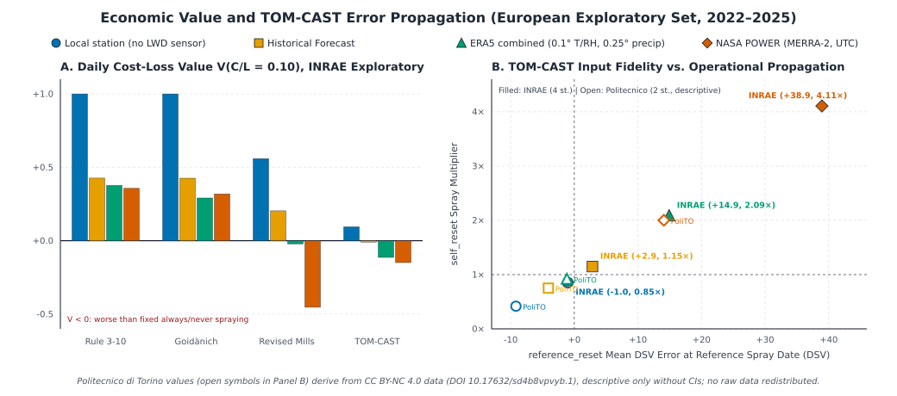
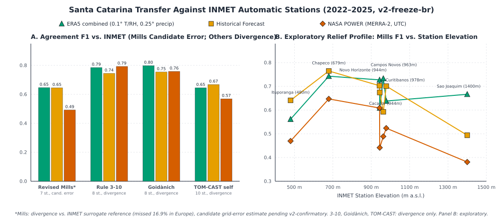

# How Reliable Are Disease-Warning Alerts Driven by Free Meteorological Data?

**vitirule v2 Technical Report — DRAFT FOR REVIEW (Not Yet Published)**

**Author:** Mateus Zunino Espindola (Universidade Federal de Santa Catarina — UFSC)  
**Date:** November 22, 2026  
**Frozen Tags:** `v1.0`, `v1.0.1`, `v1.0.2`, `v2-rules`, `v2-freeze`, `v2-freeze-br`  
**Confirmatory Status:** European confirmatory run (`v2-confirmatory`) pending recovery of the INRAE Recherche Data Gouv portal (`entrepot.recherche.data.gouv.fr`, HTTP 503 as of 22 Nov 2026).

> **Scope Statement:** *vitirule v2 does not measure field control efficacy. It measures the reliability of the meteorological input to a disease-warning system.*

---

## Abstract

Free global weather datasets—reanalyses, archived numerical weather forecasts, and satellite-assimilated products—are widely proposed as zero-cost inputs to crop disease warning systems for growers who lack on-farm sensors. Using a preregistered experimental protocol (`v2-freeze`, `v2-freeze-br`), we evaluate four published plant-disease warning rules implemented as dependency-free pure Python functions: Rule 3-10 and the Goidànich incubation calendar for grapevine downy mildew (*Plasmopara viticola*), the revised Mills table (MacHardy & Gadoury, 1989) for apple scab (*Venturia inaequalis*), and TOM-CAST for tomato early blight (*Alternaria solani*). In Europe (exploratory set: 4 INRAE AgroClim stations in 2022–2025; 2 Politecnico di Torino stations reported descriptively under CC BY-NC 4.0 without confidence intervals), alerts driven by each candidate source are benchmarked against the same rule fed with on-site station measurements including a physical leaf-wetness duration (LWD) sensor. **No free gridded source met the preregistered usability criterion (missed alerts ≤ 20%, false alarm ratio ≤ 30%, median signed lag ≤ 1 day, and upper 95% CI of missed alerts < 30%) on any of the four rules.** In contrast, keeping a local weather station while replacing only the physical LWD sensor with a simple relative-humidity-and-rain rule (`rh90_rain`) preserved identical inputs for Rule 3-10 and Goidànich and passed the usability criterion on Revised Mills in the European exploratory set (16.9% missed alerts, 95% CI [11.9, 20.7]; FAR 12.7%; F1 0.852; daily cost-loss value $V(0.10) = 0.56$), subject to future confirmation in `v2-confirmatory`. TOM-CAST failed operationally even with a local station without an LWD sensor: a small `-1.02` DSV mean input deficit under synchronized resets (`reference_reset`) desynchronized subsequent spray resets in autonomous mode (`self_reset`), yielding 57.5% missed alerts and 50.0% FAR, while wet biases in ERA5 combined and NASA POWER multiplied spray counts by 2.1× to 4.1× with negative economic value. Under true 1–3 day forecasts (`Open-Meteo Previous Runs`, 2024–2025), performance degraded further relative to quasi-analysis (`Historical Forecast`), pushing Mills economic value to $-0.06$ at day 3. Transferring the frozen protocol to 24 official INMET automatic stations in Santa Catarina, Brazil (`v2-freeze-br`; 11 producing-municipality stations selected blindly across 2022–2025), no gridded source met the usability thresholds even against the INMET surrogate reference in Revised Mills (37.6%–59.2% unmatched events; worst at São Joaquim at 1,400 m elevation, where NASA POWER F1 fell to 0.381), and TOM-CAST again multiplied sprays by 1.8× to 2.5×. We release a serverless Pyodide browser tool that runs the frozen pure-Python rules locally on a grower's own station CSV alongside the measured reliability table.

---

## Resumo em Português

Dados meteorológicos gratuitos em grade, como reanálises e previsões arquivadas, costumam ser propostos como alternativa sem custo para alimentar alertas fitossanitários em propriedades sem estação meteorológica ou sem sensor de molhamento foliar. Sob um protocolo experimental pré-registrado e congelado nas tags `v2-freeze` e `v2-freeze-br`, o vitirule v2 avalia quanto se pode confiar nesses alertas e onde eles falham, implementando quatro regras clássicas publicadas como funções puras em Python: Regra 3-10 e calendário de Goidànich para o míldio da videira, tabela de Mills revisada para a sarna da macieira e TOM-CAST para a pinta-preta do tomateiro. O vitirule v2 não mede eficácia de controle no campo; ele mede exclusivamente a confiabilidade da entrada meteorológica de um sistema de alerta.

Na avaliação exploratória europeia de 2022 a 2025 sobre quatro estações do INRAE na França e duas estações aprovadas do Politecnico di Torino na Itália em caráter descritivo sem intervalos de confiança sob licença CC BY-NC 4.0, nenhuma fonte gratuita em grade passou no critério pré-registrado de usabilidade em nenhuma das quatro regras. A estação local sem sensor de molhamento com estimador `rh90_rain` manteve entrada idêntica para 3-10 e Goidànich e passou no critério exploratório em Mills revisada, perdendo 16,9% dos eventos com razão de alarmes falsos de 12,7% e F1 de 0,852, resultado ainda sujeito ao conjunto confirmatório `v2-confirmatory` assim que o portal do INRAE sair da manutenção em HTTP 503. No TOM-CAST, até a estação local sem sensor falhou em operação autônoma porque um pequeno viés de `-1,02` DSV por intervalo desloca os zeramentos seguintes e eleva os alertas perdidos para 57,5%, enquanto o ERA5 combinado e o NASA POWER multiplicam as pulverizações em 2 a 4 vezes com valor econômico negativo. Na transferência para Santa Catarina sob `v2-freeze-br`, selecionando às cegas 11 de 24 estações automáticas do INMET em municípios produtores pela PAM 2025 do IBGE, os mesmos limites se repetiram: em Mills, a divergência contra a estação do INMET, candidata a estimativa de erro caso o conjunto confirmatório europeu repita o resultado exploratório, variou de 37,6% a 59,2% de eventos sem par, com o pior desempenho no polo de São Joaquim a 1.400 metros de altitude; em 3-10, Goidànich e TOM-CAST, a divergência confirmou o excesso de pulverizações nas grades. O projeto entrega uma página estática em Pyodide que executa as regras congeladas no navegador sobre o CSV da própria estação do usuário, exibindo a tabela de confiabilidade medida ao lado sem nunca apresentar alertas de grade como recomendação.

---

## 1. Introduction and Research Question

Plant disease warning rules translate hourly or daily weather into spray timing decisions. Because physical leaf-wetness duration (LWD) sensors require maintenance and calibration—and many smallholders lack even a basic on-farm weather station—decision-support tools increasingly substitute free gridded weather products such as ERA5, archived numerical forecasts, or NASA POWER. Yet a critical empirical question is rarely answered with a preregistered benchmark:

> **How much can a grower trust a disease alert calculated from free meteorological data, and where does it fail?**

The earlier version of this repository (`vitirule v1`, frozen at tag `v1.0` with forensic Errata `v1.0.2`) evaluated downy-mildew spray rules inside a compartmental epidemic simulator. Version 2 shifts the core of the project away from epidemic simulation toward direct measurement of meteorological input fidelity. The v1 grapevine protocol remains frozen in the repository as Case Study 1.

**What v2 does not measure:** vitirule v2 does not measure field disease control efficacy, fungicide deposition, or cultivar resistance. It measures the reliability of the meteorological input to a disease-warning system when sensor-equipped station observations are replaced by a sensorless local station or free gridded weather sources.

---

## 2. Experimental Protocol, Preregistration, and Integrity Audit

### 2.1 Four Published Disease Rules (Pure Python, Zero External Dependencies)

All rule parameters, literature divergences, and primary citations are centralized in `vitirule_v2/rules/params.json` and implemented using only the Python standard library so that the exact same code runs in offline Python, CI, and the Pyodide browser tool:

1. **Rule 3-10** (grapevine downy mildew; Baldacci, 1947; Goidànich, 1964; Rossi et al., 2008): triggers a primary infection alert inside the fixed grapevine window when local daily minimum temperature is $\ge 10.0\,^\circ\text{C}$ (Amendment 2; original `v2-rules` daily mean retained as secondary), rolling 48-hour rainfall reaches $\ge 10.0\,\text{mm}$, and daily rainfall on the trigger day is $\ge 0.2\,\text{mm}$. Consecutive qualifying days merge into one event dated by the first trigger day.
2. **Goidànich incubation calendar** (grapevine downy mildew; Müller & Sleumer, 1934; Goidànich, 1964): each 3-10 trigger launches an incubation cohort at 0% on the following day, accumulating daily progress linearly interpolated from daily mean temperature, scaled by $0.85$ when daily mean RH $< 75\%$. The primary alert fires upon reaching 100% (80% advisory stored as metadata).
3. **Revised Mills table** (apple scab; MacHardy & Gadoury, 1989; Stensvand et al., 1997; OMAFRA): evaluates hourly wetness events inside the primary apple-scab window initiated or accompanied by $\ge 0.2\,\text{mm}$ of rainfall. Wet spells separated by dry interruptions $\le 8\,\text{h}$ merge into one event counting only wet hours; dry breaks $> 8\,\text{h}$ reset the counter. Events are classified as light, moderate, or heavy.
4. **TOM-CAST** (tomato early blight; Madden et al., 1978; Pitblado, 1988, 1992; Gillespie et al., 1993): computes daily Disease Severity Values (DSV, 0–4) over local 12:00–12:00 days from wet hours and wet-period mean temperature rounded half-up, triggering a spray at 15 cumulative DSV. Evaluated in both **`reference_reset`** (input fidelity) and **`self_reset`** (operational divergence) modes.

Fixed phenological windows are applied identically to reference and candidate inputs: Northern Hemisphere (grapevine Apr 1–Sep 30, apple Mar 15–Jun 30, tomato May 1–Sep 30) and Southern Hemisphere (grapevine Oct 1–Mar 31, apple Sep 15–Dec 31, tomato Nov 1–Mar 31).

### 2.2 Candidate Sources, LWD Estimators, and Matching/Economic Metrics

- **Reference (Europe):** On-site weather station with physical LWD sensor.
- **Candidate sources (all aligned in UTC):**
  1. *Local station without LWD sensor* (keeps on-site $T$, RH, rain, wind, radiation; estimates LWD via formula).
  2. *ERA5 combined: T and RH from ERA5-Land (0.1°), precipitation, wind, and radiation from ERA5 (0.25°)* via Open-Meteo Archive (`models=era5_seamless`, CC BY 4.0).
  3. *Open-Meteo Historical Forecast* (`models=best_match`, CC BY 4.0; quasi-analysis stitched from most recent initializations).
  4. *NASA POWER* (MERRA-2, $0.5^\circ \times 0.625^\circ$, explicitly forcing `time-standard=UTC` and asserting `header.time_standard == "UTC"`).
  5. *Open-Meteo Previous Runs* (2024–2025 secondary analysis B: true 1-, 2-, and 3-day forecast horizons).
- **LWD estimators (`vitirule_v2/lwd.py`):** primary `rh90_rain` ($\text{RH} \ge 90\%$ or rain $> 0$); secondary published fixed-parameter estimators `dpd_hysteresis` (Gillespie et al., 1993: onset $\text{DPD} \le 1.8\,^\circ\text{C}$, drying $\text{DPD} \ge 3.8\,^\circ\text{C}$) and `cart_kim2002` (Kim et al., 2002, with FAO-56 10 m to 2 m wind scaling where needed).
- **Single primary analysis (`v2-freeze`):** paired 2022–2025 window, `rh90_rain`, Rule 3-10 `daily_min`, and QC `mask_with_warmup` ($\ge 95\%$ coverage, all physical/drift sensor checks retained, gaps masked plus rule-specific warm-up memory derived from `params.json`). All other combinations are secondary.
- **Event matching, daily cost-loss, and usability criterion:** greedy 1-to-1 matching within agronomically justified tolerances ($\pm 2\,\text{d}$ for 3-10 and Goidànich, $\pm 24\,\text{h}$ on `light_ts` for Mills, $\pm 3\,\text{d}$ for TOM-CAST `self_reset`). Signed lag is $t_{\text{cand}} - t_{\text{ref}}$ (positive = late). Daily cost-loss follows Richardson (2000) and Kim et al. (2008) over all unmasked season days including correct negatives ($d$) for $r = C/L \in \{0.05, 0.10, 0.20\}$, giving relative economic value $V(r) = (E_{\text{fixed}} - E_{\text{cand}}) / (E_{\text{fixed}} - E_{\text{perf}})$. Station-block bootstrap (2,000 replicates, seed `20261122`) produces 95% CIs whenever a network has $\ge 3$ stations; networks with $< 3$ stations (Politecnico, 2 passing stations) are reported strictly descriptively without CIs. A source is classified **usable** if, on the confirmatory set, missed alerts $\le 20\%$, FAR $\le 30\%$, median signed lag $\le 1.0\,\text{d}$, and upper 95% CI of missed alerts $< 30\%$.

### 2.3 Post-Freeze Code Integrity Audit and Transparent Disclosures

To verify strict adherence to the preregistered freeze tags (`v2-freeze`, `v2-freeze-br`):

1. **Zero changes to rules or metrics since `v2-freeze`:** `git diff --stat v2-freeze -- vitirule_v2/metrics.py vitirule_v2/rules/` returns empty output (0 lines modified).
2. **Audit of `git diff v2-freeze-br -- vitirule_v2/qc.py`:** the sole change is the optional parameter `require_lwd_sensor: bool = True` added to `_is_valid_hour`, `compute_raw_gap_hours`, `compute_masked_hours_for_rule`, and `evaluate_station_season_qc`. Under the default (`True`), zero criteria or behaviors change for sensor networks. Under `False` (used exclusively for sensorless INMET stations as preregistered in Section 9.1 of `v2-freeze-br`), only the `rec.wet is None` requirement and the three physical LWD-sensor drift checks are skipped, preserving the 95% coverage floor, UTC monotonicity/uniqueness checks, frozen physical bounds, and `mask_with_warmup`. Across all 24 INMET Santa Catarina stations (2022–2025), exactly **0 hours** fell in the gap between the frozen bounds in `qc.py` and the textual bounds noted in Section 9.1.
3. **Section 8 post-freeze technical fixes (both logged before final synthesis):**
   - *Open-Meteo Archive parameter (`models=era5_land` $\to$ `era5_seamless`):* an initial exploratory run after `v2-freeze` was inspected and showed zero alerts on 3-10, Goidànich, and Mills because `models=era5_land` returns 100% `null` for precipitation, wind, and radiation in Open-Meteo Archive. Switching to `models=era5_seamless` was strictly a data-collection fix with zero change to any rule, threshold, or metric; the source was renamed **ERA5 combined: T and RH from ERA5-Land, precipitation, wind, and radiation from ERA5**, and `grid_metadata` now logs distance and elevation difference for both the `0.1°` T/RH cell and the `0.25°` ERA5 precipitation cell.
   - *Goidànich hemisphere argument in `scripts/v2_phase4_brazil.py`:* an initial Santa Catarina run was inspected and showed zero Goidànich cohorts because `track_goidanich_incubation` was called without `hemisphere="southern_hemisphere"`. Passing the argument explicitly was strictly a caller bug fix with zero change to any rule or metric.

---

## 3. European Sensor-Referenced Results (Exploratory Set, Pending `v2-confirmatory`)

Because the INRAE portal (`entrepot.recherche.data.gouv.fr`, DOI `10.57745/BQ0BWB`) remained in HTTP 503 maintenance through 22 Nov 2026, all 50 additional INRAE stations remain uncollected and the single-shot confirmatory run (`v2-confirmatory`) is pending. All European results below come from the **exploratory set**: the 4 INRAE stations used in v1 (14 grapevine/tomato station-seasons and 16 apple station-seasons passing QC in 2022–2025) and the 2 passing Politecnico di Torino stations (`site1` and `site5`, 2022). Station-level scope applies: INRAE and Politecnico stations are research/vineyard stations rather than commercial apple orchards or tomato fields, so Mills and TOM-CAST measure input fidelity rather than local agronomic crop risk.

### 3.1 Primary Analysis (INRAE Exploratory, 2022–2025)

**Table 1.** Primary European exploratory evaluation (INRAE, 4 stations, 2022–2025, `rh90_rain`, Rule 3-10 `daily_min`, `mask_with_warmup`). *ERA5 combined* denotes T and RH from ERA5-Land (`0.1°`) and precipitation, wind, and radiation from ERA5 (`0.25°`).

| Rule | Candidate source | Ref / Cand | Missed (95% CI) | FAR | F1 | Median lag (IQR) | Cost-loss $V$ (`0.05` / `0.10` / `0.20`) | Exploratory usable? |
|---|---|---:|---|---:|---:|---|---|---|
| Rule 3-10 | Station (no sensor) | 130 / 130 | 0.0% [0.0, 0.0] | 0.0% | 1.000 | 0.0 d [0.0, 0.0] | 1.00 / 1.00 / 1.00 | Yes |
| Rule 3-10 | Historical Forecast | 130 / 151 | 26.2% [23.1, 37.7] | 36.4% | 0.683 | 0.0 d [0.0, 0.0] | 0.44 / 0.43 / 0.33 | No |
| Rule 3-10 | NASA POWER | 130 / 143 | 29.2% [16.3, 47.3] | 35.7% | 0.674 | 0.0 d [0.0, 0.0] | 0.37 / 0.36 / 0.26 | No |
| Rule 3-10 | ERA5 combined | 130 / 179 | 25.4% [19.3, 31.2] | 45.8% | 0.628 | 0.0 d [0.0, 0.0] | 0.40 / 0.38 / 0.25 | No |
| Goidànich | Station (no sensor) | 119 / 119 | 0.0% [0.0, 0.0] | 0.0% | 1.000 | 0.0 d [0.0, 0.0] | 1.00 / 1.00 / 1.00 | Yes |
| Goidànich | Historical Forecast | 119 / 134 | 29.4% [24.3, 45.8] | 37.3% | 0.664 | 0.0 d [0.0, 0.0] | 0.46 / 0.43 / 0.34 | No |
| Goidànich | ERA5 combined | 119 / 158 | 25.2% [16.7, 37.3] | 43.7% | 0.643 | 0.0 d [-1.0, 0.0] | 0.35 / 0.29 / 0.16 | No |
| Goidànich | NASA POWER | 119 / 129 | 34.5% [22.3, 52.5] | 39.5% | 0.629 | 0.0 d [0.0, 0.0] | 0.36 / 0.32 / 0.22 | No |
| Revised Mills | Station (no sensor) | 249 / 237 | 16.9% [11.9, 20.7] | 12.7% | 0.852 | 0.0 d [0.0, 0.06] | 0.11 / 0.56 / 0.69 | **Yes** |
| Revised Mills | Historical Forecast | 249 / 270 | 31.7% [18.0, 48.4] | 37.0% | 0.655 | -0.04 d [-0.17, 0.04] | -0.58 / 0.20 / 0.41 | No |
| Revised Mills | ERA5 combined | 249 / 326 | 34.5% [32.4, 36.2] | 50.0% | 0.567 | -0.17 d [-0.44, -0.04] | -0.99 / -0.02 / 0.22 | No |
| Revised Mills | NASA POWER | 249 / 258 | 61.9% [58.0, 65.2] | 63.2% | 0.375 | -0.46 d [-0.71, -0.25] | -1.90 / -0.45 / -0.06 | No |
| TOM-CAST `self` | Station (no sensor) | 47 / 40 | 57.5% [44.7, 70.0] | 50.0% | 0.460 | 0.0 d [-1.0, 1.0] | 0.13 / 0.09 / 0.00 | No |
| TOM-CAST `self` | ERA5 combined | 47 / 98 | 44.7% [37.0, 55.0] | 73.5% | 0.359 | 0.0 d [-1.0, 2.0] | 0.00 / -0.11 / -0.39 | No |
| TOM-CAST `self` | Historical Forecast | 47 / 54 | 63.8% [59.1, 68.1] | 68.5% | 0.337 | -1.0 d [-3.0, 0.0] | 0.05 / -0.01 / -0.15 | No |
| TOM-CAST `self` | NASA POWER | 47 / 193 | 17.0% [10.0, 25.0] | 79.8% | 0.325 | 0.0 d [-1.5, 1.0] | 0.08 / -0.15 / -0.68 | No |

In Revised Mills, exact severity-class agreement among matched events was 65.7% for the local station without sensor (24.6% underclassified), 51.8% for Historical Forecast, 44.8% for ERA5 combined, and 31.6% for NASA POWER.

### 3.2 TOM-CAST: Input Fidelity (`reference_reset`) vs. Operational Divergence (`self_reset`)

The two TOM-CAST modes measure distinct phenomena. **`reference_reset`** measures **input fidelity** by resetting the candidate accumulator to zero on every true reference spray date. **`self_reset`** measures **operational divergence**, where a single shifted application shifts every subsequent reset and propagates phase error through the remainder of the season.

The sensorless local station on the 47 INRAE intervals provides the clearest illustration: under `reference_reset`, its mean bias is modest (`-1.02` DSV per interval), yet that small dry deficit prevents 61.7% of intervals from reaching 15 DSV by the reference date (only 38.3% reached on time). Once run autonomously in `self_reset`, the resulting reset shifts cascade across the season into 57.5% missed alerts and 50.0% FAR. On the gridded sources, input bias is already large in `reference_reset`: Historical Forecast averaged `+2.85` DSV (61.7% reached, median lead `-10` d), ERA5 combined averaged `+14.91` DSV (91.5% reached, `-14` d lead, multiplying sprays from 47 to 98), and NASA POWER averaged `+38.94` DSV (100% reached, `-19` d lead, multiplying sprays 4.1× from 47 to 193 with $V(0.20) = -0.68$).

### 3.3 Politecnico di Torino Exploratory Results (Descriptive Only, No CIs, CC BY-NC 4.0)

*Attribution:* aggregates below derive from CC BY-NC 4.0 data (DOI `10.17632/sd4b8vpvyb.1`), with no raw data redistributed. With only 2 stations passing QC (`site1` and `site5`, 2022), no confidence intervals or usability tests are computed:

- **Rule 3-10 (11 events):** ERA5 combined missed 18.2% (FAR 25.0%, F1 0.783); Historical Forecast and NASA POWER both missed 54.6% (FAR 50.0% and 37.5%).
- **Goidànich (9 cycles):** ERA5 combined missed 11.1% (FAR 27.3%, F1 0.800); Historical Forecast and NASA POWER missed 55.6%.
- **Revised Mills (12 events):** local station without sensor missed 41.7% (FAR 50.0%, F1 0.539); gridded sources had FAR 62.5%–70.8% (F1 0.389–0.513).
- **TOM-CAST (12 sprays):** local station without sensor emitted only 5 sprays (`-9.17` DSV mean error in `reference_reset`, 91.7% missed in `self_reset`); NASA POWER emitted 24 sprays (`+14.08` DSV, FAR 66.7%).

### 3.4 Secondary Analyses: LWD Estimators, Real Forecast Degradation, and Sensitivities

1. **Alternative LWD estimators (`dpd_hysteresis`, `cart_kim2002`):** the local station without sensor continued to pass Mills (F1 0.840 and 0.846), whereas no gridded source passed Mills or TOM-CAST (TOM-CAST FAR 74.3%–81.3%).
2. **Real forecast horizons (`Previous Runs`, 2024–2025):** moving from `Historical Forecast` (quasi-analysis) to true 1–3 day forecasts raised missed alerts from 24.7% to 35.1%–36.4% on Rule 3-10, from 29.0% to 39.1% on Goidànich, and from 30.2% to 38.0% on Mills (FAR rising to 50.0% and $V(0.10)$ dropping from $+0.20$ to $-0.06$ at day 3; Figure 3).
3. **Long series (2019–2025), `reject_24h` QC sensitivity, and `daily_mean` Rule 3-10:** all three reproduced the exact same source ranking and usability verdicts.

---

## 4. Brazilian Transfer in Santa Catarina (`v2-freeze-br`, Public INMET Data)

### 4.1 Blind Selection of All 24 Official INMET Automatic Stations in Santa Catarina

Following the addendum frozen in `v2-freeze-br` before downloading any Brazilian data, all 24 official INMET automatic stations in Santa Catarina (2022–2025) were filtered objectively by (i) positive harvested area in apple, grape, or tomato in IBGE PAM 2025 (SIDRA table `5457`) and (ii) blind QC (`require_lwd_sensor=False`, `mask_with_warmup`) passing in at least $N = 2$ Southern Hemisphere seasons. Every single QC failure across all 24 stations was caused exclusively by **`coverage_below_0.95`**.

**Table 2.** Complete selection and QC audit of all 24 official INMET automatic stations in Santa Catarina (2022–2025).

| WMO | Municipality / Station | IBGE PAM 2025 producer? | Harvested area: apple / grape / tomato (ha) | QC failures and criterion | `v2-freeze-br` outcome |
|---|---|---|---|---|---|
| `A806` | Florianópolis | No | 0 / 0 / 0 | Apple 1/4, grape 1/3, tomato 1/3 (`coverage_below_0.95`) | Excluded (IBGE filter) |
| `A814` | Urussanga | Yes | 0 / 102 / 0 | Apple 3/4, grape 1/3, tomato 1/3 (`coverage_below_0.95`) | Included: grape, tomato |
| `A815` | São Joaquim | Yes | 9,600 / 201 / 0 | Apple 2/4, grape 1/3, tomato 1/3 (`coverage_below_0.95`) | Included: apple, grape, tomato |
| `A816` | Novo Horizonte | Yes | 0 / 0 / 1 | Apple 2/4, grape 2/3, tomato 2/3 (`coverage_below_0.95`) | Included: apple |
| `A817` | Indaial | Yes | 0 / 0 / 20 | Apple 3/4, grape 2/3, tomato 1/3 (`coverage_below_0.95`) | Included: tomato |
| `A841` | Joaçaba | Yes | 0 / 3 / 0 | Apple 4/4, grape 2/3, tomato 2/3 (`coverage_below_0.95`) | Excluded (QC `< 2` seasons) |
| `A845` | Bom Jardim da Serra (Morro da Igreja) | Yes | 1,450 / 1 / 0 | Apple 3/4, grape 2/3, tomato 2/3 (`coverage_below_0.95`) | Excluded (QC `< 2` seasons) |
| `A848` | Dionísio Cerqueira | Yes | 0 / 3 / 0 | Apple 3/4, grape 1/3, tomato 1/3 (`coverage_below_0.95`) | Included: grape, tomato |
| `A851` | Itapoá | No | 0 / 0 / 0 | Apple 1/4, grape 1/3, tomato 1/3 (`coverage_below_0.95`) | Excluded (IBGE filter) |
| `A857` | São Miguel do Oeste | Yes | 0 / 2 / 0 | Apple 4/4, grape 3/3, tomato 3/3 (`coverage_below_0.95`) | Excluded (QC 0 valid) |
| `A858` | Xanxerê | No | 0 / 0 / 0 | Apple 3/4, grape 1/3, tomato 1/3 (`coverage_below_0.95`) | Excluded (IBGE filter) |
| `A859` | Caçador | Yes | 85 / 425 / 450 | Apple 2/4, grape 1/3, tomato 1/3 (`coverage_below_0.95`) | Included: apple, grape, tomato |
| `A860` | Curitibanos | Yes | 0 / 8 / 0 | Apple 2/4, grape 1/3, tomato 0/3 (`coverage_below_0.95`) | Included: apple, grape, tomato |
| `A861` | Rio do Campo | Yes | 0 / 2 / 0 | Apple 3/4, grape 2/3, tomato 1/3 (`coverage_below_0.95`) | Included: tomato |
| `A862` | Rio Negrinho | No | 0 / 0 / 0 | Apple 4/4, grape 3/3, tomato 2/3 (`coverage_below_0.95`) | Excluded (IBGE filter) |
| `A863` | Ituporanga | Yes | 0 / 5 / 15 | Apple 1/4, grape 1/3, tomato 1/3 (`coverage_below_0.95`) | Included: apple, grape, tomato |
| `A864` | Major Vieira | Yes | 8 / 3 / 25 | Apple 4/4, grape 3/3, tomato 2/3 (`coverage_below_0.95`) | Excluded (QC `< 2` seasons) |
| `A865` | Lages | Yes | 0 / 14 / 9 | Apple 4/4, grape 3/3, tomato 2/3 (`coverage_below_0.95`) | Excluded (QC `< 2` seasons) |
| `A866` | Laguna (Farol de Santa Marta) | No | 0 / 0 / 0 | Apple 4/4, grape 3/3, tomato 2/3 (`coverage_below_0.95`) | Excluded (IBGE filter) |
| `A867` | Araranguá | No | 0 / 0 / 0 | Apple 4/4, grape 2/3, tomato 2/3 (`coverage_below_0.95`) | Excluded (IBGE filter) |
| `A868` | Itajaí | No | 0 / 0 / 0 | Apple 1/4, grape 1/3, tomato 1/3 (`coverage_below_0.95`) | Excluded (IBGE filter) |
| `A870` | Rancho Queimado | Yes | 0 / 6 / 120 | Apple 4/4, grape 3/3, tomato 3/3 (`coverage_below_0.95`, 0% cov.) | Excluded (QC 0% cov.) |
| `A895` | Chapecó | Yes | 0 / 50 / 0 | Apple 2/4, grape 1/3, tomato 1/3 (`coverage_below_0.95`) | Included: apple, grape, tomato |
| `A898` | Campos Novos | Yes | 0 / 20 / 0 | Apple 1/4, grape 0/3, tomato 0/3 (`coverage_below_0.95`) | Included: apple, grape, tomato |

In total, **11 stations** entered at least one crop: 7 stations / 16 station-seasons for apple (Mills), 8 stations / 17 station-seasons for grapevine (3-10 and Goidànich), and 10 stations / 22 station-seasons for tomato (TOM-CAST).

### 4.2 Revised Mills in Santa Catarina: Divergence Against INMET Station, Candidate Grid-Error Estimate

Because `v2-confirmatory` has not yet run, the Revised Mills comparison in Santa Catarina is strictly **divergence against the INMET station, candidate grid-error estimate if the European confirmatory set replicates the exploratory result**. Furthermore, the preregistered usability criterion was defined against **measured leaf wetness**; here it is applied to a **surrogate reference** (INMET automatic station with `rh90_rain`) that missed 16.9% of Mills events in the European exploratory set.

**Table 3.** Gridded sources vs. INMET automatic stations in Santa Catarina (2022–2025, `v2-freeze-br`). *Revised Mills* is divergence against INMET, candidate grid-error estimate pending `v2-confirmatory`; *Rule 3-10*, *Goidànich*, and *TOM-CAST* are strictly **divergence** (not error).

| Rule & Label | Gridded source | INMET / Grid | Unmatched INMET (95% CI) | Extra ratio | F1 | Median shift (IQR) | Cost-loss $V$ (`0.05` / `0.10` / `0.20`) |
|---|---|---:|---|---:|---:|---|---|
| **Revised Mills** (candidate error*) | ERA5 combined | 306 / 285 | 37.6% [29.1, 42.4] | 33.0% | 0.646 | -0.13 d [-0.29, +0.04] | -2.03 / -0.51 / +0.26 |
| **Revised Mills** (candidate error*) | Historical Forecast | 306 / 283 | 37.9% [30.9, 46.8] | 32.9% | 0.645 | -0.08 d [-0.25, 0.00] | -1.94 / -0.46 / +0.28 |
| **Revised Mills** (candidate error*) | NASA POWER | 306 / 202 | 59.2% [51.4, 64.3] | 38.1% | 0.492 | -0.38 d [-0.58, -0.25] | -3.37 / -1.14 / -0.02 |
| Rule 3-10 (divergence) | NASA POWER | 299 / 256 | 26.4% [22.5, 31.5] | 14.1% | 0.793 | 0.0 d [0.0, 0.0] | -0.65 / 0.18 / 0.35 |
| Rule 3-10 (divergence) | ERA5 combined | 299 / 292 | 22.4% [18.0, 27.2] | 20.5% | 0.785 | 0.0 d [0.0, 0.0] | -0.50 / 0.25 / 0.39 |
| Rule 3-10 (divergence) | Historical Forecast | 299 / 292 | 26.4% [22.0, 31.9] | 24.7% | 0.745 | 0.0 d [0.0, 0.0] | -0.66 / 0.17 / 0.32 |
| Goidànich (divergence) | ERA5 combined | 254 / 252 | 20.5% [15.4, 25.5] | 19.8% | 0.798 | 0.0 d [-0.75, 0.0] | -0.23 / 0.36 / 0.28 |
| Goidànich (divergence) | NASA POWER | 254 / 218 | 29.5% [23.9, 34.3] | 17.9% | 0.758 | 0.0 d [-1.0, 0.0] | -0.59 / 0.19 / 0.10 |
| Goidànich (divergence) | Historical Forecast | 254 / 250 | 25.2% [19.6, 31.3] | 24.0% | 0.754 | 0.0 d [-1.0, 0.0] | -0.39 / 0.28 / 0.19 |
| TOM-CAST `self` (divergence) | Historical Forecast | 186 / 326 | 8.1% [4.0, 13.9] | 47.5% | 0.668 | -1.0 d [-2.0, 1.0] | -0.19 / -0.02 / -0.24 |
| TOM-CAST `self` (divergence) | ERA5 combined | 186 / 350 | 7.0% [2.0, 15.0] | 50.6% | 0.645 | 0.0 d [-2.0, 1.0] | -0.15 / 0.01 / -0.23 |
| TOM-CAST `self` (divergence) | NASA POWER | 186 / 464 | 0.5% [0.0, 2.4] | 60.1% | 0.569 | 0.0 d [-1.0, 1.0] | -0.16 / -0.04 / -0.35 |

Even against the INMET surrogate reference, no gridded source met the usability thresholds on Revised Mills, and among matched Mills events gridded sources overclassified severity in 33.2%–40.0% of cases. On TOM-CAST `reference_reset`, 100% of all 186 INMET intervals reached 15 DSV early across all three gridded sources (`+11.38` DSV for Historical Forecast, `+13.16` DSV for ERA5 combined, `+21.41` DSV for NASA POWER; median lead `-3` to `-4` d), multiplying `self_reset` sprays by 1.8× to 2.5×.

### 4.3 Exploratory Diagnosis by Relief and Summer Convective Rainfall Regime

*Explicitly exploratory (Section 9.3 of `v2-freeze-br`):* across the 11 selected Santa Catarina stations, steep escarpment topography creates large elevation mismatches between stations and coarse precipitation grid centers—up to `-425 m` at Novo Horizonte and `+299 m` at Rio do Campo for the ERA5 `0.25°` cell, and `+427 m` at Urussanga and `-408 m` at São Joaquim for NASA POWER MERRA-2. In **São Joaquim** (`A815`, 1,400 m, producing 9,600 ha of apples in IBGE PAM 2025), Mills F1 dropped to its statewide minimum for both Historical Forecast (`0.494`) and NASA POWER (`0.381`), driving negative exploratory Spearman correlations with station elevation (`-0.50` and `-0.43`, $n = 7$). Confined-valley relief also degraded performance at Ituporanga (480 m, F1 `0.470`–`0.641`). Intense summer rainfall ($\ge 10\,\text{mm/h}$) accounted for 27.2% (São Joaquim) to 46.9% (Dionísio Cerqueira) of October–March rainfall, confounding altitude with convective share in this 7-station sample.

---

## 5. Practical Guidance, Serverless Pyodide Tool, and Public CI

### 5.1 What Growers and System Designers Should Take Away

1. **Do not deploy free gridded weather products as standalone spray recommenders** for Rule 3-10, Goidànich, Revised Mills, or TOM-CAST. In both Europe and Santa Catarina, precipitation displacement on `0.25°`–`0.625°` grids and wet humidity biases produce high missed-alert rates, excessive false alarms, or negative daily cost-loss value—especially under true 1–3 day forecasts.
2. **Invest first in a local weather station ($T$, RH, rain):** for Rule 3-10 and Goidànich, on-site temperature and rainfall eliminate the grid bottleneck entirely; for Revised Mills, an on-site station with `rh90_rain` passed the European exploratory usability bar (pending `v2-confirmatory`).
3. **TOM-CAST requires a calibrated physical LWD sensor:** because cumulative DSV resets propagate small input biases across the entire season, even an on-site station without an LWD sensor lost operational phase in `self_reset`.

### 5.2 Serverless Browser Tool (`docs/app/index.html`) and Public Reproducibility CI

- **Browser tool via Pyodide (`docs/app/`):** runs the exact frozen `vitirule_v2/rules/` and `vitirule_v2/lwd.py` bundle (`docs/app/vitirule_bundle.json`, verified byte-for-byte by automated tests) directly inside the user's browser with zero Python installation. Its primary workflow accepts a grower's own station CSV (generic or official INMET format) and displays detected alerts side-by-side with the measured reliability table. A secondary tab allows comparing the uploaded station CSV against `ERA5 combined` strictly as an explicitly labeled **divergence demonstration (never as spray advice)**.
- **GitHub Actions CI (`.github/workflows/v2_reproduce.yml`):** manually triggered via `workflow_dispatch`, runs all v2 unit tests, re-executes the 100% public Santa Catarina INMET + IBGE PAM + Open-Meteo + NASA POWER transfer (`v2-freeze-br`), exports public CSV tables and `fig4_santa_catarina_transfer.svg` via `--public-only`, verifies zero Politecnico references in CI outputs, and uploads the artifact.

---

## 6. Limitations, Frozen Case Study 1, and Next Steps

1. **Pending European confirmatory set (`v2-confirmatory`):** once `entrepot.recherche.data.gouv.fr` recovers from HTTP 503 and the literal dataset license of DOI `10.57745/BQ0BWB` is confirmed, all new INRAE stations passing blind QC will run once under tag `v2-confirmatory`.
2. **No physical LWD sensors yet in Santa Catarina:** direct measurement of error against physical LWD sensors in southern Brazil awaits the user's formal Epagri/Ciram data request; no Epagri/Ciram parser is implemented until the official files and schema are received.
3. **Frozen Case Study 1 (`v1.0` + Errata `v1.0.2`):** the v1 downy-mildew OSSE protocol remains untouched in the repository alongside its forensic analysis-by-analysis Errata (`v1.0.2`).

---

## References

- Alduchov, O. A., & Eskridge, R. E. (1996). Improved Magnus form approximation of saturation vapor pressure. *Journal of Applied Meteorology*, 35(4), 601–609. https://doi.org/10.1175/1520-0450(1996)035<0601:IMFAOS>2.0.CO;2
- Baldacci, E. (1947). Epifitie di *Plasmopara viticola* (1941–46) nell'Oltrepò Pavese ed adozione del calendario di incubazione come strumento di lotta. *Atti dell'Istituto Botanico della Università di Pavia*, Serie 5, 8, 45–85.
- Gillespie, T. J., Srivastava, B., & Pitblado, R. E. (1993). Using operational weather data to schedule fungicide sprays on tomatoes in southern Ontario, Canada. *Journal of Applied Meteorology*, 32(3), 567–573. https://doi.org/10.1175/1520-0450(1993)032<0567:UOWDTS>2.0.CO;2
- Goidànich, G. (1964). *Manuale di Patologia Vegetale*, Vol. II. Edagricole, Bologna.
- IBGE. (2026). *Produção Agrícola Municipal (PAM 2025), Tabela SIDRA 5457: Área colhida por município em Santa Catarina*. https://servicodados.ibge.gov.br/api/v3/agregados/5457/metadados
- INMET. (2026). *Banco de Dados Meteorológicos, arquivos históricos anuais (2022–2025)*. https://portal.inmet.gov.br/dadoshistoricos
- Kim, K. S., Beresford, R. M., & Henshall, W. R. (2008). Prediction of disease risk using site-specific estimates of weather variables. *New Zealand Plant Protection*, 61, 296–300. https://doi.org/10.30843/nzpp.2008.61.6839
- Kim, K. S., Taylor, S. E., Gleason, M. L., & Koehler, K. J. (2002). Model to enhance site-specific estimation of leaf wetness duration. *Plant Disease*, 86(2), 179–185. https://doi.org/10.1094/PDIS.2002.86.2.179
- MacHardy, W. E., & Gadoury, D. M. (1989). A revision of Mills's criteria for predicting apple scab infection periods. *Phytopathology*, 79(3), 304–310. https://doi.org/10.1094/Phyto-79-304
- Madden, L., Pennypacker, S. P., & MacNab, A. A. (1978). FAST, a forecast system for *Alternaria solani* on tomato. *Phytopathology*, 68(9), 1354–1358. https://doi.org/10.1094/Phyto-68-1354
- Müller, K., & Sleumer, H. (1934). Biologische Untersuchungen über die Peronosporakrankheit des Weinstockes. *Landwirtschaftliche Jahrbücher*, 79, 509–576.
- Pitblado, R. E. (1992). *The development and implementation of TOM-CAST: A weather-timed fungicide spray program for field tomatoes*. Ontario Ministry of Agriculture and Food, Ridgetown College.
- Richardson, D. S. (2000). Skill and relative economic value of the ECMWF ensemble prediction system. *Quarterly Journal of the Royal Meteorological Society*, 126(563), 649–667. https://doi.org/10.1002/qj.49712656313
- Rossi, V., Caffi, T., Giosuè, S., & Bugiani, R. (2008). A mechanistic model simulating primary infections of downy mildew in grapevine. *Ecological Modelling*, 212(3–4), 480–491. https://doi.org/10.1016/j.ecolmodel.2007.10.046
- Stensvand, A., Gadoury, D. M., Amundsen, T., Semb, L., & Seem, R. C. (1997). Ascospore release and infection of apple leaves by conidia and ascospores of *Venturia inaequalis* at low temperatures. *Phytopathology*, 87(10), 1046–1053. https://doi.org/10.1094/PHYTO.1997.87.10.1046
